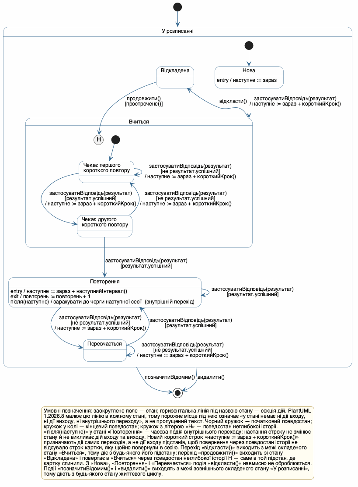
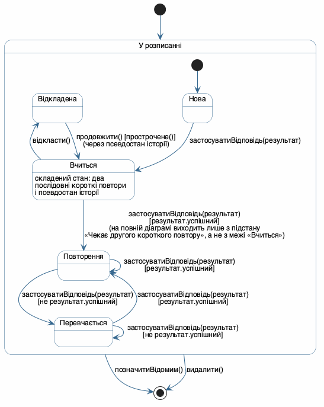
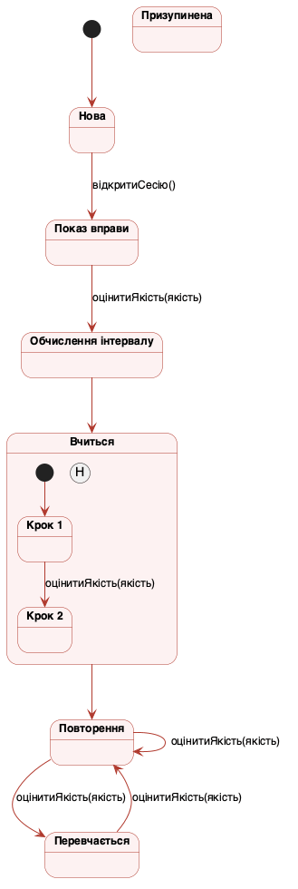

## Мета

Закріпити на практиці матеріал лекції 8 і навчитися будувати діаграму станів (State Machine Diagram) мови UML (Unified Modeling Language — уніфікована мова моделювання) для одного з класів власного курсового завдання: виражати життєвий цикл обʼєкта через прості й складені стани, застосовувати псевдостан історії, дії входу й виходу, внутрішні переходи та переходи з охоронними умовами, а головне — свідомо кодувати бізнес-правила самою структурою діаграми, зокрема відсутністю переходів там, де подія принципово не має наслідку.

Нижче наведено змістові поля титульного аркуша, яких вимагає пункт 1 структури звіту, — тему роботи та варіант предметної області; сам аркуш оформлюється окремо.

| Поле титульного аркуша | Значення |
|---|---|
| Лабораторна робота | № 5 |
| Дисципліна | Моделювання та аналіз програмного забезпечення |
| Тема роботи | Побудова діаграми станів обʼєкта |
| Варіант предметної області | «Півот» — вебсервіс і браузерне розширення для вивчення іноземної мови на основі власного контенту користувача (робочий домен `pivotsubs.com`); та сама предметна область, що й у Лабораторних роботах №1, №2, №3 і №4 |
| Обраний клас | `СтанПовторення` — стан інтервального повторення однієї картки збереженого слова (діаграма класів ЛР2, пакет «Словник і прогрес») |
| Виконав | Камінський Олексій Дмитрович, група ВТ-23-2 |
| Перевірив | Власенко О.В. |
| Інструмент | PlantUML 1.2026.8 (локальна установка, рендеринг Graphviz) |

Тема є спільною для всіх пʼяти лабораторних робіт і для курсової, бо збігається з темою дипломної роботи. Система складається з вебсервісу й браузерного розширення: користувач дивиться відео на YouTube і бачить поверх плеєра два рядки субтитрів — оригінал і переклад, клікає незнайоме слово й отримує його значення, зберігає слово у власний словник разом з реплікою-контекстом, читає власні документи у вбудованій читалці й повторює збережені слова в сесіях інтервальних повторень.

Межі моделі зафіксовано один раз і вони діють у всіх роботах: відеоплатформа одна — YouTube, решта площадок присутні лише як точка підстановки за інтерфейсом `ДжерелоСубтитрів`; ШІ (штучний інтелект) — це зовнішній сервіс за API, система лише формує запит, кешує відповідь і рахує витрати ліміту. Ніяких нових припущень про продукт у цій роботі не зроблено: усі стани, події й бізнес-правила нижче виведені з Лабораторних робіт №1, №2 і №4.

## Розділ 1. Обґрунтування вибору класу з Лабораторної роботи №2

### 1.1. Три кандидати і критерій відбору

Крок 1 методики (розділ 1.2 методичних вказівок) вимагає обрати клас, чий життєвий цикл природно проходить через **кілька станів із розгалуженням за подіями**, а не просто через послідовність кроків. На повній діаграмі класів ЛР2 таких кандидатів рівно три — це класи, що мають атрибут-прапорець статусу.

| Кандидат (клас ЛР2) | Атрибут статусу і його значення | Розгалуження за подіями | Призупинення й повернення | Оцінка |
|---|---|---|---|---|
| `РоботаРозпізнавання` | `стан: СтанРоботиEnum` — у черзі, звук, модель, запис, готово, помилка | слабке: лінійний конвеєр плюс одна гілка «помилка» | немає: перезапуск завжди з початку етапу | послідовність кроків, а не життєвий цикл; підходить радше для діаграми діяльності |
| `Підписка` | `статус: СтатусEnum` — пробна, активна, прострочена, скасована | є, але всі переходи керуються зовнішнім платіжним провайдером | немає: «пауза» підписки в продукті не передбачена | складеного стану немає з чого зробити; історія була б декоративною |
| `СтанПовторення` | `стан: СтанEnum` — нова, вчиться, повторення, перевчається | сильне: кожна відповідь користувача розгалужує долю картки | є: сесію повторень можна перервати й повернутися до неї пізніше | **обрано** |

### 1.2. Чому саме `СтанПовторення`

Клас `СтанПовторення` обрано з чотирьох причин, кожна з яких перевіряється за текстом ЛР2, а не постулюється.

По-перше, у ЛР2 цей клас уже має готовий набір станів. Розділ 3.2 ЛР2 прямо зазначає: «Два перелічення знадобляться вже в наступних роботах: `СтанEnum` і `СтанРоботиEnum` — це готові набори станів для діаграм станів картки слова й роботи з розпізнавання мовлення». Тобто обрана сутність була заздалегідь спроєктована саме під цю лабораторну роботу, і значення `нова`, `вчиться`, `повторення`, `перевчається` переходять у діаграму без жодного перейменування.

По-друге, у ЛР2 за цим класом визнано **власний життєвий цикл**: «`СтанПовторення` має власний життєвий цикл усередині життя картки слова, тому це клас, повʼязаний композицією, а не група полів у `ЗбереженеСлово`: стан перераховується після кожної вправи, і його зручно читати окремо від самої картки». Діаграма станів є природним способом показати саме цей життєвий цикл.

По-третє, усі три методи, які клас мав у первісній редакції ЛР2, — `застосуватиВідповідь(результат)`, `прострочене()`, `наступнийІнтервал()` — це або подія переходу, або охоронна умова, або дія. Жоден з них не є службовим геттером, тому перевірка узгодженості з діаграмою класів (пункт 8 структури звіту) має зміст, а не є формальністю.

По-четверте, у ЛР4 цей самий клас уже був обʼєктним вузлом діаграми діяльності в чотирьох різних станах (`[нова]`, `[вчиться]`, `[повторення]`, і черга сесії), причому Розділ 1.1 ЛР4 відхилив сценарій UC16 як основу діаграми діяльності саме тому, що в ньому «немає зовсім» зовнішньої взаємодії. Те, що було недоліком для діаграми діяльності, є перевагою для діаграми станів: життєвий цикл картки визначається винятково власними подіями обʼєкта, без доріжок зовнішніх систем.

**Висновок:** `СтанПовторення` — єдиний клас моделі, який одночасно має готове перелічення станів, визнаний у ЛР2 власний життєвий цикл, розгалуження за подіями й природний сюжет призупинення; решта два кандидати не дають або розгалуження, або призупинення.

## Розділ 2. Відбір станів і подій за методикою розділу 1.2

### 2.1. Таблиця відбору

Крок 2 методики вимагає виписати атрибути, схожі на прапорці стану, і методи, схожі на події. Нижче — результат для класу `СтанПовторення` і його власника `ЗбереженеСлово`, звірений з текстовими специфікаціями ЛР1 (UC06, UC07, UC16) і з діаграмою діяльності ЛР4.

| Атрибут, метод класу або правило предметної області | Що з нього випливає для діаграми станів |
|---|---|
| `стан: СтанEnum` зі значеннями нова, вчиться, повторення, перевчається (ЛР2, розділ 3.2, **первісна редакція**) | Чотири безпосередні підстани складеного стану `У розписанні`: `Нова`, `Вчиться`, `Повторення`, `Перевчається`. Пʼяте значення `відкладена` додано в ЛР2 **за результатами цієї роботи** (Розділ 7.2), і йому відповідає пʼятий підстан `Відкладена` |
| `застосуватиВідповідь(результат: РезультатВправи): void` | Головна подія діаграми: девʼять із сімнадцяти переходів відбуваються саме за нею |
| Поле `успішний` параметра `результат` | Дві взаємовиключні охоронні умови `[результат.успішний]` і `[не результат.успішний]`, що розгалужують долю картки після кожної вправи |
| `прострочене(): Boolean` | Охоронна умова `[прострочене()]` на переході `продовжити()` зі стану `Відкладена`. Тригером переходу цей запит навмисно **не** зроблено: він лишається чистим предикатом без побічних дій — обґрунтування в Розділі 3.4 |
| Атрибут `наступне: DateTime` як момент настання строку | **Часова подія** `після(наступне)` — тригер внутрішнього переходу в стані `Повторення` з дією `/ зарахувати до черги наступної сесії` |
| `наступнийІнтервал(): Duration` і атрибут `наступне: DateTime` | Дія входу стану `Повторення`: `entry / наступне := зараз + наступнийІнтервал()` |
| `короткийКрок(): Duration` (ЛР2, додано за зауваженням ЛР6) | Дія `/ наступне := зараз + короткийКрок()` на шести переходах, що починають короткий крок фази навчання або перевчання: переходи 2, 3, 4, 6, 11 і 13 таблиці Розділу 4 |
| Атрибут `повторень: Int` | Дія виходу стану `Повторення`: `exit / повторень := повторень + 1` |
| UC16 (ЛР1): «Сесія вправами без кнопок самооцінки — оцінку виводить система з відповіді» | Подія завжди одна й та сама — `застосуватиВідповідь(результат)`; окремих подій «знаю» / «не знаю» на діаграмі немає |
| ЛР4, вузли «Сформувати чергу прострочених карток» і цикл `while` з перевіркою перед тілом | Картка потрапляє у вправу лише як прострочена, звідси охоронна умова `[прострочене()]` на поверненні з `Відкладена` |
| Бізнес-правило: короткі повтори фази навчання йдуть один за одним у межах однієї фази | Складений стан `Вчиться` з двома послідовними підстанами `Чекає першого короткого повтору` і `Чекає другого короткого повтору` |
| Бізнес-правило: сесію повторень можна закрити посеред фази навчання й повернутися до неї пізніше | Стан `Відкладена` і **псевдостан неглибокої історії** всередині `Вчиться` |
| Композиція `ЗбереженеСлово "1" *-- "0..1" СтанПовторення` (ЛР2) | Початковий псевдостан: розписання створюється разом із карткою слова, тому перехід у `Нова` події не має |
| UC07 (ЛР1) «Позначити слово як відоме» і каскадне видалення з ЛР2 | Дві події, що ведуть до **кінцевого псевдостану**: `позначитиВідомим()` і `видалити()` |

### 2.2. Чому чотири значення `СтанEnum` стали підстанами одного складеного стану

Крок 4 методики вимагає шукати підетапи, що мають сенс лише всередині одного «великого» стану. Тут таких групувань виявилося два, вкладені одне в одне.

Зовнішнє групування — складений стан `У розписанні`. Усі чотири значення `СтанEnum` описують картку, яка **має розписання й бере участь у сесіях**; обʼєкт `СтанПовторення` взагалі не існує поза цією умовою, бо композиція ЛР2 привʼязує його до живої картки слова. Через межу цього складеного стану виходять рівно ті дві події, що знищують обʼєкт, — `позначитиВідомим()` і `видалити()`. Без зовнішнього групування ці дві події довелося б намалювати пʼять разів кожну (з кожного стану життєвого циклу), а з ним — по одному разу, і саме цей механізм лекція 8 називає «одним із найпотужніших механізмів повторного використання в UML».

Внутрішнє групування — складений стан `Вчиться`. Значення `вчиться` перелічення `СтанEnum` насправді покриває **два послідовні короткі повтори**: картку показують через кілька хвилин після першої відповіді, потім, у разі успіху, ще раз через довший проміжок, і лише після другого успіху вона «випускається» у стан `Повторення` з інтервалом у днях. Ці два підстани не мають сенсу поза фазою навчання, тому це класичний складений стан.

### 2.3. Чому «Перевчається» навмисно лишено простим станом

Симетрія підказує зробити складеним і стан `Перевчається`, але це було б моделюванням заради нотації. Фаза перевчання в прийнятому розписанні має **рівно один** короткий крок: зірвана картка чекає один короткий інтервал і наступною успішною відповіддю повертається в `Повторення`. Послідовності з двох і більше підстанів тут немає, отже немає й «позиції всередині послідовності», яку мав би що запамʼятовувати псевдостан історії. Саме тому в `Перевчається` немає ні вкладених підстанів, ні переходу `відкласти()` — див. Розділ 6.

**Висновок:** відбір дав вісім станів, шість подій (пʼять викличних і одну часову) і три охоронні умови, причому жодна назва стану не є дієсловом дії, а **пʼять із пʼяти** підстанів верхнього рівня дослівно збігаються зі значеннями `СтанEnum` після доповнення ЛР2; у первісній редакції ЛР2 збігалися чотири з пʼяти, бо значення `відкладена` в переліченні бракувало.

## Розділ 3. Діаграма станів

### 3.1. Код діаграми

Вихідний код збережено у файлі `state.puml` і наводиться повністю.

```text
@startuml
' =====================================================================
' Лабораторна робота №5. Діаграма станів об'єкта
' Клас `СтанПовторення` з діаграми класів ЛР2 — стан інтервального
' повторення (FSRS) однієї картки збереженого слова.
' Предметна область: «Півот» — вебсервіс і браузерне розширення
' для вивчення іноземної мови на основі власного контенту користувача.
' Камінський Олексій Дмитрович, група ВТ-23-2
' =====================================================================

skinparam defaultFontName "Helvetica"
skinparam defaultFontSize 14
skinparam shadowing false
skinparam ArrowFontSize 12
skinparam nodesep 28
skinparam ranksep 34
skinparam state {
  BackgroundColor #FEFEFE
  BorderColor #33668E
  ArrowColor #33668E
  FontStyle bold
  AttributeFontSize 12
  AttributeFontStyle plain
  StartColor #33668E
  EndColor #33668E
}
skinparam legend {
  BackgroundColor #FFFDF2
  BorderColor #C9B47A
  FontSize 12
}

' ---------------------------------------------------------------------
' Зовнішній складений стан: картка має розписання й бере участь у сесіях.
' Його безпосередні підстани — це рівно значення `СтанEnum` з ЛР2
' (нова, вчиться, повторення, перевчається) плюс `Відкладена`.
' ---------------------------------------------------------------------
state "У розписанні" as УРозписанні {

  state "Нова" as Нова
  Нова : entry / наступне := зараз

  ' ------- складений стан із двома послідовними підстанами -------
  state "Вчиться" as Вчиться {
    state "Чекає першого\nкороткого повтору" as Крок1
    state "Чекає другого\nкороткого повтору" as Крок2

    [*] --> Крок1
    Крок1 --> Крок2 : застосуватиВідповідь(результат)\n[результат.успішний]\n/ наступне := зараз + короткийКрок()
    Крок1 --> Крок1 : застосуватиВідповідь(результат)\n[не результат.успішний]\n/ наступне := зараз + короткийКрок()
    Крок2 --> Крок1 : застосуватиВідповідь(результат)\n[не результат.успішний]\n/ наступне := зараз + короткийКрок()

    state H <<history>>
  }

  state "Повторення" as Повторення
  Повторення : entry / наступне := зараз + наступнийІнтервал()
  Повторення : exit / повторень := повторень + 1
  Повторення : після(наступне) / зарахувати до черги наступної сесії  (внутрішній перехід)

  state "Перевчається" as Перевчається
  state "Відкладена" as Відкладена

  [*] --> Нова
  Нова --> Вчиться : застосуватиВідповідь(результат)\n/ наступне := зараз + короткийКрок()
  Крок2 --> Повторення : застосуватиВідповідь(результат)\n[результат.успішний]

  Повторення --> Повторення : застосуватиВідповідь(результат)\n[результат.успішний]
  Повторення --> Перевчається : застосуватиВідповідь(результат)\n[не результат.успішний]\n/ наступне := зараз + короткийКрок()
  Перевчається --> Повторення : застосуватиВідповідь(результат)\n[результат.успішний]
  Перевчається --> Перевчається : застосуватиВідповідь(результат)\n[не результат.успішний]\n/ наступне := зараз + короткийКрок()

  ' ------- призупинення сесії й повернення саме туди, де спинилися -------
  Вчиться -up-> Відкладена : відкласти()
  Відкладена --> H : продовжити()\n[прострочене()]
}

[*] --> УРозписанні
УРозписанні --> [*] : позначитиВідомим()
УРозписанні --> [*] : видалити()

legend bottom
Умовні позначення: заокруглене поле — стан; горизонтальна лінія під назвою стану — секція дій. PlantUML
1.2026.8 малює цю лінію в кожному стані, тому порожнє місце під нею означає «у стані немає ні дії входу,
ні дії виходу, ні внутрішнього переходу», а не пропущений текст. Чорний кружок — початковий псевдостан;
кружок у колі — кінцевий псевдостан; кружок з літерою «H» — псевдостан неглибокої історії.
«після(наступне)» у стані «Повторення» — часова подія внутрішнього переходу: настання строку не змінює
стану й не викликає дій входу та виходу. Новий короткий строк «наступне := зараз + короткийКрок()»
призначають дії самих переходів, а не дії входу підстанів, щоб повернення через псевдостан історії не
відсувало строк картки, яку щойно повернули в сесію. Перехід «відкласти()» виходить з межі складеного
стану «Вчиться», тому діє з будь-якого його підстану; перехід «продовжити()» виходить зі стану
«Відкладена» і повертає в «Вчиться» через псевдостан неглибокої історії H — саме в той підстан, де
картку спинили. З «Нова», «Повторення» і «Перевчається» подія «відкласти()» навмисно не оброблюється.
Події «позначитиВідомим()» і «видалити()» виходять з межі зовнішнього складеного стану «У розписанні»,
тому діють з будь-якого стану життєвого циклу.
end legend
@enduml
```

### 3.2. Повна діаграма



Діаграму експортовано у двох форматах: `state.svg` (SVG — Scalable Vector Graphics, масштабовані векторні зображення, формат, якого вимагає пункт 4 завдання) і `state.png` (для вставки в цей звіт).

### 3.3. Спрощений оглядовий вид

Повна діаграма містить вісім станів і сімнадцять переходів, тому для швидкого огляду життєвого циклу додано другий файл — `state_view.puml`, де складений стан `Вчиться` показано **згорнутим**. Це демонструє першу практичну задачу складених станів за лекцією 8: «ззовні композитний стан виглядає як один простий прямокутник, і лише той, кому це важливо, розгортає його внутрішню структуру». На оглядовому виді видно рівно той рівень, який зберігається в атрибуті `СтанПовторення.стан: СтанEnum`.

Оглядовий вид — це **спрощення**, а не друга модель, і одне місце в ньому читалося б інакше, ніж на повній діаграмі, якби його не підписати. Перехід «випуску» картки там намальовано як `Вчиться --> Повторення`, тобто **з межі** згорнутого складеного стану, а за семантикою UML перехід з межі діє з будь-якого підстану. На повній діаграмі цей перехід виходить саме з `Чекає другого короткого повтору` і діяти з першого короткого повтору не повинен (відповідь на питання 2 самоконтролю). Щоб спрощення не прочиталося як зміна правила, підпис цього переходу в `state_view.puml` доповнено приміткою «на повній діаграмі виходить лише з підстану „Чекає другого короткого повтору“, а не з межі „Вчиться“» — так само, як сусідній перехід `продовжити()` підписано «(через псевдостан історії)». Решта переходів оглядового виду виходить з тих самих елементів, що й на повній діаграмі, тому додаткових застережень не потребує.



### 3.4. Нотація PlantUML 1.2026.8: як записано entry, exit і внутрішній перехід

Під час побудови виявилася практична розбіжність між записом, наведеним у довіднику методичних вказівок (розділ 1.1), і синтаксисом, який приймає встановлена версія PlantUML 1.2026.8. Запис виду

```text
state "Повторення" as Повторення {
  entry / наступнийІнтервал()
}
```

у цій версії дає `Syntax Error?` — голі рядки `entry / …` і `exit / …` усередині фігурних дужок більше не розбираються. Робочий запис — через опис стану після двокрапки, який рендериться окремою секцією всередині прямокутника стану:

```text
state "Повторення" as Повторення
Повторення : entry / наступне := зараз + наступнийІнтервал()
Повторення : exit / повторень := повторень + 1
Повторення : після(наступне) / зарахувати до черги наступної сесії  (внутрішній перехід)
```

Візуальний результат тотожний зразку викладача: стан має секцію з рядками `entry`, `exit` і рядком внутрішнього переходу, відокремлену горизонтальною лінією від назви стану. Внутрішній перехід свідомо позначено не стрілкою, а рядком усередині стану — саме тому, що він, за визначенням лекції 8, не викликає дій входу й виходу.

Друга розбіжність стосувалася не нотації, а семантики, і її знайшла звірка з Лабораторною роботою №6. У первісній редакції цієї роботи тригером внутрішнього переходу був `прострочене()`, тобто той самий `Boolean`-запит, що стоїть охоронною умовою на переході `продовжити()`. Розбіжність 1 розділу 9.3 ЛР6 показала, чому так робити не можна: в UML операція реалізується або власним методом, або переходами скінченного автомата за викличною подією, але не одним і одразу. Якби `прострочене()` було викличною подією, то в кожному стані, де для неї немає переходу (а це всі стани, крім `Повторення`), виклик просто **відкидався б** — і запит, який зобовʼязаний завжди повернути значення, у більшості станів не повертав би нічого. Саме цим користується сценарій Б ЛР6, де планувальник опитує картки в будь-якому стані.

Тому тригер замінено на **часову подію** `після(наступне)`: внутрішній перехід у стані `Повторення` спрацьовує, коли настає момент, записаний в атрибуті `наступне`. Дію виписано явно — `/ зарахувати до черги наступної сесії`, — щоб перехід не лишався порожнім; вона не змінює жодного атрибута самого `СтанПовторення`, бо черга належить сесії, а не картці (вузол «Сформувати чергу прострочених карток» діаграми діяльності ЛР4), і саме через це дії `entry` та `exit` спрацьовувати не повинні. Запит `прострочене(): Boolean` лишився на діаграмі рівно в одній ролі — охоронною умовою переходу 8, тобто чистим предикатом без побічних дій, якого можна викликати з будь-якого стану. Розбіжність 1 ЛР6 на цьому закрита.

Третє рішення нотації стосується короткого кроку фази навчання. Розбіжність 3 розділу 9.3 ЛР6 справедливо зауважила, що `наступнийІнтервал()` обслуговує лише стан `Повторення`, тоді як у фазах навчання й перевчання новий строк задається коротким кроком, і за цим зауваженням у ЛР2 оголошено `СтанПовторення.короткийКрок(): Duration`. ЛР6 планувала показати його **діями входу** підстанів `Вчиться` і стану `Перевчається`, але під час побудови виявилося, що дія входу тут дала б хибну поведінку: вхід у підстан відбувається й тоді, коли картка повертається через псевдостан історії за подією `продовжити()`, і дія входу відсунула б строк картки, яку щойно повернули в сесію, рівно на один короткий крок уперед — тобто показати її одразу стало б неможливо, хоча охоронна умова `[прострочене()]` щойно підтвердила, що строк настав. Тому призначення нового короткого строку винесено в **дії самих переходів** — тих шести, що справді починають новий короткий крок (переходи 2, 3, 4, 6, 11, 13), — а повернення через історію строку не чіпає. Розбіжність 3 ЛР6 закрита саме так, і ця відмінність від початкового плану зафіксована в розділі 9.3 ЛР6.

Остання, суто зображальна деталь: у PlantUML 1.2026.8 горизонтальна лінія під назвою стану малюється **в кожному** стані, навіть якщо в діаграмі взагалі немає жодного опису. Тому порожнє місце під лінією в станах `Відкладена`, `Чекає першого короткого повтору`, `Чекає другого короткого повтору` і `Перевчається` означає «дій входу, виходу й внутрішніх переходів у цьому стані немає», а не пропущений текст; щоб це не прочиталося як недогляд, пояснення винесено першим реченням легенди діаграми.

**Висновок:** діаграма побудована, обидва формати експортовано, а для швидкого огляду додано окремий файл зі згорнутим складеним станом.

## Розділ 4. Таблиця станів і переходів

Таблиця складена за зразком розділу 3.3 методичних вказівок. Позначення `Вчиться → Чекає першого короткого повтору` означає вхід у складений стан через його внутрішній початковий псевдостан.

Переходів на діаграмі **сімнадцять**: шістнадцять стрілок у коді `state.puml` плюс один внутрішній перехід, який за визначенням стрілкою не малюється. Рядків у таблиці п'ятнадцять, бо рядки 1 і 2 склеюють по дві стрілки кожен: рядок 1 — це `[*] --> УРозписанні` разом із `[*] --> Нова`, а рядок 2 — `Нова --> Вчиться` разом із `[*] --> Крок1`, тобто обидва рази вхід у складений стан показано одним рядком разом із доходженням до конкретного підстану через внутрішній початковий псевдостан. Покриття повне: кожна з шістнадцяти стрілок і єдиний внутрішній перехід мають у таблиці свій рядок.

| № | З якого стану | Подія | До якого стану | Коментар |
|---|---|---|---|---|
| 1 | (початковий псевдостан) | — | У розписанні → Нова | Обʼєкт створюється разом із карткою слова (композиція ЛР2), тому події на цьому переході немає |
| 2 | Нова | `застосуватиВідповідь(результат)` `/ наступне := зараз + короткийКрок()` | Вчиться → Чекає першого короткого повтору | Охоронної умови немає **свідомо**: перша відповідь будь-якої якості виводить картку зі стану «нова»; якість впливає на `стабільність`, `складність` і довжину першого короткого кроку, а не на стан. Дія переходу призначає строк першого короткого повтору |
| 3 | Чекає першого короткого повтору | `застосуватиВідповідь(результат) [результат.успішний]` `/ наступне := зараз + короткийКрок()` | Чекає другого короткого повтору | Перехід з охоронною умовою; дія переходу призначає строк другого короткого повтору |
| 4 | Чекає першого короткого повтору | `застосуватиВідповідь(результат) [не результат.успішний]` `/ наступне := зараз + короткийКрок()` | Чекає першого короткого повтору | Зовнішній перехід сам у себе; дій входу й виходу в підстані немає, тому єдиний ефект дає дія самого переходу — картці призначають новий строк першого короткого повтору, і невдала відповідь відсуває її показ, а не лишає все без змін |
| 5 | Чекає другого короткого повтору | `застосуватиВідповідь(результат) [результат.успішний]` | Повторення | «Випуск» картки; перехід перетинає межу складеного стану `Вчиться` зсередини. Власної дії не має: новий строк призначає дія входу стану `Повторення`, і він уже довгий, а не короткий |
| 6 | Чекає другого короткого повтору | `застосуватиВідповідь(результат) [не результат.успішний]` `/ наступне := зараз + короткийКрок()` | Чекає першого короткого повтору | Зрив повертає картку на початок послідовності коротких повторів, а не лишає на місці, і дія переходу відлічує короткий крок заново |
| 7 | Вчиться (межа складеного стану) | `відкласти()` | Відкладена | Діє з **обох** підстанів фази навчання; псевдостан історії при цьому запамʼятовує, з якого саме |
| 8 | Відкладена | `продовжити() [прострочене()]` | Історія → той самий підстан `Вчиться`, де картку спинили | Якщо короткий інтервал ще не минув, умова хибна й обʼєкт лишається в `Відкладена`. Дії цей перехід **не має свідомо**: строк уже настав (це й перевіряє охоронна умова), тому картку треба показати одразу, а не відсунути ще на один короткий крок — саме тому `короткийКрок()` стоїть у діях переходів, а не в діях входу підстанів (Розділ 3.4) |
| 9 | Повторення | `після(наступне)` — **часова подія** | Повторення (без зміни стану) | **Внутрішній перехід** з дією `/ зарахувати до черги наступної сесії`: настання строку не змінює стану, дії входу й виходу не виконуються, `повторень` і `наступне` лишаються без змін. Інакше кожна перевірка строку накручувала б лічильник повторень і відсувала б сам строк |
| 10 | Повторення | `застосуватиВідповідь(результат) [результат.успішний]` | Повторення | **Зовнішній** перехід сам у себе: спрацьовують `exit` (`повторень + 1`) і `entry` (новий, довший строк) |
| 11 | Повторення | `застосуватиВідповідь(результат) [не результат.успішний]` `/ наступне := зараз + короткийКрок()` | Перевчається | Зрив вивченої картки; спрацьовує `exit` стану `Повторення` (`повторень + 1`), а дія переходу замінює довгий строк коротким кроком фази перевчання |
| 12 | Перевчається | `застосуватиВідповідь(результат) [результат.успішний]` | Повторення | Повернення у фазу повторень після одного короткого кроку; власної дії не має, бо новий довгий строк призначає дія входу стану `Повторення` |
| 13 | Перевчається | `застосуватиВідповідь(результат) [не результат.успішний]` `/ наступне := зараз + короткийКрок()` | Перевчається | Зовнішній перехід сам у себе; `entry` і `exit` у цьому стані відсутні, тому єдиний ефект дає дія самого переходу — короткий крок фази перевчання відлічується заново |
| 14 | У розписанні (межа складеного стану) | `позначитиВідомим()` | Кінцевий псевдостан | UC07 ЛР1: слово переходить у профіль відомої лексики, розписання зникає разом із карткою |
| 15 | У розписанні (межа складеного стану) | `видалити()` | Кінцевий псевдостан | Видалення слова або його матеріалу; каскад описано приміткою до агрегації `Матеріал ◇ ЗбереженеСлово` в ЛР2 |

Два уточнення до рядків 4 і 13, щоб текст не обіцяв більше, ніж є на діаграмі. По-перше, у станах `Чекає першого короткого повтору`, `Чекає другого короткого повтору` і `Перевчається` немає ні дії входу, ні дії виходу, тому весь ефект зовнішнього переходу сам у себе дає **дія самого переходу** — `наступне := зараз + короткийКрок()`. Це відрізняє рядки 4 і 13 від рядка 10, де строк перепризначає дія входу стану `Повторення`, а дія виходу ще й збільшує `повторень`: невдала відповідь у короткому кроці відсуває лише показ картки й **не** зараховується як повторення. Крім цього, стрілки 4 і 13 несуть ще одне, суто модельне навантаження: вони відрізняють «подію оброблено, стан не змінився» від порожньої клітинки матриці Розділу 6.5, тобто від стану, у якому події взагалі немає переходу.

По-друге, про те, що саме винесено в явні дії, а що лишилося всередині методу. Перерахунок `стабільність` і `складність`, який розписання FSRS виконує після кожної відповіді, є внутрішнім ефектом самого методу `застосуватиВідповідь(результат)`, однаковим для всіх девʼяти переходів цієї події, тому його не винесено в дію жодного окремого переходу. А от призначення нової дати `наступне` винесено явно скрізь, бо для нього ЛР2 дає окремі члени класу, і їх **два**, а не один: `наступнийІнтервал(): Duration` — довгий строк фази повторень, показаний дією входу стану `Повторення`, і `короткийКрок(): Duration` — короткий строк фаз навчання й перевчання, показаний діями переходів 2, 3, 4, 6, 11 і 13. Другий метод у первісній редакції ЛР2 відсутній: його оголошено за зауваженням розбіжності 3 розділу 9.3 ЛР6 («для фаз „Вчиться“ і „Перевчається“ новий строк задається коротким кроком, а не повним інтервалом»), і ця робота його застосовує. Чому саме дії переходів, а не дії входу підстанів, як пропонувала ЛР6, — пояснено в Розділі 3.4 і в коментарі до рядка 8.

**Висновок:** сімнадцять переходів (шістнадцять стрілок і один внутрішній), шість різних подій — пʼять викличних і одна часова, — три різні охоронні умови; переходи 14 і 15 намальовано по одному разу замість пʼяти завдяки зовнішньому складеному стану.

## Розділ 5. Перевірка проходження для двох послідовностей подій

Таблиці складені за зразком розділу 3.4 методичних вказівок. Послідовності дібрано так, щоб разом вони покрили всі сім вимог пункту 2 завдання: складений стан, історію, охоронну умову, дію входу, дію виходу, внутрішній перехід і кінцевий псевдостан.

### 5.1. Послідовність А: картка проходить увесь цикл зі зривом після випуску

`застосуватиВідповідь()` → `застосуватиВідповідь()` [успішно] → `застосуватиВідповідь()` [невдало] → `застосуватиВідповідь()` [успішно] → `застосуватиВідповідь()` [успішно] → `після(наступне)` → `застосуватиВідповідь()` [невдало] → `застосуватиВідповідь()` [успішно] → `позначитиВідомим()`.

| Крок | Подія | Стан після події | Що сталося з атрибутами |
|---|---|---|---|
| 0 | — (створення разом із карткою слова) | У розписанні / Нова | `entry`: `наступне := зараз`, тому часова подія `після(наступне)` настає в цьому стані одразу, а предикат `прострочене()` одразу істинний — окремого переходу для них тут немає, бо на стан це не впливає (Розділ 6.5) |
| 1 | `застосуватиВідповідь(результат)` | У розписанні / Вчиться / Чекає першого короткого повтору | Вхід у складений стан через внутрішній початковий псевдостан; дія переходу 2: `наступне := зараз + короткийКрок()` |
| 2 | `застосуватиВідповідь(результат) [результат.успішний]` | У розписанні / Вчиться / Чекає другого короткого повтору | Перехід 3 таблиці Розділу 4; дія переходу призначила строк другого короткого повтору |
| 3 | `застосуватиВідповідь(результат) [не результат.успішний]` | У розписанні / Вчиться / Чекає першого короткого повтору | Перехід 6: зрив повертає на початок послідовності й відлічує короткий крок заново; `повторень` не змінюється, бо `exit` є лише в `Повторення` |
| 4 | `застосуватиВідповідь(результат) [результат.успішний]` | У розписанні / Вчиться / Чекає другого короткого повтору | Перехід 3 удруге |
| 5 | `застосуватиВідповідь(результат) [результат.успішний]` | У розписанні / Повторення | Перетин межі `Вчиться`; `entry`: `наступне := зараз + наступнийІнтервал()` |
| 6 | `після(наступне)` | У розписанні / Повторення | **Внутрішній перехід**: настав строк, картку зараховано до черги наступної сесії; `наступне` і `повторень` не змінилися, `entry` і `exit` не спрацювали |
| 7 | `застосуватиВідповідь(результат) [не результат.успішний]` | У розписанні / Перевчається | `exit` стану `Повторення`: `повторень := повторень + 1`; далі дія переходу 11: `наступне := зараз + короткийКрок()` |
| 8 | `застосуватиВідповідь(результат) [результат.успішний]` | У розписанні / Повторення | `entry` спрацював удруге: призначено новий строк |
| 9 | `позначитиВідомим()` | Кінцевий псевдостан | Перехід 14 з межі зовнішнього складеного стану; перед знищенням обʼєкта спрацював `exit` стану `Повторення`: `повторень := повторень + 1` — так само, як на кроці 8 послідовності Б |

### 5.2. Послідовність Б: сесію перервано посеред фази навчання

`застосуватиВідповідь()` → `застосуватиВідповідь()` [успішно] → `відкласти()` → `продовжити()` зарано → `продовжити()` вчасно → `застосуватиВідповідь()` [успішно] → `відкласти()` → `видалити()`.

| Крок | Подія | Стан після події | Що сталося з атрибутами |
|---|---|---|---|
| 0 | — (створення разом із карткою слова) | У розписанні / Нова | `entry`: `наступне := зараз` |
| 1 | `застосуватиВідповідь(результат)` | У розписанні / Вчиться / Чекає першого короткого повтору | Дія переходу 2: `наступне := зараз + короткийКрок()` |
| 2 | `застосуватиВідповідь(результат) [результат.успішний]` | У розписанні / Вчиться / Чекає другого короткого повтору | Дія переходу 3: строк другого короткого повтору |
| 3 | `відкласти()` | У розписанні / Відкладена | Перехід 7 з межі `Вчиться`; псевдостан історії запамʼятав саме `Чекає другого короткого повтору` |
| 4 | `продовжити()`, причому `прострочене()` хибне | У розписанні / Відкладена — **стан не змінився** | Подія сталася, але охоронна умова хибна, тому переходу не було: картку не можна показати раніше за її короткий інтервал |
| 5 | `продовжити()`, причому `прострочене()` істинне | У розписанні / Вчиться / **Чекає другого короткого повтору** | Повернення **саме туди**, де сесію перервали, а не на початок фази навчання — це і є ефект псевдостану історії. Атрибут `наступне` при цьому **не** перепризначається: дій входу в підстанах немає, а `короткийКрок()` стоїть у діях переходів, тому картку, строк якої вже настав, показують одразу (Розділ 3.4) |
| 6 | `застосуватиВідповідь(результат) [результат.успішний]` | У розписанні / Повторення | Перехід 5; `entry` призначив довгий інтервал |
| 7 | `відкласти()` | У розписанні / Повторення — **стан не змінився** | З `Повторення` перехід за цією подією **навмисно відсутній**: див. Розділ 6.2 |
| 8 | `видалити()` | Кінцевий псевдостан | Перехід 15; `exit` стану `Повторення` спрацював перед знищенням обʼєкта |

### 5.3. Чому реакція обʼєкта однозначна

Однозначність перевірено двома прийомами. Перший — порівняння охоронних умов на виходах з одного стану: подія `застосуватиВідповідь(результат)` виходить із пʼяти станів, і в кожному з них, крім `Нова`, вона розщеплюється рівно на дві гілки з **взаємовиключними й вичерпними** умовами `[результат.успішний]` і `[не результат.успішний]`; у стані `Нова` гілка одна, без умови, тому невизначеності теж немає. Другий — перевірка, що жодна подія не має двох переходів з одного стану без розрізнювальних умов; у таблиці Розділу 4 пар рядків з однаковим станом-джерелом, однаковою подією й однаковою (або відсутньою) умовою немає.

Окремо перевірено семантику кроків 4 і 7 послідовності Б. Вони демонструють **дві різні причини** того, що стан не змінився, і їх не можна плутати: на кроці 4 перехід існує, але не спрацював через хибну охоронну умову; на кроці 7 переходу немає взагалі, і подія просто не оброблюється в цьому стані. Жодного з цих випадків діаграма не лишає двозначним.

**Висновок:** обидві послідовності пройдено без жодної точки, де подія могла б привести обʼєкт у два різні стани; разом вони демонструють усі сім обовʼязкових елементів діаграми.

## Розділ 6. Навмисно відсутні переходи й бізнес-правила, які вони кодують

Крок 6 методики вимагає явно перевірити, з яких станів навмисно відсутній той чи інший перехід. Нижче — чотири такі рішення, кожне з яких є свідомим, а не пропуском.

### 6.1. З `Відкладена` не можна застосувати відповідь

**Відсутній перехід:** `Відкладена` + `застосуватиВідповідь(результат)`.

**Бізнес-правило:** оцінку отримує лише та картка, для якої вправу справді показали. Коли користувач закрив сесію, картка вийшла з черги сесії (вузол «Вилучити картку з черги сесії» діаграми діяльності ЛР4), а отже жодної вправи для неї на екрані немає й жодної відповіді надійти не може. Структурно це означає, що відкладену картку неможливо «випустити» у стан `Повторення` в обхід фази навчання — щоб дати відповідь, її треба спершу повернути в сесію подією `продовжити()`.

Цю заборону закодовано **відсутністю стрілки**, а не охоронною умовою на переході, і це сильніше: охоронну умову виду `[картка в черзі сесії]` довелося б додати до девʼяти переходів події `застосуватиВідповідь()` і легко було б забути в одному з них.

### 6.2. З `Нова`, `Повторення` і `Перевчається` не можна відкласти картку

**Відсутні переходи:** `Нова` + `відкласти()`, `Повторення` + `відкласти()`, `Перевчається` + `відкласти()`.

**Бізнес-правило:** відкладання існує рівно для того, щоб **запамʼятати позицію всередині послідовності коротких повторів**, і має сенс лише там, де така послідовність є, тобто у складеному стані `Вчиться`. У трьох перелічених станах картка просто чекає один-єдиний строк `наступне`, і розписання FSRS визначається цією датою, а не тим, відкрите зараз вікно сесії чи ні: закрити сесію й повернутися до неї завтра для такої картки абсолютно те саме, що нічого не робити. Окремий стан «відкладена» для неї не ніс би жодної інформації, а псевдостан історії не мав би що відновлювати.

Саме це правило пояснює, **чому псевдостан історії розміщено всередині `Вчиться`, а не на рівні всього життєвого циклу**: історія потрібна там і лише там, де є більш ніж один підстан, у який можна повернутися.

### 6.3. Жодна подія не повертає картку в `Нова`

**Відсутній перехід:** будь-який стан → `Нова`.

**Бізнес-правило:** прогрес повторень не обнуляється. У продукті немає кнопки «почати це слово спочатку»: щоб отримати нове розписання, слово треба видалити зі словника й зберегти заново, і тоді композиція ЛР2 створить **новий** обʼєкт `СтанПовторення` з новим `id`, а не поверне старий у початковий стан. На діаграмі це видно безпосередньо: у стан `Нова` веде єдина стрілка — з початкового псевдостану, тобто з моменту створення обʼєкта.

### 6.4. З чотирьох станів не можна продовжити сесію, а відкладену картку не можна відкласти вдруге

**Відсутні переходи:** `Нова` + `продовжити()`, обидва підстани `Вчиться` + `продовжити()`, `Повторення` + `продовжити()`, `Перевчається` + `продовжити()`, а також `Відкладена` + `відкласти()`.

**Бізнес-правило для `продовжити()`:** ця подія повертає картку в чергу поточної сесії, тому має сенс лише там, звідки є що повертати, — у стані `Відкладена`. У решті пʼяти станів картка з черги не виходила, і «продовжити» для неї означало б або нічого, або друге входження того самого обʼєкта в чергу. Пара `відкласти()` / `продовжити()` при цьому замкнена: у жодному стані обидві події переходу одночасно не мають. Там, де картку можна відкласти (обидва підстани `Вчиться`), повертати ще нема звідки; а повернути її можна лише з того єдиного стану, у якому відкладати вже немає сенсу. Саме ця замкненість робить псевдостан історії досяжним рівно одним шляхом, а не «про всяк випадок».

**Бізнес-правило для `відкласти()` зі стану `Відкладена`:** подія **ідемпотентна** й наслідку не має — картка вже поза чергою сесії. Стрілку сам у себе тут не намальовано свідомо: на цій діаграмі зовнішній перехід сам у себе означає «подія оброблена, і щось сталося» (рядки 4, 10 і 13 таблиці Розділу 4 мають або дію переходу, або `entry`/`exit`), а тут не сталося б нічого. Прочерк читається точніше: подія в цьому стані не обробляється, бо обробляти нема чого.

### 6.5. Зведена матриця «стан × подія»

Таблиця показує реакцію на кожну з шести подій з кожного зі станів; прочерк означає навмисну відсутність переходу. Саме цю матрицю лекція 8 має на увазі, кажучи, що якісна діаграма станів показує не лише що можливо, а й що неможливо.

| Стан \ Подія | `застосуватиВідповідь()` | `після(наступне)` | `відкласти()` | `продовжити()` | `позначитиВідомим()` | `видалити()` |
|---|---|---|---|---|---|---|
| Нова | → Вчиться | — | — (6.2) | — (6.4) | → кінець | → кінець |
| Чекає першого короткого повтору | → Чекає другого / сам у себе | — | → Відкладена | — (6.4) | → кінець | → кінець |
| Чекає другого короткого повтору | → Повторення / → Чекає першого | — | → Відкладена | — (6.4) | → кінець | → кінець |
| Повторення | сам у себе / → Перевчається | внутрішній перехід | — (6.2) | — (6.4) | → кінець | → кінець |
| Перевчається | → Повторення / сам у себе | — | — (6.2) | — (6.4) | → кінець | → кінець |
| Відкладена | — (6.1) | — (6.1) | — (6.4) | → історія `Вчиться`, якщо `[прострочене()]` | → кінець | → кінець |

Порожні клітинки часової події `після(наступне)` поза станом `Повторення` також є свідомим рішенням, але його треба прочитати точно. Строк `наступне` є **в усіх** станах життєвого циклу, і момент його настання буває в кожному з них: у `Нова` — одразу після дії входу `наступне := зараз`, у `Чекає першого короткого повтору`, `Чекає другого короткого повтору` й `Перевчається` — щойно минув короткий крок, призначений дією відповідного переходу, у `Повторення` — щойно минув довгий інтервал, у `Відкладена` — щойно минув той строк, на якому сесію перервали. Порожня клітинка означає не «тут цієї миті не буває», а «діаграма не показує для неї окремого переходу в цьому стані».

Намальовано цей перехід там і лише там, де він щось **спростовує**. У стані `Повторення` — і тільки в ньому — є дії входу й виходу, тому без явного внутрішнього переходу читач мав би право припустити, що настання строку обробляється зовнішнім переходом сам у себе: тоді `exit` накручував би `повторень` без жодної вправи, а `entry` відсував би строк уперед просто тому, що картку перевірили. Рядок усередині стану це припущення знімає. У станах `Нова`, обох підстанах `Вчиться` і в `Перевчається` ні дій входу, ні дій виходу немає, тому спростовувати нічого: настання строку там так само не змінює ні стану, ні жодного атрибута, і окремий перехід був би порожнім.

Окремо треба прочитати прочерк у рядку `Відкладена`, бо він єдиний означає не «не показано», а **«не відбувається»**. Відкладена картка вже поза чергою поточної сесії (6.1), тому настання її строку не зараховує її до черги — це робить лише подія `продовжити()`, а охоронна умова `[прострочене()]` на ній якраз і перевіряє, що строк настав. Це той випадок, де порожня клітинка кодує правило, а не економію нотації.

Запит `прострочене(): Boolean` при цьому лишається на діаграмі рівно в одній ролі — охоронної умови переходу 8, — і саме тому він є чистим предикатом без побічних дій, якого планувальник сесії може викликати з будь-якого стану, не надсилаючи обʼєктові жодної події (Розділ 3.4).

**Висновок:** чотири групи відсутніх переходів кодують чотири різні правила — «оцінюють лише показане», «відкладати можна лише те, що має позицію в послідовності», «прогрес не обнуляється» і «повертати в сесію можна лише те, що з неї вийшло»; разом із поясненням прочерків стовпця `після(наступне)` це покриває **кожну** порожню клітинку матриці, тому жодна з них не є випадковою.

## Розділ 7. Перевірка узгодженості з діаграмою класів Лабораторної роботи №2

### 7.1. Таблиця «подія діаграми станів → метод класу»

Пункт 5 завдання вимагає перевірити, чи кожна подія діаграми станів відповідає методу, задекларованому на діаграмі класів. Перевірку виконано **після** побудови діаграми, як того вимагає питання 6 самоконтролю: інакше модель станів підлаштувалася б під наявний перелік методів і не виявила б його неповноти.

| Елемент діаграми станів | Де вжито | Відповідність у діаграмі класів ЛР2 | Статус |
|---|---|---|---|
| Подія `застосуватиВідповідь(результат)` | переходи 2–6, 10–13 (девʼять переходів) | `СтанПовторення.застосуватиВідповідь(результат: РезультатВправи): void` | **є в ЛР2**, сигнатура збігається дослівно |
| Часова подія `після(наступне)` і дія `зарахувати до черги наступної сесії` (внутрішній перехід) | перехід 9 | атрибут `СтанПовторення.наступне: DateTime` | **є в ЛР2**: часовій події відповідає не операція, а момент, записаний в атрибуті; чергу складає сесія, тому нових членів класу дія не потребує |
| Охоронна умова `[прострочене()]` | перехід 8 | `СтанПовторення.прострочене(): Boolean` | **є в ЛР2**: повертає `Boolean`, тому придатна як охоронна умова без обгортки |
| Дія входу `наступне := зараз + наступнийІнтервал()` | стан `Повторення` | `СтанПовторення.наступнийІнтервал(): Duration` і атрибут `СтанПовторення.наступне: DateTime` | **є в ЛР2**: тип `Duration` коректно додається до `DateTime` |
| Дія переходів `наступне := зараз + короткийКрок()` | переходи 2, 3, 4, 6, 11, 13 | `СтанПовторення.короткийКрок(): Duration` | **додано у ЛР2 за зауваженням ЛР6** (розбіжність 3 розділу 9.3): `наступнийІнтервал()` обслуговує лише стан `Повторення`, а фази навчання й перевчання потребують окремого короткого кроку |
| Дія входу `наступне := зараз` | стан `Нова` | атрибут `СтанПовторення.наступне: DateTime` | **є в ЛР2** |
| Дія виходу `повторень := повторень + 1` | стан `Повторення` | атрибут `СтанПовторення.повторень: Int` | **є в ЛР2** |
| Назви підстанів `Нова`, `Вчиться`, `Повторення`, `Перевчається` | підстани `У розписанні` | `СтанПовторення.стан: СтанEnum` зі значеннями нова, вчиться, повторення, перевчається | **є в ЛР2**, збіг дослівний |
| Стан `Відкладена` | підстан `У розписанні` | пʼяте значення `відкладена` в `СтанEnum` (таблиця розділу 3.2 ЛР2) | **додано у ЛР2 за результатами цієї роботи**; у первісній редакції ЛР2 значення не було |
| Охоронні умови `[результат.успішний]` і `[не результат.успішний]` | переходи 3–6, 10–13 | перелічуваний тип `РезультатВправи` зі значеннями `успішний` і `невдалий` (таблиця розділу 3.2 ЛР2) | **додано у ЛР2 за результатами цієї роботи**; раніше тип фігурував лише як тип параметра без розкриття складу |
| Подія `відкласти()` | перехід 7 | `СтанПовторення.відкласти(): void` | **додано у ЛР2 за результатами цієї роботи** (і незалежно підтверджено ЛР6) |
| Подія `продовжити()` | перехід 8 | `СтанПовторення.продовжити(): void` | **додано у ЛР2 за результатами цієї роботи** |
| Подія `позначитиВідомим()` | перехід 14 | `ЗбереженеСлово.позначитиВідомим(): ВідомеСлово` | **додано у ЛР2 за результатами цієї роботи**; ця ж операція покриває створення `ВідомеСлово`, якого в ЛР2 не було |
| Подія `видалити()` | перехід 15 | `ЗбереженеСлово.видалити(): void` | **додано у ЛР2 за результатами цієї роботи**; раніше каскад був описаний лише приміткою до звʼязку |

### 7.2. Перелік правок до діаграми класів і їхній стан

Перевірка дала шість конкретних правок до ЛР2; усі вони стосуються саме тих місць, яких діаграма класів не могла побачити, бо статична модель не описує життєвий цикл. **Усі шість правок унесено в ЛР2 за результатами цієї роботи** — розділ 9.1 звіту ЛР2 «Доповнення за результатами ЛР5 і ЛР6» містить їх окремою таблицею із зазначенням класу-отримувача й підстави. Жодного нового класу для цього створювати не довелося: усі шість вкладено в уже наявні `СтанПовторення` і `ЗбереженеСлово` та в таблицю перелічуваних типів розділу 3.2 ЛР2.

- `СтанПовторення.відкласти(): void` — вивести картку з черги поточної сесії, запамʼятавши підстан фази навчання. **Додано у ЛР2.**
- `СтанПовторення.продовжити(): void` — повернути картку в сесію; у разі істинної умови `прострочене()` вона повертається у свій попередній підстан. **Додано у ЛР2.**
- `СтанEnum` — додати пʼяте значення `відкладена`, бо атрибут `СтанПовторення.стан` має вміти зберігати й цей стан. **Додано у ЛР2**, таблиця розділу 3.2.
- `ЗбереженеСлово.позначитиВідомим(): ВідомеСлово` — операція UC07, що переводить слово в профіль відомої лексики; у первісній редакції ЛР2 була лише зворотна операція `ВідомеСлово.скасувати(): void`. **Додано у ЛР2.**
- `ЗбереженеСлово.видалити(): void` — явна операція видалення картки; каскад на `СтанПовторення` у ЛР2 був описаний лише текстом примітки, а операції, що його запускає, не оголошував жоден клас. **Додано у ЛР2.**
- `РезультатВправи` — розкрити склад типу-параметра, на значення якого посилаються охоронні умови. **Додано у ЛР2** як перелічуваний тип зі значеннями `успішний` і `невдалий` (таблиця розділу 3.2); охоронні умови `[результат.успішний]` і `[не результат.успішний]` читаються як порівняння з цими двома значеннями.

Сьомий член класу, яким користується ця діаграма, — `СтанПовторення.короткийКрок(): Duration` — у цьому переліку **не числиться**, бо його вивела не ця робота, а ЛР6: розбіжність 3 розділу 9.3 того звіту показала, що `наступнийІнтервал()` обслуговує лише стан `Повторення`, і метод було оголошено в ЛР2 ще до цієї звірки. Ця робота лише застосувала його в діях шести переходів і тим закрила план ЛР6; відмінність від початкового плану ЛР6 — дії переходів замість дій входу підстанів — пояснено в Розділі 3.4.

Дві події з шести (`позначитиВідомим()` і `видалити()`) є операціями не самого `СтанПовторення`, а його власника `ЗбереженеСлово`: вони доходять до розписання через композицію `ЗбереженеСлово "1" *-- "0..1" СтанПовторення`, тобто знищення цілого знищує частину. Це коректно для діаграми станів частини — подію, що завершує життєвий цикл обʼєкта, не обовʼязково має оголошувати сам обʼєкт, — але оголосити цю операцію десь у моделі все одно потрібно, і саме тому обидві додано до `ЗбереженеСлово`, а не до `СтанПовторення`.

**Висновок:** сім елементів діаграми станів із чотирнадцяти знайшли дослівну відповідність у первісній редакції ЛР2, а сім — ні; жодного випадку, коли подія суперечить наявному методу (інша назва при тому самому змісті), не виявлено. Шість із семи розбіжностей знайшла й закрила саме ця робота, а сьому — дію `наступне := зараз + короткийКрок()` — ця робота взяла вже готовою: метод `СтанПовторення.короткийКрок(): Duration` оголошено в ЛР2 за зауваженням розбіжності 3 розділу 9.3 ЛР6, і діаграма станів застосувала його в діях шести переходів. Після правок усі чотирнадцять елементів діаграми станів мають відповідник у ЛР2, а кількість операцій на її повній діаграмі зросла з 63 до 73.

## Розділ 8. Перевірка відповідності вимогам пункту 2 завдання

Кожну вимогу перевірено підрахунком за кодом `state.puml`, а не на око.

| Вимога пункту 2 завдання | Де виконана | Підрахунок |
|---|---|---|
| Щонайменше шість станів, рахуючи підстани складеного стану | `У розписанні`, `Нова`, `Вчиться`, `Чекає першого короткого повтору`, `Чекає другого короткого повтору`, `Повторення`, `Перевчається`, `Відкладена` | **8 ≥ 6** |
| Щонайменше один складений стан із не менш як двома послідовними підстанами | `Вчиться` містить `Чекає першого короткого повтору` → `Чекає другого короткого повтору`; додатково складеним є зовнішній `У розписанні` з пʼятьма підстанами | **2 складені стани; у `Вчиться` 2 послідовні підстани ≥ 2** |
| Щонайменше один псевдостан історії, застосований осмислено | `state H <<history>>` усередині `Вчиться`; подія призупинення — `відкласти()` (перехід 7), подія відновлення — `продовжити()` (перехід 8), повернення у два різні підстани залежно від того, де картку спинили | **1; осмисленість доведено кроками 3–5 послідовності Б** |
| Щонайменше один перехід із явною охоронною умовою | `[результат.успішний]` — 4 переходи, `[не результат.успішний]` — 4 переходи, `[прострочене()]` — 1 перехід | **9 переходів з умовами; 3 різні умови** |
| Щонайменше один стан із дією входу або виходу | `Нова` — `entry`; `Повторення` — `entry` і `exit` | **2 стани з `entry`, 1 з `exit`** |
| Щонайменше один внутрішній перехід | `Повторення : після(наступне) / зарахувати до черги наступної сесії  (внутрішній перехід)` — тригером є часова подія, а не виклик запиту (Розділ 3.4) | **1** |
| Щонайменше один кінцевий псевдостан | Один кінцевий псевдостан, у який ведуть переходи 14 і 15 | **1** |
| Щонайменше одне навмисно відсутнє бізнес-правило з поясненням | Розділ 6: чотири групи відсутніх переходів плюс зведена матриця «стан × подія», де пояснено кожну порожню клітинку | **4 ≥ 1** |

**Висновок:** усі вісім вимог виконано одночасно, з запасом за кількістю станів, складених станів, охоронних умов і пояснених відсутніх переходів.

## Розділ 9. Рендеринг і перевірка вихідних файлів

Усі три діаграми відрендерено локальною установкою PlantUML 1.2026.8 командами, наведеними нижче; обидва формати створено для кожного файла.

```text
plantuml -tsvg state.puml && plantuml -tpng state.puml
plantuml -tsvg state_view.puml && plantuml -tpng state_view.puml
plantuml -tsvg state_ai_draft.puml && plantuml -tpng state_ai_draft.puml
```

| Файл | Призначення | Розмір | Перевірка |
|---|---|---|---|
| `state.puml` | вихідний код повної діаграми станів | ≈ 7,0 КБ | рендериться без попереджень |
| `state.svg` | експорт у SVG, якого вимагає пункт 4 завдання | ≈ 26 КБ | > 3 КБ, не порожній |
| `state.png` | растровий експорт для вставки в цей звіт | ≈ 58 КБ | > 3 КБ, не порожній |
| `state_view.puml` / `.svg` / `.png` | спрощений оглядовий вид зі згорнутим `Вчиться` | ≈ 3,1 / 15 / 22 КБ | > 3 КБ, не порожні |
| `state_ai_draft.puml` / `.svg` / `.png` | ШІ-чернетка, збережена навмисно з хибами для наступного розділу | ≈ 2,8 / 13 / 16 КБ | > 3 КБ, не порожні |

**Висновок:** усі шість зображень створено й перевірено за розміром; жодне не порожнє.

## Критичний аналіз ШІ-чернетки

Методичні вказівки (розділ 1.3) дозволяють брати в ШІ чернетку діаграми, але вимагають, щоб ключові проєктні рішення — які переходи є, а яких немає — приймала людина. Тому порядок роботи був такий: кроки 1–6 методики виконано самостійно (Розділи 1, 2 і 6 цього звіту), і лише після цього в мовної моделі запитано чернетку за словесним описом життєвого циклу картки. Чернетку збережено у файлі `state_ai_draft.puml` **навмисно з усіма хибами** — вона потрібна лише для цього розділу й не є результатом роботи.

```text
@startuml
state "Нова" as Нова
state "Показ вправи" as ПоказВправи
state "Обчислення інтервалу" as ОбчисленняІнтервалу
state "Вчиться" as Вчиться {
  state "Крок 1" as Крок1
  state "Крок 2" as Крок2
  [*] --> Крок1
  Крок1 --> Крок2 : оцінитиЯкість(якість)
  state H <<history>>
}
state "Повторення" as Повторення
state "Перевчається" as Перевчається
state "Призупинена" as Призупинена

[*] --> Нова
Нова --> ПоказВправи : відкритиСесію()
ПоказВправи --> ОбчисленняІнтервалу : оцінитиЯкість(якість)
ОбчисленняІнтервалу --> Вчиться
Вчиться --> Повторення
Повторення --> Повторення : оцінитиЯкість(якість)
Повторення --> Перевчається : оцінитиЯкість(якість)
Перевчається --> Повторення : оцінитиЯкість(якість)
@enduml
```



| Типова хиба ШІ саме в діаграмі станів | Чому це помилка | Як виправлено в підсумковій діаграмі |
|---|---|---|
| **Псевдостан історії без події призупинення.** `state H <<history>>` намальовано всередині `Вчиться`, але жодного переходу **до** H немає, і жодної події, що виводила б обʼєкт зі складеного стану, теж немає | Історія без пари «подія призупинення — подія відновлення» недосяжна й нічого не означає: відновлювати нема звідки. Лекція 8 прямо попереджає, що модель «часто взагалі не пропонує історію без прямої вказівки», а коли пропонує — ставить її декоративно | Додано стан `Відкладена` і пару переходів: `Вчиться --> Відкладена : відкласти()` з межі складеного стану та `Відкладена --> H : продовжити() [прострочене()]`. Осмисленість доведено кроками 3–5 послідовності Б, де картка повертається в **другий** короткий повтор, а не в перший |
| **Недосяжний стан `Призупинена`.** Стан оголошено, але жодна стрілка в нього не входить і не виходить | Недосяжний стан — це або забута гілка, або, як тут, спроба «про всяк випадок» показати паузу, не продумавши, хто її викликає | Стан перейменовано на `Відкладена`, привʼязано до конкретної події `відкласти()` і до псевдостану історії; у матриці Розділу 6.5 для нього явно виписано реакцію на всі шість подій |
| **Два переходи без події зовсім:** `ОбчисленняІнтервалу --> Вчиться` і `Вчиться --> Повторення` | Для діаграми станів обʼєкта перехід без події означає автоматичне спрацювання, щойно завершилася внутрішня діяльність стану. Тут це твердило б, що картка «випускається» сама, без відповіді користувача, чого в інтервальних повтореннях не буває | Обидва переходи дістали подію `застосуватиВідповідь(результат)` і охоронну умову `[результат.успішний]`. Єдині переходи без події на підсумковій діаграмі — три входи з початкових псевдостанів (зовнішнього, `У розписанні` та `Вчиться`), де події й не повинно бути: обʼєкт у цю мить створюється або входить у складений стан |
| **Дві гілки з однієї події без розрізнювальних охоронних умов:** `Повторення --> Повторення` і `Повторення --> Перевчається` обидві за `оцінитиЯкість(якість)` | Пряма помилка з таблиці розділу 9 лекції 8: незрозуміло, який перехід має спрацювати, тобто поведінка обʼєкта недетермінована | Додано взаємовиключні й вичерпні умови `[результат.успішний]` і `[не результат.успішний]`; перевірку, що таких пар більше немає в жодному стані, виконано в Розділі 5.3 |
| **Стани названо діями і змішано рівень абстракції:** `Показ вправи`, `Обчислення інтервалу` поряд зі станом `Повторення`, що триває дні | Перші два — це дії з діаграми діяльності ЛР4, а не тривалі умови; плюс на одній діаграмі опиняються стани масштабом у частки секунди й у тижні, що руйнує цілісність моделі | Обидва стани прибрано: показ вправи й перерахунок розписання — це внутрішній ефект події `застосуватиВідповідь()`, винесений у дію входу `entry / наступне := зараз + наступнийІнтервал()`. Усі вісім станів підсумкової діаграми названо тривалими умовами — іменниковими формами або формами очікування на зразок «Чекає першого короткого повтору», як у зразку викладача («Очікує замовлення»), — і всі вони мають порівнянний масштаб: від хвилин до тижнів |
| **Подія не відповідає жодному методу класу з ЛР2:** `оцінитиЯкість(якість: Int)` | Модель відтворила інтерфейс чужої, поширеної у навчальних даних системи (оцінка 0–5 у SM-2), замість методу цієї моделі. Перевірка узгодженості з ЛР2 провалилася б на всіх девʼяти переходах одразу | Подію перейменовано на `застосуватиВідповідь(результат)` — дослівно за ЛР2; це узгоджується і з UC16 ЛР1, де сесія **не має** кнопок самооцінки, тому параметром є результат вправи, а не бал користувача. Повну звірку наведено в Розділі 7 |
| **Кінцевого псевдостану немає зовсім.** Жоден перехід не веде в `[*]`, тому життєвий цикл картки в чернетці не має завершення | Кінцевий псевдостан — обовʼязковий елемент за пунктом 2 завдання, але передусім це змістова прогалина: модель, у якій обʼєкт ніколи не знищується, не показує ні UC07 «Позначити слово як відоме», ні каскадного видалення картки разом зі словом, тобто два реальні виходи з життєвого циклу просто зникають. Ця хиба типова саме для ШІ-чернеток: модель описує «робочий» цикл і мовчки припускає, що обʼєкт живе вічно | Додано один кінцевий псевдостан, у який ведуть переходи 14 і 15 — `позначитиВідомим()` і `видалити()`. Обидва намальовано **з межі** зовнішнього складеного стану `У розписанні`, тому діють з будь-якого стану життєвого циклу й замінюють пʼять однакових стрілок кожен (Розділ 2.2) |

Корисним у чернетці виявилося рівно одне: вона одразу запропонувала складений стан `Вчиться` з двома кроками, тобто вгадала місце, де потрібна вкладеність. Шість із семи виправлень вимагали знання саме цієї предметної області та ЛР1–ЛР2, а не знання UML: ШІ ставить історію як прикрасу, лишає недосяжні стани, забуває охоронні умови й підміняє імена методів моделі іменами з чужих прикладів. Сьоме — відсутній кінцевий псевдостан — не потребувало навіть предметної області: досить було звірити чернетку з переліком обовʼязкових елементів пункту 2 завдання.

## Відповіді на питання для самоконтролю

### 1. Чому важливо явно пояснювати, яке бізнес-правило кодує відсутність переходу з певного стану?

Бо відсутність стрілки виглядає однаково і тоді, коли правило продумане, і тоді, коли гілку просто забули. Читач діаграми не може їх розрізнити без тексту. У цій роботі три такі місця (Розділ 6) пояснені окремо, а щоб жодна клітинка не лишилася неперевіреною, додано зведену матрицю «стан × подія»: порожня клітинка в ній — це твердження моделі, а не мовчання.

### 2. Яка різниця між переходом, що виходить із межі складеного стану, і переходом, що виходить безпосередньо з одного з його підстанів? Який із двох підходів ви застосували у своїй роботі і чому?

Перехід із межі діє з **будь-якого** підстану, перехід із підстану — лише з нього одного. У роботі застосовано обидва, і кожен там, де його семантика правильна. З межі виходять `відкласти()` (бо відкласти картку можна на будь-якому з двох коротких повторів) і дві події завершення життєвого циклу `позначитиВідомим()` і `видалити()` (бо слово можна прибрати зі словника в будь-який момент) — останнє замінило пʼять однакових стрілок однією. Безпосередньо з підстану виходить «випуск» картки `Чекає другого короткого повтору --> Повторення`: він **не** повинен діяти з першого короткого повтору, і відсутність стрілки з `Чекає першого короткого повтору` забороняє це структурно, надійніше за охоронну умову.

### 3. Як перевірити, що псевдостан історії застосований саме там, де він дійсно потрібен, а не просто «про всяк випадок»?

Достатньо двох перевірок. Перша: чи є у складеному стані **більше одного** підстану, в який можна повернутися? Якщо підстан один, історія вироджується у звичайний перехід. Друга: чи існує конкретна пара подій — та, що виводить зі складеного стану, і та, що повертає? У цій роботі обидві перевірки пройдено: у `Вчиться` два підстани, пара подій — `відкласти()` і `продовжити()`, а крок 5 послідовності Б показує повернення саме в другий підстан. І навпаки, у `Перевчається` перша перевірка провалюється (крок один), тому історії там немає свідомо.

### 4. Наведіть приклад внутрішнього переходу з вашої власної діаграми й поясніть, чому він не повинен викликати дій входу та виходу.

Це часова подія `після(наступне)` у стані `Повторення` з дією `/ зарахувати до черги наступної сесії`. Настання строку означає лише те, що картка стала придатною до чергової сесії, — а вправи ще не було. Якби це був зовнішній перехід сам у себе, щоразу спрацьовували б `exit / повторень := повторень + 1` і `entry / наступне := зараз + наступнийІнтервал()`: лічильник повторень накручувався б без жодної вправи, а строк картки відсувався б уперед рівно тієї миті, коли він настав, тобто картка не потрапила б у чергу ніколи. Внутрішній перехід документує, що нічого з цього не відбувається, — що й видно на кроці 6 послідовності А. Саме тому тригером тут є **часова** подія, а не виклик запиту `прострочене()`: запит мусить лишатися чистим предикатом, якого планувальник викликає з будь-якого стану, не надсилаючи обʼєктові події (Розділ 3.4).

### 5. Що означає для діаграми станів ситуація, коли та сама подія з того самого стану веде до двох різних переходів без розрізнювальних охоронних умов?

Що поведінка обʼєкта недетермінована: модель не визначає, у якому стані він опиниться. Саме цю хибу містила ШІ-чернетка в стані `Повторення`. Виправляють її або взаємовиключними охоронними умовами, або псевдостаном вибору; у роботі обрано перший шлях, бо умова обчислюється з параметра самої події.

### 6. Чому перевірку узгодженості подій діаграми станів із методами діаграми класів варто виконувати саме після побудови, а не до неї?

Бо перевірка **до** побудови перетворюється на обмеження: модель станів тоді описує лише те, для чого вже є метод, і неповнота діаграми класів не виявляється ніколи. Перевірка після побудови дає зворотний звʼязок: у цій роботі вона знайшла шість конкретних правок до ЛР2 (Розділ 7.2), серед них цілу відсутню пару операцій «відкласти / продовжити» і пʼяте значення перелічення `СтанEnum`, яких статична модель побачити не могла. Усі шість уже внесено до ЛР2, тому зворотний звʼязок виявився не формальним: він змінив затверджену раніше діаграму класів.

## Висновки

Для діаграми станів обрано клас `СтанПовторення` з діаграми класів Лабораторної роботи №2 — стан інтервального повторення однієї картки збереженого слова. Вибір обґрунтований не зручністю, а трьома властивостями, яких два інші кандидати (`РоботаРозпізнавання` і `Підписка`) не мають одночасно: готовий набір станів у переліченні `СтанEnum`, визнаний ще в ЛР2 власний життєвий цикл усередині життя картки слова й сильне розгалуження за подіями, де кожна відповідь користувача розводить долю картки на дві гілки. Та сама властивість, через яку ЛР4 відхилила сценарій UC16 як основу діаграми діяльності — відсутність зовнішніх учасників, — виявилася перевагою для діаграми станів, бо життєвий цикл картки визначається винятково її власними подіями.

Побудована діаграма містить вісім станів, два складені стани, сімнадцять переходів, шість подій — пʼять викличних і одну часову — і три охоронні умови й задовольняє всі вісім вимог пункту 2 завдання з запасом, що перевірено підрахунком у Розділі 8. Два складені стани вкладені одне в одне й відповідають за різне: зовнішній `У розписанні` групує все, що існує, поки картка має розписання, і дозволяє намалювати дві події знищення обʼєкта по одному разу замість пʼяти; внутрішній `Вчиться` розкриває, що значення `вчиться` перелічення `СтанEnum` насправді покриває два послідовні короткі повтори. Псевдостан неглибокої історії розміщено саме всередині `Вчиться` і саме тому, що лише там є більш ніж один підстан, у який можна повернутися: подія `відкласти()` виводить картку з будь-якого з двох коротких повторів у стан `Відкладена`, а подія `продовжити()` з охоронною умовою `[прострочене()]` повертає її через історію туди, де сесію перервали, а не на початок фази навчання.

Найбільшу змістову вагу в роботі має не те, що на діаграмі намальовано, а те, чого на ній навмисно немає. Чотири групи відсутніх переходів кодують чотири бізнес-правила: з `Відкладена` не можна застосувати відповідь, бо оцінку отримує лише картка, для якої вправу справді показали; з `Нова`, `Повторення` і `Перевчається` не можна відкласти картку, бо відкладання існує для запамʼятовування позиції в послідовності коротких повторів, а там такої послідовності немає; жодна подія не повертає картку в `Нова`, бо прогрес повторень не обнуляється — нове розписання означає новий обʼєкт; і `продовжити()` має перехід лише зі стану `Відкладена`, бо повертати в сесію можна лише те, що з неї вийшло. Щоб жодна порожня клітинка не лишилася випадковою, складено зведену матрицю «стан × подія» на шість подій і шість станів, а прочерки стовпця часової події `після(наступне)` розібрано окремо — зокрема єдиний серед них, що означає не «не показано», а «не відбувається»: у стані `Відкладена` настання строку картку до черги не зараховує. Таблиці проходження для двох послідовностей подій показали, що реакція однозначна, і додатково розвели два різні випадки «стан не змінився»: хибна охоронна умова (перехід є, але не спрацював) і навмисно відсутній перехід (події в цьому стані не обробляють).

Перевірка узгодженості з діаграмою класів ЛР2, виконана свідомо **після** побудови, дала на чотирнадцять елементів діаграми станів сім дослівних збігів і сім розбіжностей, з яких шість знайшла й закрила саме ця робота, а сьома — дія `наступне := зараз + короткийКрок()` — спирається на метод `СтанПовторення.короткийКрок(): Duration`, уже доданий у ЛР2 за зауваженням ЛР6. Усі сім елементів тепер оголошено в ЛР2. Головна подія `застосуватиВідповідь(результат: РезультатВправи)`, охоронна умова `прострочене()`, дія входу `наступнийІнтервал()`, атрибути `наступне` й `повторень` та всі чотири назви підстанів верхнього рівня збігаються з ЛР2 дослівно. Натомість у первісній редакції ЛР2 бракувало цілої пари операцій `відкласти()` / `продовжити()`, пʼятого значення `відкладена` в переліченні `СтанEnum`, операцій `ЗбереженеСлово.позначитиВідомим()` і `ЗбереженеСлово.видалити()`, а також розкриття складу типу `РезультатВправи`; усі шість елементів тепер оголошено в ЛР2, і їх зведено в розділі 9.1 того звіту. Жодної суперечності (однакового змісту під різними іменами) не виявлено, і це підтверджує, що саме послідовність «спершу побудувати, потім звірити» робить перевірку корисною, а не формальною.

Зворотний звʼязок виявився двостороннім: не лише ця робота правила ЛР2, а й Лабораторна робота №6 правила цю. Розділ 9.3 звіту ЛР6 лишав два пункти, адресовані саме діаграмі станів, і обидва тут закрито. Розбіжність 1 — подвійне вживання `прострочене()` як події внутрішнього переходу й водночас як охоронної умови — усунено заміною тригера на **часову подію** `після(наступне)`; аргумент ЛР6 визнано слушним, бо в UML операція реалізується або власним методом, або переходами автомата за викличною подією, і запит, який зобовʼязаний завжди повернути значення, не може в більшості станів відкидатися. Розбіжність 3 — неявний короткий крок фаз навчання й перевчання — усунено діями `наступне := зараз + короткийКрок()` на шести переходах, але **не** діями входу підстанів, як планувала ЛР6: дія входу спрацьовувала б і при поверненні через псевдостан історії й відсувала б строк картки, яку щойно повернули в сесію, тому її довелося б одразу ж обходити винятком. Обидва рішення відображено в розділі 9.3 ЛР6, де ці два рядки більше не числяться планом.

ШІ-чернетка виявилася корисною рівно в одному: вона вгадала місце, де потрібна вкладеність, запропонувавши складений стан із двома кроками. Решту довелося виправляти, і всі сім хиб — декоративний псевдостан історії без події призупинення, недосяжний стан, два переходи без події, дві гілки з однієї події без розрізнювальних охоронних умов, стани, названі діями, подія `оцінитиЯкість(якість)`, узята з чужої системи замість методу цієї моделі, і цілковита відсутність кінцевого псевдостану, через яку життєвий цикл картки не мав завершення, — вимагали знання предметної області, попередніх лабораторних робіт і тексту завдання, а не знання нотації UML. Це збігається з попередженням лекції 8 про те, що мовна модель радше відтворює спрощені приклади зі своїх навчальних даних, ніж простежує логіку конкретної моделі, і підтверджує рекомендований методичкою порядок: кроки 1–6 методики виконати самостійно, а ШІ підключати лише до оформлення вже продуманого життєвого циклу.
