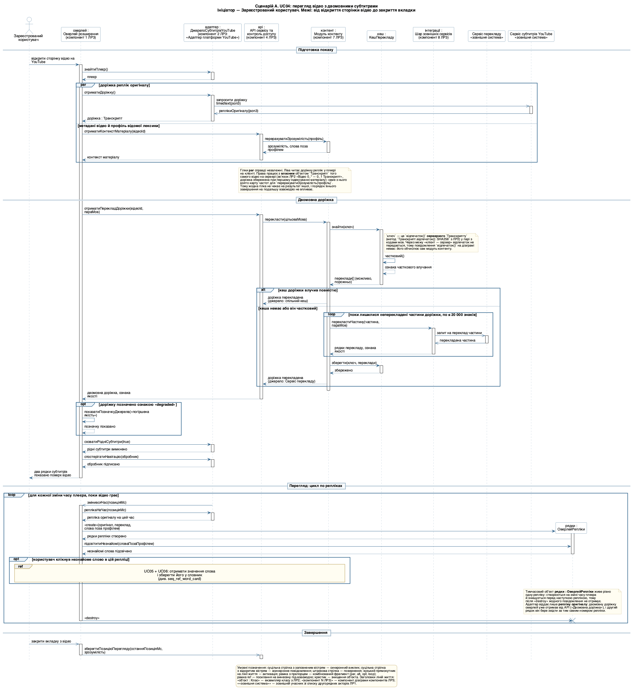
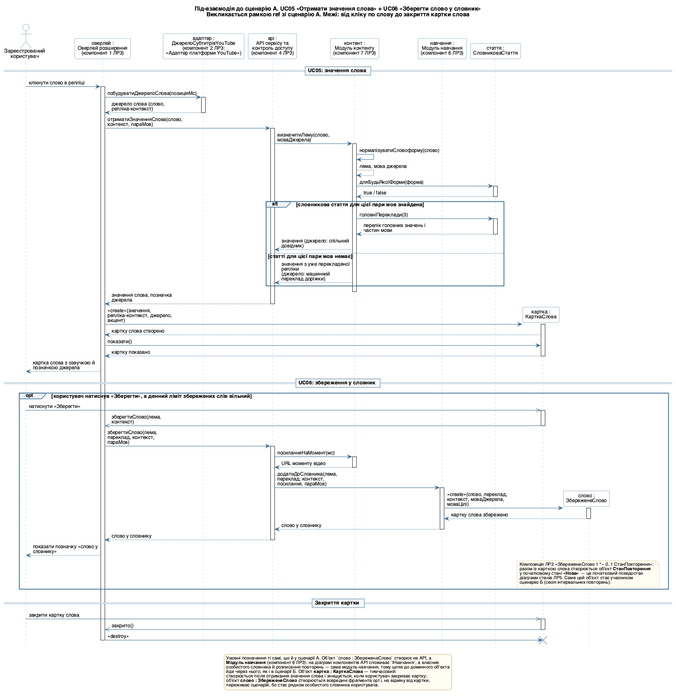
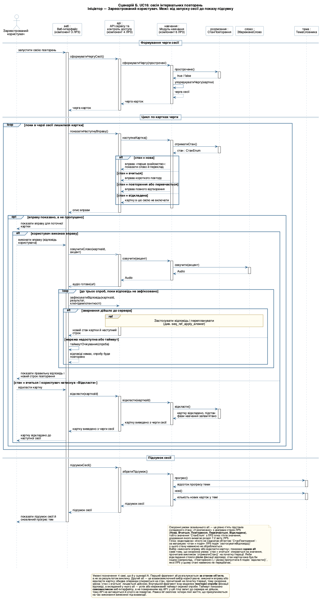
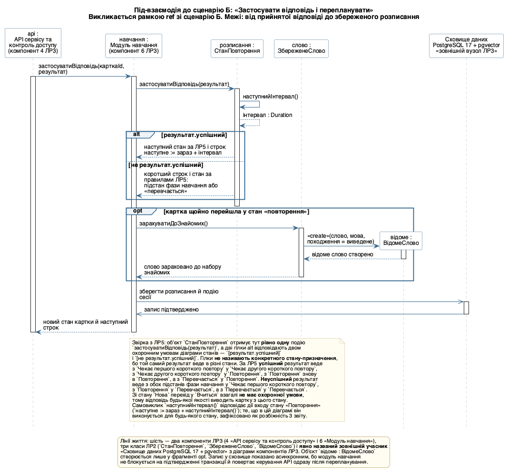
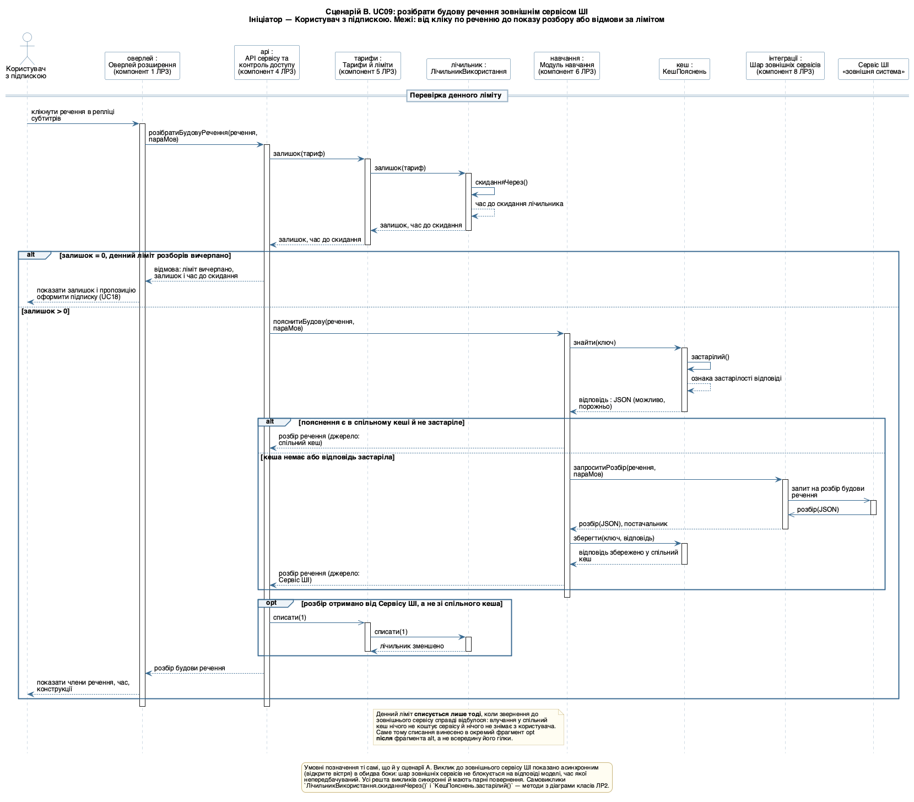

## Мета

Закріпити на практиці матеріал лекції 9 і навчитися будувати діаграми послідовності (Sequence Diagram) мови UML (Unified Modeling Language — уніфікована мова моделювання) для ключових сценаріїв власного курсового завдання: показувати, які обʼєкти беруть участь у сценарії, у якому порядку вони обмінюються повідомленнями, застосовувати комбіновані фрагменти для розгалужень, циклів і паралельності, виносити повторювані під-взаємодії в посилання ref, а головне — перевіряти, що побудована взаємодія узгоджена зі структурною моделлю (діаграмою класів ЛР2) і з поведінковою моделлю життєвого циклу обʼєкта (діаграмою станів ЛР5).

Формальний титульний аркуш оформлено першою сторінкою цього документа; нижче продубльовано його змістові поля, яких вимагає пункт 1 структури звіту, — тему роботи та варіант предметної області.

| Поле титульного аркуша | Значення |
|---|---|
| Лабораторна робота | № 6 |
| Дисципліна | Моделювання та аналіз програмного забезпечення |
| Тема роботи | Побудова діаграм послідовності для ключових сценаріїв системи |
| Варіант предметної області | «Півот» — вебсервіс і браузерне розширення для вивчення іноземної мови на основі власного контенту користувача (робочий домен `pivotsubs.com`); та сама предметна область, що й у Лабораторних роботах №1–№5 |
| Обрані сценарії | А — UC04 «Дивитися відео з двомовними субтитрами»; Б — UC16 «Пройти сесію інтервальних повторень»; В — UC09 «Розібрати будову речення» |
| Винесені під-взаємодії | «UC05 + UC06: отримати значення слова і зберегти його у словник»; «Застосувати відповідь і перепланувати» |
| Виконав | Камінський Олексій Дмитрович, група ВТ-23-2 |
| Перевірив | Власенко О.В. |
| Інструмент | PlantUML 1.2026.8 (локальна установка, рендеринг Graphviz) |

Тема є спільною для всіх шести лабораторних робіт і для курсової, бо збігається з темою дипломної роботи. Система складається з вебсервісу й браузерного розширення: користувач дивиться відео на YouTube і бачить поверх плеєра два рядки субтитрів — оригінал і переклад, клікає незнайоме слово й отримує його значення в контексті, зберігає слово у власний словник разом з реплікою-контекстом, читає власні документи у вбудованій читалці й повторює збережені слова в сесіях інтервальних повторень.

Межі моделі зафіксовано один раз і вони діють у всіх роботах: відеоплатформа одна — YouTube, решта площадок присутні лише як точка підстановки за інтерфейсом `ДжерелоСубтитрів`; ШІ (штучний інтелект) — це зовнішній сервіс за API (Application Programming Interface — програмний інтерфейс застосунку), система лише формує запит, кешує відповідь і рахує витрати ліміту. Жодного нового припущення про продукт у цій роботі не зроблено: усі учасники, повідомлення й охоронні умови виведені з Лабораторних робіт №1, №2, №3, №4 і №5.

## Розділ 1. Обґрунтування вибору сценаріїв

### 1.1. Критерій відбору і відкинуті кандидати

Крок 1 методики (розділ 1.2 методичних вказівок) вимагає обрати сценарій, який справді вимагає взаємодії кількох обʼєктів і має розгалуження, — «а не тривіальний „один виклик — одна відповідь“». Пункт 1 завдання додає дві обовʼязкові властивості комплекту: хоча б один сценарій має містити цикл або повторні спроби, хоча б один — розгалуження за станом обʼєкта. На діаграмі варіантів використання ЛР1 двадцять два овали — двадцять нумерованих варіантів використання і дві спеціалізації UC02 (UC02.1 «Увійти поштою або паролем» і UC02.2 «Увійти через зовнішній акаунт»); кандидатів, що взагалі претендують на діаграму послідовності, сім.

| Кандидат (UC з ЛР1) | Скільки обʼєктів задіяно | Розгалуження | Цикл або повторні спроби | Рішення |
|---|---|---|---|---|
| UC02 «Увійти в сервіс» | 4: веб-інтерфейс, API, провайдер авторизації, поштовий сервіс | є: вхід поштою або через зовнішній акаунт (узагальнення UC02.1 / UC02.2 у ЛР1) | немає | відкинуто: це стандартний протокол OAuth 2.0, у якому майже немає власних класів ЛР2 — узагальнення вже показане на діаграмі ЛР1 |
| UC04 «Дивитися відео з двомовними субтитрами» | 10: актор, 5 компонентів ЛР3, 2 класи ЛР2, 2 зовнішні системи | є: переклад доріжки у спільному кеші або звернення до сервісу перекладу | є обидва: цикл по частинах доріжки і цикл по репліках | обрано як сценарій А |
| UC12 «Завантажити власний матеріал» | 5: веб-інтерфейс, API, модуль контенту, парсер, документ | є: вибір парсера за форматом | немає | відкинуто: головна цінність сценарію — поліморфізм парсерів, а він уже виражений реалізацією інтерфейсу `ПарсерДокумента` на діаграмі класів ЛР2 і точкою підстановки на ЛР3 |
| UC16 «Пройти сесію інтервальних повторень» | 7: актор, 2 компоненти ЛР3, 4 класи ЛР2 | є, і саме **за станом обʼєкта** `СтанПовторення` — п'ять підстанів діаграми станів ЛР5 | є обидва: цикл по картках черги і повторні спроби фіксації відповіді | обрано як сценарій Б |
| UC17 «Пройти тест обсягу словника» | 4: веб-інтерфейс, API, модуль навчання, оцінка рівня | слабке: лише «вгадав / не вгадав» | є: цикл по словах тесту | відкинуто: уся робота зосереджена всередині одного модуля, тому це радше діаграма діяльності (застереження розділу 1.3 методички) |
| UC18 «Оформити й керувати підпискою» | 5: веб-інтерфейс, API, тарифи й ліміти, платіжний провайдер, поштовий сервіс | є: успішна оплата або відмова | немає | відкинуто: протокол нав'язаний платіжним провайдером і майже не зачіпає доменних класів ЛР2 |
| UC09 «Розібрати будову речення» | 9: актор, 4 компоненти ЛР3, 2 класи ЛР2, зовнішня система | є двічі: вичерпаний або вільний денний ліміт; відповідь зі спільного кеша або від сервісу ШІ | немає | обрано як сценарій В |

### 1.2. Чому обрано саме ці три сценарії

Обрано три сценарії, а не два, з трьох причин.

По-перше, три сценарії разом утворюють наскрізну історію продукту і прямо продовжують бізнес-процес, який уже був побудований діаграмою діяльності в ЛР4: UC04 (подивитися відео й натрапити на незнайоме слово) → UC05 і UC06 (зрозуміти слово й зберегти його) → UC16 (повторити збережене слово до стану, коли воно більше не підсвічується). ЛР4 показала цей процес як **алгоритм** — послідовність кроків у шести доріжках; ЛР6 показує той самий процес як **взаємодію** — хто кому надсилає повідомлення. Саме такий перехід рекомендує розділ 10 лекції 9. Сценарій В (UC09) додає до цієї історії четвертий, принципово інший сюжет — звернення до зовнішнього сервісу ШІ з перевіркою денного ліміту, — і доводить, що та сама методика працює й для платної функції.

По-друге, три сценарії покривають три різні типи взаємодії, і це видно за складом ліній життя: сценарій А — майже цілком **клієнтський** (оверлей розширення й адаптер платформи, сервер лише постачає переклад); сценарій Б — цілком **серверний** (веб-інтерфейс і три доменні обʼєкти ЛР2, жодної зовнішньої системи); сценарій В — **межовий** (клієнт ініціює, сервер перевіряє ліміт, зовнішній сервіс виконує роботу).

По-третє, жоден один сценарій не покриває всіх шести вимог пункту 2 завдання одночасно: фрагмент `par` природний лише там, де система справді робить дві незалежні речі водночас (сценарій А, завантаження доріжки субтитрів паралельно з обчисленням зрозумілості матеріалу), а розгалуження за **станом обʼєкта** природне лише там, де цей стан існує (сценарій Б, обʼєкт `СтанПовторення` з ЛР5). Зведення обох в один сценарій дало б штучну діаграму, у якій `par` стояв би там, де дії насправді залежні, — а це саме та помилка, від якої застерігає таблиця розділу 9 лекції 9.

### 1.3. Чому дві під-взаємодії винесено окремими діаграмами

Крок 7 методики вимагає виносити повторювані або надто обʼємні під-взаємодії в посилання `ref`, щоб діаграма лишалася читабельною. У цій роботі винесено дві під-взаємодії, і обидва рішення мають кількісне обґрунтування.

«UC05 + UC06: отримати значення слова і зберегти його у словник» винесено зі сценарію А тому, що сценарій А уже має десять ліній життя, а під-взаємодія додала б іще чотири (`Модуль навчання`, `СловниковаСтаття`, `КарткаСлова`, `ЗбереженеСлово`) і два вкладені фрагменти всередині циклу по репліках — тобто четвертий рівень вкладеності. Крім того, ця під-взаємодія викликається не лише зі сценарію А: у продукті картка слова відкривається так само з читалки власних документів (UC13), тому виносити її варто й з міркувань повторного використання.

«Застосувати відповідь і перепланувати» винесено зі сценарію Б тому, що вона виконується всередині циклу повторних спроб, тобто потенційно тричі, і саме вона містить усю логіку перепланування за алгоритмом інтервальних повторень. Залишена всередині сценарію Б, вона зробила б вкладеність «цикл по картках → opt → цикл спроб → alt → перепланування» нечитабельною.

Обидві під-взаємодії намальовано окремими діаграмами, тому жодне посилання `ref` у цій роботі не вказує в порожнечу.

**Висновок:** із семи кандидатів обрано три сценарії, що разом дають наскрізну історію продукту, покривають клієнтський, серверний і межовий типи взаємодії і забезпечують усі шість вимог пункту 2 завдання без жодного штучно доданого фрагмента; дві під-взаємодії винесено в `ref` за кроком 7 методики й намальовано окремо.

## Розділ 2. Таблиця відбору учасників і фрагментів

### 2.1. Таблиця відбору за зразком розділу 3.1 методички

Таблиця складена за кроками 1–7 методики розділу 1.2 методичних вказівок, по одному стовпчику на сценарій.

| Крок методики | Сценарій А: двомовні субтитри (UC04) | Сценарій Б: сесія повторень (UC16) | Сценарій В: розбір речення (UC09) |
|---|---|---|---|
| 1–2. Ініціатор і межі | Ініціатор — актор **Зареєстрований користувач**. Початок — відкриття сторінки відео на YouTube. Завершення — закриття вкладки зі збереженням позиції перегляду | Ініціатор — актор **Зареєстрований користувач**. Початок — запуск сесії повторень. Завершення — показ підсумку сесії й оновленого прогресу тем | Ініціатор — актор **Користувач з підпискою** (саме він асоційований з UC09 у ЛР1). Початок — клік по реченню в репліці. Завершення — показ розбору або відмова за вичерпаним лімітом |
| 3. Учасники | Зареєстрований користувач, Оверлей розширення (к. 1), ДжерелоСубтитрівYouTube (к. 2), API сервісу (к. 4), Модуль контенту (к. 7), КешПерекладу, Шар зовнішніх сервісів (к. 8), Сервіс перекладу, Сервіс субтитрів YouTube, ОверлейРепліки | Зареєстрований користувач, Веб-інтерфейс (к. 3), API сервісу (к. 4), Модуль навчання (к. 6), СтанПовторення, ЗбереженеСлово, ТемаСловника | Користувач з підпискою, Оверлей розширення (к. 1), API сервісу (к. 4), Тарифи й ліміти (к. 5), ЛічильникВикористання, Модуль навчання (к. 6), КешПояснень, Шар зовнішніх сервісів (к. 8), Сервіс ШІ |
| 4. Основний потік | знайти плеєр → отримати доріжку оригіналу → отримати переклад доріжки → вимкнути рідні субтитри → підписатися на навігацію → малювати репліки | сформувати чергу прострочених карток → для кожної картки показати вправу → прийняти відповідь → застосувати її й перепланувати → показати підсумок | перевірити денний ліміт → узяти пояснення зі спільного кеша або в сервісу ШІ → списати ліміт → показати розбір |
| 5. Фрагменти | **par** (доріжка субтитрів паралельно з метаданими й профілем лексики), **alt** (кеш доріжки влучив / не влучив), **loop** (частини доріжки по ≤ 20 000 знаків), **loop** (репліки, поки відео грає), **opt** (позначка «degraded»), **opt** (користувач клікнув слово), **ref** (UC05 + UC06) | **loop** (картки черги сесії), **alt** з чотирьох операндів (розгалуження за станом `СтанПовторення`), **opt** (вправу показано, а не пропущено), **alt** (виконати вправу / відкласти картку — взаємовиключний вибір користувача на тому самому прочитаному стані), **loop** (до трьох повторних спроб), **alt** (спроба дійшла / мережевий таймаут), **ref** (застосувати відповідь і перепланувати) | **alt** (ліміт вичерпано / ліміт вільний), **alt** (відповідь зі спільного кеша / від сервісу ШІ), **opt** (списати ліміт лише після реального звернення до ШІ) |
| 6. Тимчасові обʼєкти | **рядки : ОверлейРепліки** — створюється на кожній зміні часу плеєра і знищується перед наступною реплікою | немає: усі обʼєкти сценарію переживають сесію | немає: відповідь ШІ зберігається у спільному кеші, окремого тимчасового обʼєкта не потрібно |
| 7. Винесені під-взаємодії | «UC05 + UC06: отримати значення слова і зберегти його у словник» — файл `seq_ref_word_card.puml` | «Застосувати відповідь і перепланувати» — файл `seq_ref_apply_answer.puml` | немає: діаграма вміщається на один екран |

### 2.2. Звідки взято кожну лінію життя

Пункт «імена мають точно збігатися з ЛР2, ЛР3 і ЛР5» перевірено для кожної з 24 різних ліній життя комплекту. Заголовок кожної лінії життя записано у форматі `обʼєкт : Клас` для класів ЛР2 і `обʼєкт : Назва компонента (компонент N ЛР3)` для компонентів — щоб жодна лінія життя не була вигаданою.

| Лінія життя | Джерело імені | У яких діаграмах |
|---|---|---|
| Зареєстрований користувач | актор ЛР1 (основний актор UC04, UC06, UC16) | А, під-взаємодія UC05 + UC06, Б |
| Користувач з підпискою | актор ЛР1 (основний актор UC09) | В |
| оверлей : Оверлей розширення (к. 1) | компонент 1 діаграми компонентів ЛР3 | А, під-взаємодія UC05 + UC06, В |
| адаптер : ДжерелоСубтитрівYouTube (к. 2) | клас ЛР2 (реалізація інтерфейсу `ДжерелоСубтитрів`), розгорнутий у компоненті 2 ЛР3 «Адаптер платформи YouTube» | А, під-взаємодія UC05 + UC06 |
| веб : Веб-інтерфейс (к. 3) | компонент 3 ЛР3 | Б |
| api : API сервісу та контроль доступу (к. 4) | компонент 4 ЛР3 | А, обидві під-взаємодії, Б, В |
| тарифи : Тарифи й ліміти (к. 5) | компонент 5 ЛР3 | В |
| навчання : Модуль навчання (к. 6) | компонент 6 ЛР3 | під-взаємодія UC05 + UC06, Б, під-взаємодія «Застосувати відповідь», В |
| контент : Модуль контенту (к. 7) | компонент 7 ЛР3 | А, під-взаємодія UC05 + UC06 |
| інтеграції : Шар зовнішніх сервісів (к. 8) | компонент 8 ЛР3 | А, В |
| кеш : КешПерекладу | клас ЛР2, пакет «Спільні довідники без власника» | А |
| кеш : КешПояснень | клас ЛР2, пакет «Спільні довідники без власника» | В |
| стаття : СловниковаСтаття | клас ЛР2, пакет «Спільні довідники без власника» | під-взаємодія UC05 + UC06 |
| слово : ЗбереженеСлово | клас ЛР2, пакет «Словник і прогрес» | під-взаємодія UC05 + UC06, Б, під-взаємодія «Застосувати відповідь» |
| розписання : СтанПовторення | клас ЛР2 і обʼєкт діаграми станів ЛР5 | Б, під-взаємодія «Застосувати відповідь» |
| тема : ТемаСловника | клас ЛР2, пакет «Словник і прогрес» | Б |
| відоме : ВідомеСлово | клас ЛР2, пакет «Словник і прогрес» | під-взаємодія «Застосувати відповідь» |
| лічильник : ЛічильникВикористання | клас ЛР2, пакет «Акаунт і доступ» | В |
| рядки : ОверлейРепліки | **класу в ЛР2 немає** — тимчасовий клас, що потребує додавання (розділ 8.4) | А |
| картка : КарткаСлова | **класу в ЛР2 немає**; назву узгоджено з інтерфейсом `IКарткаСлова` компонента 1 ЛР3 | під-взаємодія UC05 + UC06 |
| Сервіс субтитрів YouTube | зовнішня система: другорядний актор ЛР1 і елемент хмари «Зовнішні системи» ЛР3 | А |
| Сервіс перекладу | зовнішня система: другорядний актор ЛР1, спадкоємець абстрактного «Зовнішнього постачальника ШІ-функцій» | А |
| Сервіс ШІ | зовнішня система: другорядний актор ЛР1, спадкоємець того самого абстрактного постачальника | В |
| Сховище даних PostgreSQL 17 + pgvector | вузол сховища діаграми компонентів ЛР3 (на діаграмі розгортання ЛР3 — «Вузол 4. Сервер бази даних») | під-взаємодія «Застосувати відповідь» |

Одна назва в цій таблиці потребує окремого пояснення, бо в ЛР2 і в ЛР3 вона різна. На діаграмі компонентів ЛР3 компонент 2 називається **«Адаптер платформи YouTube»** — це назва модуля розгортання; на діаграмі класів ЛР2 клас, що реалізує інтерфейс `ДжерелоСубтитрів`, називається **`ДжерелоСубтитрівYouTube`** — це назва типу. Лінія життя діаграми послідовності позначає **обʼєкт**, тому її заголовок записано у форматі `обʼєкт : Клас` з імʼям класу ЛР2, а дослівну назву компонента ЛР3 додано третім рядком заголовка: `адаптер : ДжерелоСубтитрівYouTube (компонент 2 ЛР3: «Адаптер платформи YouTube»)`. Так у заголовку видно обидва джерела імені одночасно, і жодне з них не підмінено іншим.

### 2.3. Скільки ліній життя в кожній діаграмі

| Діаграма | Ліній життя | Актор або явно названий зовнішній учасник | Вимога «≥ 3» |
|---|---|---|---|
| Сценарій А (`seq_a_subtitles`) | 10 | актор «Зареєстрований користувач» + 2 зовнішні системи | виконано |
| Під-взаємодія UC05 + UC06 (`seq_ref_word_card`) | 9 | актор «Зареєстрований користувач» | виконано |
| Сценарій Б (`seq_b_review`) | 7 | актор «Зареєстрований користувач» | виконано |
| Під-взаємодія «Застосувати відповідь» (`seq_ref_apply_answer`) | 6 | явно названий зовнішній учасник «Сховище даних PostgreSQL 17 + pgvector» | виконано |
| Сценарій В (`seq_c_grammar`) | 9 | актор «Користувач з підпискою» + зовнішня система «Сервіс ШІ» | виконано |

**Висновок:** усі 24 різні лінії життя комплекту мають джерело в ЛР1, ЛР2 або ЛР3, і лише дві з них (`ОверлейРепліки`, `КарткаСлова`) є новими тимчасовими класами, які діаграма послідовності й мала виявити; жодна діаграма не має менше шести ліній життя при вимозі «не менше трьох».

## Розділ 3. Сценарій А: перегляд відео з двомовними субтитрами (UC04)

Сценарій відтворює основний і альтернативні потоки специфікації UC04 з Розділу 6 ЛР1. Ініціатор — актор «Зареєстрований користувач»; межі сценарію — від відкриття сторінки відео на YouTube до закриття вкладки, коли система зберігає позицію перегляду й відсоток зрозумілості матеріалу.

### 3.1. Код діаграми

Вихідний код файла `seq_a_subtitles.puml` наведено повністю.

```text
@startuml
' =====================================================================
' Лабораторна робота №6. Діаграма послідовності. СЦЕНАРІЙ А
' UC04 «Дивитися відео з двомовними субтитрами» (ЛР1), з посиланням ref
' на винесену під-взаємодію UC05 + UC06 (файл seq_ref_word_card.puml).
' Предметна область: «Півот» — вебсервіс і браузерне розширення
' для вивчення іноземної мови на основі власного контенту користувача.
' Камінський Олексій Дмитрович, група ВТ-23-2
' Лінії життя: актор із ЛР1, компоненти з ЛР3 (номери збережено),
' класи з ЛР2 у форматі «обʼєкт : Клас».
' Охоронні умови записано без квадратних дужок: PlantUML 1.2026.8
' додає дужки сам, а написані вручну з'їдають перше слово умови.
' =====================================================================

skinparam defaultFontName "Helvetica"
skinparam defaultFontSize 13
skinparam shadowing false
skinparam ArrowFontSize 12
skinparam maxMessageSize 170
skinparam LifelineStrategy solid
skinparam sequence {
  ParticipantBackgroundColor #FEFEFE
  ParticipantBorderColor #33668E
  ParticipantFontSize 12
  ActorBackgroundColor #FEFEFE
  ActorBorderColor #33668E
  ArrowColor #33668E
  LifeLineBorderColor #9AB3C6
  GroupBackgroundColor #EDF3F8
  GroupBorderColor #33668E
  GroupHeaderFontSize 12
  ReferenceBackgroundColor #FFFDF2
  ReferenceBorderColor #C9B47A
  DividerBackgroundColor #F7FAFC
  DividerBorderColor #9AB3C6
}
skinparam note {
  BackgroundColor #FFFDF2
  BorderColor #C9B47A
  FontSize 11
}
skinparam legend {
  BackgroundColor #FFFDF2
  BorderColor #C9B47A
  FontSize 11
}

' Нижні рамки учасників прибрано: PlantUML малює їх і під хрестиком
' знищеного обʼєкта, через що хрестик виглядає як початок нової лінії життя.
hide footbox

title Сценарій А. UC04: перегляд відео з двомовними субтитрами\nІніціатор — Зареєстрований користувач. Межі: від відкриття сторінки відео до закриття вкладки

actor "Зареєстрований\nкористувач" as U
participant "оверлей :\nОверлей розширення\n(компонент 1 ЛР3)" as OV
participant "адаптер :\nДжерелоСубтитрівYouTube\n(компонент 2 ЛР3:\n«Адаптер платформи YouTube»)" as YT
participant "api :\nAPI сервісу та\nконтроль доступу\n(компонент 4 ЛР3)" as API
participant "контент :\nМодуль контенту\n(компонент 7 ЛР3)" as CNT
participant "кеш :\nКешПерекладу" as CACHE
participant "інтеграції :\nШар зовнішніх сервісів\n(компонент 8 ЛР3)" as EXT
participant "Сервіс перекладу\n<<зовнішня система>>" as CTR
participant "Сервіс субтитрів YouTube\n<<зовнішня система>>" as CYT
participant "рядки :\nОверлейРепліки" as CUE

== Підготовка показу ==

U -> OV : відкрити сторінку відео на YouTube
activate OV

OV -> YT : знайтиПлеєр()
activate YT
YT --> OV : плеєр
deactivate YT

par доріжка реплік оригіналу
  OV -> YT : отриматиДоріжку()
  activate YT
  YT ->> CYT : запросити доріжку timedtext(json3)
  activate CYT
  CYT ->> YT : реплікиОригіналу(json3)
  deactivate CYT
  YT --> OV : доріжка : Транскрипт
  deactivate YT
else метадані відео й профіль відомої лексики
  OV -> API : отриматиКонтекстМатеріалу(відеоId)
  activate API
  API -> CNT : перерахуватиЗрозумілість(профіль)
  activate CNT
  CNT --> API : зрозумілість, слова поза профілем
  deactivate CNT
  API --> OV : контекст матеріалу
  deactivate API
end

note over API, CNT #FFFDF2
  Гілки **par** справді незалежні. Ліва читає доріжку реплік у плеєрі
  на клієнті. Права працює з **власним** обʼєктом `Транскрипт` того
  самого відео на сервері (звʼязок ЛР2 «Відео 0..* — 0..1 Транскрипт»,
  доріжка збережена при першому індексуванні матеріалу): саме з нього
  взято карту частот для `перерахуватиЗрозумілість(профіль)`.
  Тому жодна гілка не чекає на результат іншої, і порядок їхнього
  завершення на подальшу взаємодію не впливає.
end note

== Двомовна доріжка ==

OV -> API : отриматиПерекладДоріжки(відеоId, параМов)
activate API
API -> CNT : перекласти(цільоваМова)
activate CNT
CNT -> CACHE : знайти(ключ)
activate CACHE
note right of CACHE #FFFDF2
  `ключ` — це `відпечаток()` **серверного** `Транскрипту`
  (метод `Транскрипт.відпечаток(): SHA256` з ЛР2) у парі з
  кодами мов. Через межу «клієнт — сервер» відпечаток не
  передається, тому повідомлення `відпечаток()` на діаграмі
  немає: його обчислює сам модуль контенту.
end note
CACHE -> CACHE : частковий()
CACHE --> CACHE : ознака часткового влучання
CACHE --> CNT : переклади[] (можливо, порожньо)
deactivate CACHE

alt кеш доріжки влучив повністю
  CNT --> API : доріжка перекладена (джерело: спільний кеш)
else кеша немає або він частковий
  loop поки лишилися неперекладені частини доріжки, по ≤ 20 000 знаків
    CNT -> EXT : перекластиЧастину(частина, параМов)
    activate EXT
    EXT ->> CTR : запит на переклад частини
    activate CTR
    CTR ->> EXT : перекладена частина
    deactivate CTR
    EXT --> CNT : рядки перекладу, ознака якості
    deactivate EXT
  end
  CNT -> CACHE : зберегти(ключ, переклади)
  activate CACHE
  CACHE --> CNT : збережено
  deactivate CACHE
  CNT --> API : доріжка перекладена (джерело: Сервіс перекладу)
end
deactivate CNT
API --> OV : двомовна доріжка, ознака якості
deactivate API

opt доріжку позначено ознакою «degraded»
  OV -> OV : показатиПозначкуДжерела(«погіршена якість»)
  OV --> OV : позначку показано
end

OV -> YT : сховатиРодніСубтитри(true)
activate YT
YT --> OV : рідні субтитри вимкнено
deactivate YT

OV -> YT : спостерігатиНавігацію(обробник)
activate YT
YT --> OV : обробник підписано
deactivate YT

OV --> U : два рядки субтитрів показано поверх відео
deactivate OV

== Перегляд: цикл по репліках ==

loop для кожної зміни часу плеєра, поки відео грає
  YT ->> OV : змінивсяЧас(позиціяМс)
  activate OV
  OV -> YT : реплікаНаЧас(позиціяМс)
  activate YT
  YT --> OV : репліка оригіналу на цей час
  deactivate YT

  create CUE
  OV -> CUE : <<create>>(оригінал, переклад, слова поза профілем)
  activate CUE
  CUE --> OV : рядки репліки створено
  OV -> CUE : підсвітитиНезнайомі(словаПозаПрофілем)
  CUE --> OV : незнайомі слова підсвічено
  deactivate CUE

  opt користувач клікнув незнайоме слово в цій репліці
    ref over U, OV, YT, API, CNT : UC05 + UC06: отримати значення слова\nі зберегти його у словник\n(див. seq_ref_word_card)
  end

  note over CUE #FFFDF2
    Тимчасовий обʼєкт **рядки : ОверлейРепліки** живе рівно
    одну репліку: створюється на зміні часу плеєра
    й знищується перед наступною реплікою, тому
    після «destroy» жодного повідомлення не отримує.
    Адаптер віддає лише **репліку оригіналу**: двомовну доріжку
    оверлей уже отримав від API («Двомовна доріжка»), і другий
    рядок він бере звідти за тим самим номером репліки.
  end note

  OV -> CUE : <<destroy>>
  destroy CUE
  deactivate OV
end

== Завершення ==

U ->> OV : закрити вкладку з відео
activate OV
OV ->> API : зберегтиПозиціюПерегляду(останняПозиціяМс, зрозумілість)
activate API
deactivate OV
deactivate API

legend bottom
Умовні позначення: суцільна стрілка з заповненим вістрям — синхронний виклик; суцільна стрілка
з відкритим вістрям — асинхронне повідомлення; штрихова стрілка — повернення; вузький прямокутник
на лінії життя — активація; рамка з прапорцем — комбінований фрагмент (par, alt, opt, loop);
рамка ref — посилання на винесену під-взаємодію; хрестик — знищення обʼєкта. Заголовки ліній життя:
«обʼєкт : Клас» — екземпляр класу з ЛР2; «(компонент N ЛР3)» — компонент діаграми компонентів ЛР3;
«<<зовнішня система>>» — зовнішній учасник зі списку другорядних акторів ЛР1.
end legend

@enduml
```

### 3.2. Діаграма



### 3.3. Як читати діаграму

Користувач синхронно відкриває сторінку відео, і з цього моменту починається активація оверлея розширення — він триватиме до того, як двомовні субтитри буде намальовано. Першим ділом оверлей синхронно просить адаптер платформи знайти плеєр і отримує його у відповідь: це найкоротша пара «виклик — повернення» на діаграмі, і вона задає тон усій решті синхронних викликів, кожен з яких має парну штрихову стрілку.

Фрагмент **par** кодує дві справді незалежні дії. Ліва гілка — завантаження доріжки реплік: адаптер **асинхронно** звертається до зовнішнього сервісу субтитрів YouTube за доріжкою `timedtext` у форматі `json3` і так само асинхронно отримує її назад. Асинхронність тут не декоративна: адаптер працює у світі сторінки, відповідь платформи непередбачувана в часі, і блокувати на ній оверлей не можна. Права гілка — звернення до серверної частини по метадані відео й профіль відомої лексики, де `Модуль контенту` синхронно питає обʼєкт матеріалу про зрозумілість. Дві гілки виконуються одночасно, і подальша взаємодія триває лише після того, як завершилися **обидві**: без доріжки немає що показувати, без профілю лексики немає що підсвічувати.

Незалежність гілок `par` доведено окремо, бо на перший погляд її можна запідозрити: `перерахуватиЗрозумілість(профіль)` рахує відсоток за **картою частот доріжки**, а доріжку приносить ліва гілка. Насправді залежності немає, і саме це фіксує примітка під фрагментом. За діаграмою класів ЛР2 звʼязок `Відео "0..*" -- "0..1" Транскрипт : доріжка реплік` належить **серверній** частині: доріжка зберігається в сервісі ще при першому індексуванні матеріалу, і карта частот будується з неї. Ліва гілка читає доріжку в плеєрі **на клієнті** й потрібна для показу, а не для підрахунку. Отже, обидві гілки працюють з різними екземплярами `Транскрипт`, жодна не чекає на результат іншої, і порядок їхнього завершення на подальшу взаємодію не впливає — це рівно той критерій виправданості `par`, про який ідеться в розділі 9 лекції 9.

Далі оверлей синхронно просить переклад доріжки повідомленням `отриматиПерекладДоріжки(відеоId, параМов)`. Параметри тут рівно ті, які на діаграмі справді є: `відеоId` оверлей уже вживав у лівому сусідньому виклику `отриматиКонтекстМатеріалу(відеоId)`, а пара мов — це налаштування користувача. Відпечатка доріжки серед параметрів навмисно немає: `Транскрипт.відпечаток(): SHA256` — справжній метод ЛР2, але він обчислюється **на сервері**, з власного серверного `Транскрипту`, і саме його разом із кодами мов `Модуль контенту` подає як `ключ` у виклику `КешПерекладу.знайти(ключ)`. Якби відпечаток фігурував параметром клієнтського виклику, діаграма твердила б, що десь було повідомлення `відпечаток()`, якого на ній немає; примітка біля кеша фіксує цю межу явно.

Ланцюг викликів `оверлей → api → контент` точно відтворює напрямки інтерфейсів діаграми компонентів ЛР3: оверлей споживає `IApiСервісу`, API споживає `IКонтент`, і жоден виклик не «перестрибує» через рівень. Модуль контенту звертається до спільного кеша перекладів, а кеш виконує **самовиклик** `частковий()` — метод, який на діаграмі класів ЛР2 справді належить класу `КешПерекладу` і повертає ознаку того, чи лежить у кеші лише частина доріжки.

Фрагмент **alt** розрізняє два результати цього пошуку. Якщо кеш влучив повністю — переклад віддається одразу, і сервіс не витрачає ані копійки: саме в цьому сенс спільного кеша, описаний у ЛР2 приміткою до пакета «Спільні довідники без власника». Якщо кеша немає або він частковий — вмикається вкладений **loop**, що перебирає частини доріжки по 20 000 знаків кожна, як того вимагає крок 5 специфікації UC04. Усередині циклу `Шар зовнішніх сервісів` асинхронно звертається до сервісу перекладу й асинхронно приймає перекладену частину; після циклу переклад записується у спільний кеш для наступних глядачів того самого ролика.

Фрагмент **opt** із умовою «доріжку позначено ознакою degraded» відповідає альтернативному потоку 5а специфікації UC04: при вичерпаному ліміті або недоступному постачальнику система тихо відкочується на базового перекладача й лише показує позначку погіршеної якості. Оскільки позначку малює сам оверлей, це другий **самовиклик** діаграми.

Після цього оверлей вимикає рідні субтитри плеєра (`сховатиРодніСубтитри(true)`) і підписується на навігацію (`спостерігатиНавігацію(обробник)`) — обидва методи є на діаграмі класів ЛР2 в інтерфейсі `ДжерелоСубтитрів`. Активація оверлея закривається поверненням «два рядки субтитрів показано поверх відео»: з цього моменту оверлей не висить на стеку виклику, а чекає на події плеєра.

Фрагмент **loop** «для кожної зміни часу плеєра, поки відео грає» — подієвий. Кожну ітерацію запускає **асинхронне** повідомлення `змінивсяЧас(позиціяМс)` від адаптера, і саме воно щоразу наново відкриває активацію оверлея. Оверлей синхронно просить у адаптера репліку на поточний час і отримує **лише репліку оригіналу**: адаптер працює з доріжкою `timedtext`, яку сам же й повернув у фрагменті `par`, і перекладу він ніколи не бачив. Другий, перекладений рядок оверлей бере з **двомовної доріжки**, яку отримав від API у розділі «Двомовна доріжка», за тим самим номером репліки. Саме тому `реплікаНаЧас(позиціяМс)` повертає оригінал, а не пару рядків: інакше діаграма приписала б адаптерові дані, яких йому ніхто не передавав. Отримавши обидва рядки, оверлей **створює тимчасовий обʼєкт** `рядки : ОверлейРепліки` — лінія життя цього обʼєкта починається не вгорі діаграми, а рівно в точці повідомлення `«create»`. Обʼєкт живе рівно одну репліку: після того, як незнайомі слова підсвічено, а користувач, можливо, встиг клікнути слово, оверлей **знищує** його повідомленням `«destroy»`, і лінія життя обривається хрестиком. Після знищення обʼєкт не отримує жодного повідомлення — це перевірено окремо, бо саме така помилка є типовою для ШІ-чернеток (розділ «Протокол використання ШІ»).

Усередині циклу стоїть фрагмент **opt** з умовою «користувач клікнув незнайоме слово в цій репліці», а в ньому — єдине посилання **ref** цієї діаграми на винесену під-взаємодію «UC05 + UC06». Рамка `ref` охоплює п'ять ліній життя, що призупиняються на час виконання під-взаємодії: актора, оверлей, адаптер, API і модуль контенту. Лінії життя спільного кеша, шару інтеграцій, зовнішніх сервісів і тимчасового обʼєкта рамка навмисно не охоплює — у під-взаємодії вони не беруть участі.

Завершується сценарій **асинхронною** парою: користувач закриває вкладку, і оверлей, не чекаючи відповіді, надсилає на сервер позицію перегляду й зрозумілість. Синхронним цей виклик бути не може: вкладка вже закривається, чекати на відповідь нікому. Попри це, лінія життя API має тут власну активацію: асинхронність означає, що **відправник** не блокується, а не що отримувач нічого не робить — сервер справді виконує запис, і коротка смужка активації це показує. Активація оверлея закривається раніше за активацію API, і саме такий порядок `deactivate` стоїть у коді.

**Висновок:** сценарій А містить 10 ліній життя, 25 повідомлень-викликів (18 синхронних, 7 асинхронних), 18 повернень, 2 самовиклики, створення і знищення тимчасового обʼєкта, фрагменти par, alt, loop (двічі), opt (двічі) і одне посилання ref; парне повернення мають 17 із 18 синхронних повідомлень — єдиний виняток `«destroy»` пояснено в розділі 8.1; усі 19 активацій відкрито й закрито явними командами `activate` і `deactivate`.

## Розділ 4. Під-взаємодія «UC05 + UC06: отримати значення слова і зберегти його у словник»

Ця діаграма — та сама взаємодія, на яку вказує рамка `ref` у сценарії А. Вона відтворює основний потік специфікації UC05 з ЛР1 і розширення UC06, яке в ЛР1 позначене відношенням `<<extend>>` до UC05.

### 4.1. Код діаграми

```text
@startuml
' =====================================================================
' Лабораторна робота №6. ВИНЕСЕНА ПІД-ВЗАЄМОДІЯ до сценарію А
' «UC05 + UC06: отримати значення слова і зберегти його у словник».
' На цю діаграму вказує рамка ref у файлі seq_a_subtitles.puml.
' Предметна область: «Півот» — вебсервіс і браузерне розширення
' для вивчення іноземної мови на основі власного контенту користувача.
' Камінський Олексій Дмитрович, група ВТ-23-2
' =====================================================================

' --- блок skinparam тут такий самий, як у сценарії А (шрифт Helvetica, кольори ЛР2/ЛР3, ---
' --- без тіней, оформлення рамок фрагментів), з однією відмінністю: немає директив ---
' --- ReferenceBackgroundColor і ReferenceBorderColor, бо рамки ref на цій діаграмі немає. ---
' --- Повний текст блока є у файлі .puml ---

' Нижні рамки учасників прибрано: PlantUML малює їх і під хрестиком
' знищеного обʼєкта, через що хрестик виглядає як початок нової лінії життя.
hide footbox

title Під-взаємодія до сценарію А. UC05 «Отримати значення слова» + UC06 «Зберегти слово у словник»\nВикликається рамкою ref зі сценарію А. Межі: від кліку по слову до закриття картки слова

actor "Зареєстрований\nкористувач" as U
participant "оверлей :\nОверлей розширення\n(компонент 1 ЛР3)" as OV
participant "адаптер :\nДжерелоСубтитрівYouTube\n(компонент 2 ЛР3:\n«Адаптер платформи YouTube»)" as YT
participant "api :\nAPI сервісу та\nконтроль доступу\n(компонент 4 ЛР3)" as API
participant "контент :\nМодуль контенту\n(компонент 7 ЛР3)" as CNT
participant "навчання :\nМодуль навчання\n(компонент 6 ЛР3)" as LRN
participant "стаття :\nСловниковаСтаття" as DICT
participant "картка :\nКарткаСлова" as CARD
participant "слово :\nЗбереженеСлово" as SW

== UC05: значення слова ==

U -> OV : клікнути слово в репліці
activate OV
OV -> YT : побудуватиДжерелоСлова(позиціяМс)
activate YT
YT --> OV : джерело слова (слово, репліка-контекст)
deactivate YT

OV -> API : отриматиЗначенняСлова(слово, контекст, параМов)
activate API
API -> CNT : визначитиЛему(слово, моваДжерела)
activate CNT
CNT -> CNT : нормалізуватиСловоформу(слово)
CNT --> CNT : лема, мова джерела
CNT -> DICT : дляБудьЯкоїФорми(форма)
activate DICT
DICT --> CNT : true / false
deactivate DICT

alt словникова стаття для цієї пари мов знайдена
  CNT -> DICT : головніПереклади(3)
  activate DICT
  DICT --> CNT : перелік головних значень і частин мови
  deactivate DICT
  CNT --> API : значення (джерело: спільний довідник)
else статті для цієї пари мов немає
  CNT --> API : значення з уже перекладеної репліки\n(джерело: машинний переклад доріжки)
end
deactivate CNT
API --> OV : значення слова, позначка джерела
deactivate API

create CARD
OV -> CARD : <<create>>(значення, репліка-контекст, джерело, акцент)
activate CARD
CARD --> OV : картку слова створено
OV -> CARD : показати()
CARD --> OV : картку показано
deactivate CARD
OV --> U : картка слова з озвучкою й позначкою джерела

== UC06: збереження у словник ==

opt користувач натиснув «Зберегти», а денний ліміт збережених слів вільний
  U ->> CARD : натиснути «Зберегти»
  activate CARD
  CARD ->> OV : зберегтиСлово(лема, контекст)
  deactivate CARD
  OV -> API : зберегтиСлово(лема, переклад, контекст, параМов)
  activate API
  API -> CNT : посиланняНаМомент(мс)
  activate CNT
  CNT --> API : URL моменту відео
  deactivate CNT
  API -> LRN : додатиДоСловника(лема, переклад, контекст, посилання, параМов)
  activate LRN
  create SW
  LRN -> SW : <<create>>(слово, переклад, контекст, моваДжерела, моваЦілі)
  activate SW
  SW --> LRN : картку слова збережено
  deactivate SW
  LRN --> API : слово у словнику
  deactivate LRN
  API --> OV : слово у словнику
  deactivate API
  OV --> U : показати позначку «слово у словнику»

  note over SW #FFFDF2
    Композиція ЛР2 «ЗбереженеСлово 1 *-- 0..1 СтанПовторення»:
    разом із карткою слова створюється обʼєкт **СтанПовторення**
    у початковому стані **«Нова»** — це початковий псевдостан
    діаграми станів ЛР5. Саме цей обʼєкт стає учасником
    сценарію Б (сесія інтервальних повторень).
  end note
end

== Закриття картки ==

U ->> CARD : закрити картку слова
activate CARD
CARD ->> OV : закрито()
deactivate CARD
OV -> CARD : <<destroy>>
destroy CARD
deactivate OV

legend bottom
Умовні позначення ті самі, що й у сценарії А. Обʼєкт `слово : ЗбереженеСлово` створює не API, а
**Модуль навчання** (компонент 6 ЛР3): на діаграмі компонентів API споживає `IНавчання`, а власник
особистого словника й розписання повторень — саме модуль навчання, тому шлях до доменного обʼєкта
йде через нього, як і в сценарії Б. Обʼєкт **картка : КарткаСлова** — тимчасовий:
створюється після отримання значення слова і знищується, коли користувач закриває картку;
обʼєкт **слово : ЗбереженеСлово** створюється всередині фрагмента opt і, на відміну від картки,
переживає сценарій, бо стає рядком особистого словника користувача.
end legend

@enduml
```

### 4.2. Діаграма



### 4.3. Як читати діаграму

Взаємодія починається з синхронного кліку користувача по слову в репліці. Оверлей просить адаптер побудувати джерело слова для поточної позиції плеєра — метод `побудуватиДжерелоСлова(позиціяМс)` є на діаграмі класів ЛР2 в інтерфейсі `ДжерелоСубтитрів`, — і отримує назад саме слово разом із реплікою-контекстом, яка потім стане полем `контекст` картки слова.

Далі оверлей синхронно звертається до API, API — до модуля контенту, і модуль контенту виконує **самовиклик** `нормалізуватиСловоформу(слово)`. Це крок 2 специфікації UC05 («система визначає лему слова й мову джерела»): саме тут словоформа зводиться до леми, бо в словниковому довіднику стаття зберігається за лемою, а не за формою, у якій слово трапилося в субтитрах. Потім модуль перевіряє в обʼєкта `СловниковаСтаття`, чи підходить стаття для будь-якої форми цього слова.

Фрагмент **alt** кодує крок 4 специфікації UC05. Якщо стаття для цієї пари мов знайдена — модуль просить у неї три головні переклади (`головніПереклади(3)`), і картка показує значення зі спільного довідника. Якщо статті немає — система **не робить жодного нового звернення до зовнішнього сервісу**: переклад репліки вже отриманий у сценарії А, тому картка показує значення з уже перекладеного рядка й чесно позначає джерело як машинний переклад доріжки. Це важливе проєктне рішення, і воно саме тому й помітне на діаграмі послідовності: на діаграмі класів його не видно взагалі.

Лінія життя `навчання : Модуль навчання` у першій половині діаграми мовчить — вона потрібна лише у фрагменті `opt`, і далі пояснено, чому саме. Отримавши значення, оверлей **створює тимчасовий обʼєкт** `картка : КарткаСлова` — лінія життя починається в точці `«create»` — і синхронно просить його показатися. Повернення «картка слова з озвучкою й позначкою джерела» закриває крок 5 специфікації UC05.

Фрагмент **opt** з умовою «користувач натиснув „Зберегти“, а денний ліміт збережених слів вільний» — це рівно те, що в ЛР1 позначено як `<<extend>>` UC06 до UC05 з умовою вільного ліміту. Натискання кнопки показано **асинхронним** повідомленням від актора до картки: натискання — це подія інтерфейсу, користувач не блокується на ній. Картка так само асинхронно передає подію оверлею, і далі починається синхронний ланцюг збереження. API просить модуль контенту сформувати посилання на момент відео (`посиланняНаМомент(мс)` — метод класу `Відео` з ЛР2), а тоді передає збереження **Модулю навчання** повідомленням `додатиДоСловника(...)`, і вже той **створює обʼєкт** `слово : ЗбереженеСлово`. Ланцюг навмисно не скорочено до «API створює обʼєкт напряму»: на діаграмі компонентів ЛР3 компонент 4 споживає інтерфейси `IНавчання` і `IКонтент` і не має жодного прямого звʼязку з доменними обʼєктами, а власник особистого словника й розписання повторень — компонент 6 «Модуль навчання». Той самий шлях `API → Модуль навчання → ЗбереженеСлово` видно й у сценарії Б, де модуль навчання звертається до того самого обʼєкта з `озвучити(акцент)`. На відміну від картки, обʼєкт `слово : ЗбереженеСлово` переживає сценарій: він стає рядком особистого словника користувача.

Примітка на лінії життя `ЗбереженеСлово` фіксує те, чого на діаграмі послідовності не видно, але що випливає з композиції ЛР2 `ЗбереженеСлово "1" *-- "0..1" СтанПовторення`: разом із карткою слова створюється обʼєкт `СтанПовторення` у початковому стані **«Нова»**. Саме цей обʼєкт і стає головним героєм сценарію Б, а початковий стан «Нова» — це початковий псевдостан діаграми станів ЛР5.

Завершується під-взаємодія **знищенням** картки: користувач асинхронно закриває її, картка асинхронно повідомляє про це оверлей, і оверлей надсилає `«destroy»`. Після хрестика картка повідомлень не отримує.

**Висновок:** під-взаємодія містить 9 ліній життя, 18 викликів (14 синхронних, 4 асинхронні), 15 повернень, 1 самовиклик, два створення обʼєктів (тимчасова `КарткаСлова` і довговічне `ЗбереженеСлово`) і одне знищення, фрагменти alt і opt; парне повернення мають 13 із 14 синхронних повідомлень (виняток — `«destroy»`), усі 13 активацій закрито.

## Розділ 5. Сценарій Б: сесія інтервальних повторень (UC16)

Сценарій відтворює UC16 з ЛР1 і ту частину бізнес-процесу ЛР4, що починається вузлом «Відкрити словник і запустити сесію повторень». Це єдиний сценарій комплекту, у якому розгалуження виконується **за станом обʼєкта**, а не за результатом виклику: охоронні умови зовнішнього фрагмента `alt` — це рівно підстани складеного стану «У розписанні» з діаграми станів ЛР5.

### 5.1. Код діаграми

```text
@startuml
' =====================================================================
' Лабораторна робота №6. Діаграма послідовності. СЦЕНАРІЙ Б
' UC16 «Пройти сесію інтервальних повторень» (ЛР1).
' Розгалуження за станом обʼєкта «розписання : СтанПовторення»
' виконано строго за значеннями СтанEnum з ЛР2 і за діаграмою
' станів ЛР5 (підстани складеного стану «У розписанні»).
' Посилання ref веде на файл seq_ref_apply_answer.puml.
' Камінський Олексій Дмитрович, група ВТ-23-2
' =====================================================================

' --- блок skinparam тут такий самий, як у сценарії А (шрифт Helvetica, кольори ЛР2/ЛР3, ---
' --- без тіней, оформлення рамок фрагментів і рамки ref), з однією відмінністю: ---
' --- maxMessageSize 180 замість 170, бо підписи повідомлень цієї діаграми довші. ---
' --- Повний текст блока є у файлі .puml ---

' Нижні рамки учасників прибрано — так само, як в інших діаграмах комплекту.
hide footbox

title Сценарій Б. UC16: сесія інтервальних повторень\nІніціатор — Зареєстрований користувач. Межі: від запуску сесії до показу підсумку

actor "Зареєстрований\nкористувач" as U
participant "веб :\nВеб-інтерфейс\n(компонент 3 ЛР3)" as WEB
participant "api :\nAPI сервісу та\nконтроль доступу\n(компонент 4 ЛР3)" as API
participant "навчання :\nМодуль навчання\n(компонент 6 ЛР3)" as LRN
participant "розписання :\nСтанПовторення" as RS
participant "слово :\nЗбереженеСлово" as SW
participant "тема :\nТемаСловника" as VOC

== Формування черги сесії ==

U -> WEB : запустити сесію повторень
activate WEB
WEB -> API : сформуватиЧергуСесії()
activate API
API -> LRN : сформуватиЧергу(прострочені)
activate LRN
LRN -> RS : прострочене()
activate RS
RS --> LRN : true / false
deactivate RS
LRN -> LRN : упорядкуватиЧергу(картки)
LRN --> LRN : черга сесії
LRN --> API : черга карток
deactivate LRN
API --> WEB : черга карток
deactivate API

== Цикл по картках черги ==

loop поки в черзі сесії лишилися картки
  WEB -> API : показатиНаступнуВправу()
  activate API
  API -> LRN : наступнаКартка()
  activate LRN
  LRN -> RS : отриматиСтан()
  activate RS
  RS --> LRN : стан : СтанEnum
  deactivate RS

  alt стан = нова
    LRN --> API : вправа «перше знайомство»: показати слово й переклад
  else стан = вчиться
    LRN --> API : вправа короткого повтору
  else стан = повторення або перевчається
    LRN --> API : вправа повного відтворення
  else стан = відкладена
    LRN --> API : картку в цю сесію не включати
  end
  deactivate LRN
  API --> WEB : опис вправи
  deactivate API

  opt вправу показано, а не пропущено
    WEB --> U : показати вправу для поточної картки

    alt користувач виконав вправу
      U -> WEB : виконати вправу (відповідь користувача)

      WEB ->> API : озвучитиСлово(карткаId, акцент)
      activate API
      API -> LRN : озвучити(акцент)
      activate LRN
      LRN -> SW : озвучити(акцент)
      activate SW
      SW --> LRN : Audio
      deactivate SW
      LRN --> API : Audio
      deactivate LRN
      API ->> WEB : аудіо готове(url)
      deactivate API

      loop до трьох спроб, поки відповідь не зафіксовано
        WEB -> API : зафіксуватиВідповідь(карткаId, результат, ключІдемпотентності)
        alt звернення дійшло до сервера
          activate API
          ref over API, LRN, RS, SW : Застосувати відповідь і перепланувати\n(див. seq_ref_apply_answer)
          API --> WEB : новий стан картки й наступний строк
          deactivate API
        else мережа недоступна або таймаут
          WEB -> WEB : таймаутОчікування(спроба)
          WEB --> WEB : відповіді немає, спробу буде повторено
        end
      end

      WEB --> U : показати правильну відповідь і новий строк повторення

    else стан = вчиться і користувач натиснув «Відкласти»
      U -> WEB : відкласти картку
      WEB -> API : відкласти(карткаId)
      activate API
      API -> LRN : відкласти(карткаId)
      activate LRN
      LRN -> RS : відкласти()
      activate RS
      RS --> LRN : картку відкладено, підстан фази навчання запамʼятано
      deactivate RS
      LRN --> API : картку виведено з черги сесії
      deactivate LRN
      API --> WEB : картку виведено з черги сесії
      deactivate API
      WEB --> U : картку відкладено до наступної сесії
    end
  end
end

== Підсумок сесії ==

WEB -> API : підсумокСесії()
activate API
API -> LRN : зібратиПідсумок()
activate LRN
LRN -> VOC : прогрес()
activate VOC
VOC --> LRN : відсоток прогресу теми
deactivate VOC
LRN -> VOC : нові()
activate VOC
VOC --> LRN : кількість нових карток у темі
deactivate VOC
LRN --> API : підсумок сесії
deactivate LRN
API --> WEB : підсумок сесії
deactivate API
WEB --> U : показати підсумок сесії й оновлений прогрес тем
deactivate WEB

note over RS #FFFDF2
  Охоронні умови зовнішнього alt — це рівно пʼять підстанів
  складеного стану «У розписанні» з діаграми станів ЛР5
  (**Нова**, **Вчиться**, **Повторення**, **Перевчається**, **Відкладена**),
  тобто значення `СтанEnum` з ЛР2 плюс пʼяте значення,
  додавання якого вимагає розділ 7.2 звіту ЛР5.
  Гілка «відкладена» нічого не надсилає обʼєктові `СтанПовторення`:
  за матрицею «стан × подія» ЛР5 подія `застосуватиВідповідь()`
  з цього стану навмисно не оброблюється.
  Вибір «виконати вправу або відкласти картку» показано **одним alt**
  саме тому, що охоронна умова `стан = вчиться` спирається на значення,
  прочитане викликом `отриматиСтан()` на початку ітерації. Якби
  відкладання стояло **після** фіксації відповіді, стан картки вже був би
  іншим (наприклад, «Повторення»), і умова пропустила б подію `відкласти()`,
  якої ЛР5 у цьому стані навмисно не передбачає.
end note

legend bottom
Умовні позначення ті самі, що й у сценарії А. Перший фрагмент alt розгалужується **за станом обʼєкта**,
а не за результатом виклику. Другий alt — це взаємовиключний вибір користувача: виконати вправу або
відкласти картку; обидва операнди спираються на стан, прочитаний на початку ітерації, тому охоронна
умова `стан = вчиться` лишається дійсною. Внутрішній фрагмент loop моделює **повторні спроби** фіксації
відповіді, а вкладений у нього alt — успіх або мережевий таймаут окремої спроби. Таймаут показано
**самовикликом** веб-інтерфейсу, а не поверненням від API: у цій гілці запит до сервера не дійшов,
тому API не активується й нічого не повертає. Рамка ref охоплює чотири лінії життя, що призупиняються
на час виконання винесеної під-взаємодії.
end legend

@enduml
```

### 5.2. Діаграма



### 5.3. Як читати діаграму

Користувач синхронно запускає сесію повторень у веб-інтерфейсі. Веб-інтерфейс звертається до API, API — до модуля навчання: ланцюг знову точно відтворює інтерфейси ЛР3 (`Web -down-( IApi`, `API -down-( ILearn`, де `ILearn` — псевдонім інтерфейсу з видимою назвою «IНавчання»), і веб-інтерфейс ніде не звертається до доменних обʼєктів безпосередньо. Модуль навчання питає обʼєкт `розписання : СтанПовторення` методом `прострочене()` — це справжній метод класу `СтанПовторення` з ЛР2 — і виконує **самовиклик** `упорядкуватиЧергу(картки)`. Повернення піднімається тим самим ланцюгом назад до веб-інтерфейсу.

Зовнішній фрагмент **loop** «поки в черзі сесії лишилися картки» охоплює всю роботу з однією карткою. На кожній ітерації модуль навчання читає стан картки (`отриматиСтан()`) і входить у фрагмент **alt** із **чотирьох** операндів. Перші три операнди обирають тип вправи: для стану `нова` — вправа першого знайомства, для стану `вчиться` — вправа короткого повтору, для станів `повторення` і `перевчається` — вправа повного відтворення. Четвертий операнд, `стан = відкладена`, нічого не показує й нічого не надсилає обʼєктові `СтанПовторення`: за матрицею «стан × подія» ЛР5 подія `застосуватиВідповідь()` зі стану «Відкладена» навмисно не оброблюється, і діаграма послідовності цю заборону поважає. Охоронні умови чотирьох операндів взаємовиключні й у сукупності вичерпні — вони покривають усі п'ять підстанів ЛР5.

Фрагмент **opt** «вправу показано, а не пропущено» відділяє решту роботи від четвертого операнда `alt`. Усередині нього веб-інтерфейс показує вправу, а далі стоїть **другий фрагмент alt** — взаємовиключний вибір користувача: виконати вправу або відкласти картку. Саме в цьому місці, а не після фіксації відповіді, стоїть охоронна умова `стан = вчиться`, і це принципово. Значення стану прочитане на початку ітерації викликом `отриматиСтан()`; після того, як рамка `ref` застосувала відповідь, стан картки вже інший — наприклад, картка з підстану «Чекає другого короткого повтору» після успішної відповіді опиняється у «Повторення», де за розділом 6.2 ЛР5 подія `відкласти()` навмисно не оброблюється. Якби відкладання лишалося окремим фрагментом **після** циклу спроб, умова `стан = вчиться` спиралася б на застаріле значення й пропускала б заборонену подію. Операнд `alt` цю діру закриває: обидві гілки читаються на тому самому стані, і жодна не може спрацювати після того, як стан змінився.

Перша гілка цього `alt` — звичайний хід вправи. Користувач синхронно виконує вправу, після чого веб-інтерфейс **асинхронно** просить озвучити слово: озвучка не повинна блокувати вправу, тому запит і відповідь `аудіо готове(url)` показані відкритими вістрями. Усередині цього асинхронного обміну стоїть синхронний ланцюг до класу `ЗбереженеСлово` з викликом `озвучити(акцент)` — це метод ЛР2 з дослівно тією самою сигнатурою.

Внутрішній фрагмент **loop** «до трьох спроб, поки відповідь не зафіксовано» моделює **повторні спроби**, яких вимагає пункт 1 завдання. Усередині нього фрагмент **alt** розрізняє успішну спробу й мережевий таймаут. Повідомлення `зафіксуватиВідповідь(карткаId, результат, ключІдемпотентності)` надсилається **до** розгалуження, бо спроба робиться в обох випадках; розрізняється лише те, чи вона дійшла. Успішна гілка відкриває активацію API, містить єдине посилання **ref** на винесену під-взаємодію «Застосувати відповідь і перепланувати» (рамка охоплює чотири лінії життя — API, модуль навчання, розписання і слово) і закривається поверненням «новий стан картки й наступний строк». Гілка таймауту не активує API взагалі й нічого від нього не отримує: у ній запит до сервера **не дійшов**, тому показувати повернення `API --> WEB` було б неправдою — повернення означає, що отримувач виконав роботу й віддає керування. Замість цього таймаут показано **самовикликом** веб-інтерфейсу `таймаутОчікування(спроба)`: вичерпання часу очікування — це подія самого клієнта, і саме клієнт вирішує повторити спробу. Третій параметр `ключІдемпотентності` додано спеціально після звірки з діаграмою станів, щоб три мережеві спроби не перетворилися на три події `застосуватиВідповідь()` для одного й того самого обʼєкта (розбіжність 5 розділу 9.3).

Друга гілка цього `alt` — «стан = вчиться і користувач натиснув „Відкласти“». Охоронна умова тут складена з двох частин навмисно: ЛР5 у розділі 6.2 прямо обґрунтовує, що подія `відкласти()` існує лише в межах складеного стану «Вчиться», бо тільки там є позиція в послідовності коротких повторів, яку варто запамʼятати псевдостаном історії. Без першої половини умови діаграма послідовності вимагала б від обʼєкта поведінки, якої діаграма станів не передбачає. Сам виклик іде ланцюгом `веб → api → навчання → розписання`, а не від API до обʼєкта `СтанПовторення` напряму: на діаграмі компонентів ЛР3 компонент 4 споживає `IНавчання`, а власником розписання є компонент 6, і той самий шлях уже вжито в цьому ж сценарії для `озвучити(акцент)` та у винесеній під-взаємодії для `застосуватиВідповідь()`.

Після виходу з циклу веб-інтерфейс просить підсумок сесії, а модуль навчання читає з обʼєкта `тема : ТемаСловника` два показники — `прогрес()` і `нові()`. Обидва методи є на діаграмі класів ЛР2 дослівно. Сценарій завершується поверненням до актора з підсумком сесії й оновленим прогресом тем.

**Висновок:** сценарій Б містить 7 ліній життя, 23 виклики (21 синхронний, 2 асинхронні), 25 повернень, 2 самовиклики, два цикли (по картках і по спробах), три фрагменти `alt` (чотири операнди за станом обʼєкта, два за вибором користувача, два за результатом мережевої спроби), один фрагмент `opt` і одне посилання `ref`; усі 21 синхронне повідомлення мають парні повернення, а розгалуження за станом обʼєкта виконано рівно за п'ятьма підстанами діаграми станів ЛР5.

## Розділ 6. Під-взаємодія «Застосувати відповідь і перепланувати»

Ця діаграма — та сама взаємодія, на яку вказує рамка `ref` у сценарії Б. Вона зосереджує всю логіку перепланування картки за алгоритмом інтервальних повторень і є головним місцем звірки з діаграмою станів ЛР5 (розділ 9).

### 6.1. Код діаграми

```text
@startuml
' =====================================================================
' Лабораторна робота №6. ВИНЕСЕНА ПІД-ВЗАЄМОДІЯ до сценарію Б
' «Застосувати відповідь і перепланувати».
' На цю діаграму вказує рамка ref у файлі seq_b_review.puml.
' Кожна реакція обʼєкта «розписання : СтанПовторення» звірена
' з діаграмою станів ЛР5 (розділ 3.5 звіту).
' Камінський Олексій Дмитрович, група ВТ-23-2
' =====================================================================

' --- блок skinparam тут такий самий, як у сценарії А (шрифт Helvetica, кольори ЛР2/ЛР3, ---
' --- без тіней, оформлення рамок фрагментів), з трьома відмінностями: maxMessageSize 190 ---
' --- замість 170; немає директив ActorBackgroundColor і ActorBorderColor, бо на цій ---
' --- діаграмі немає актора; немає директив ReferenceBackgroundColor і ReferenceBorderColor, ---
' --- бо немає рамки ref. Повний текст блока є у файлі .puml ---

' Нижні рамки учасників прибрано — так само, як в інших діаграмах комплекту.
hide footbox

title Під-взаємодія до сценарію Б: «Застосувати відповідь і перепланувати»\nВикликається рамкою ref зі сценарію Б. Межі: від прийнятої відповіді до збереженого розписання

participant "api :\nAPI сервісу та\nконтроль доступу\n(компонент 4 ЛР3)" as API
participant "навчання :\nМодуль навчання\n(компонент 6 ЛР3)" as LRN
participant "розписання :\nСтанПовторення" as RS
participant "слово :\nЗбереженеСлово" as SW
participant "відоме :\nВідомеСлово" as KW
participant "Сховище даних\nPostgreSQL 17 + pgvector\n<<зовнішній вузол ЛР3>>" as DB

API -> LRN : застосуватиВідповідь(карткаId, результат)
activate API
activate LRN

LRN -> RS : застосуватиВідповідь(результат)
activate RS
RS -> RS : наступнийІнтервал()
RS --> RS : інтервал : Duration

alt результат.успішний
  RS --> LRN : наступний стан за ЛР5 і строк наступне := зараз + інтервал
else не результат.успішний
  RS --> LRN : коротший строк і стан за правилами ЛР5:\nпідстан фази навчання або «перевчається»
end
deactivate RS

opt картка щойно перейшла у стан «повторення»
  LRN -> SW : зарахуватиДоЗнайомих()
  activate SW
  create KW
  SW -> KW : <<create>>(слово, мова, походження = виведене)
  activate KW
  KW --> SW : відоме слово створено
  deactivate KW
  SW --> LRN : слово зараховано до набору знайомих
  deactivate SW
end

LRN ->> DB : зберегти розписання й подію сесії
activate DB
DB ->> LRN : запис підтверджено
deactivate DB

LRN --> API : новий стан картки й наступний строк
deactivate LRN
deactivate API

note over RS #FFFDF2
  Звірка з ЛР5: обʼєкт `СтанПовторення` отримує тут **рівно одну** подію
  `застосуватиВідповідь(результат)`, а дві гілки alt відповідають двом
  охоронним умовам діаграми станів — `[результат.успішний]`
  і `[не результат.успішний]`. Гілки **не називають конкретного стану-призначення**,
  бо той самий результат веде в різні стани. За ЛР5 **успішний** результат веде
  з `Чекає першого короткого повтору` у `Чекає другого короткого повтору`,
  з `Чекає другого короткого повтору` у `Повторення`, з `Повторення` знову
  в `Повторення`, а з `Перевчається` у `Повторення`. **Неуспішний** результат
  веде з обох підстанів фази навчання у `Чекає першого короткого повтору`,
  з `Повторення` у `Перевчається`, а з `Перевчається` у `Перевчається`.
  Зі стану `Нова` перехід у `Вчиться` взагалі **не має охоронної умови**,
  тому відповідь будь-якої якості виводить картку з цього стану.
  Самовиклик `наступнийІнтервал()` відповідає дії входу стану «Повторення»
  (`наступне := зараз + наступнийІнтервал()`); те, що в цій діаграмі він
  виконується для будь-якого стану, зафіксовано як розбіжність 3 звіту.
end note

legend bottom
Лінії життя: шість — два компоненти ЛР3 (4 «API сервісу та контроль доступу» і 6 «Модуль навчання»),
три класи ЛР2 (`СтанПовторення`, `ЗбереженеСлово`, `ВідомеСлово`) і **явно названий зовнішній учасник**
«Сховище даних PostgreSQL 17 + pgvector» з діаграми компонентів ЛР3. Обʼєкт `відоме : ВідомеСлово`
створюється лише у фрагменті opt. Запис у сховище показано асинхронним, бо модуль навчання
не блокується на підтвердженні транзакції й повертає керування API одразу після перепланування.
end legend

@enduml
```

### 6.2. Діаграма



### 6.3. Як читати діаграму

Ця діаграма — єдина в комплекті без актора: у ній немає людини, бо вона виконується цілком усередині серверної частини. Вимогу «щонайменше три лінії життя, серед них актор або **явно названий зовнішній учасник**» забезпечує шоста лінія життя — вузол «Сховище даних PostgreSQL 17 + pgvector» з діаграми компонентів ЛР3 (на діаграмі розгортання ЛР3 це «Вузол 4. Сервер бази даних»).

API синхронно передає відповідь модулю навчання, а модуль навчання надсилає обʼєктові `розписання : СтанПовторення` **єдину подію** `застосуватиВідповідь(результат)` — метод з дослівно тією самою сигнатурою є на діаграмі класів ЛР2, і та сама подія стоїть на девʼяти переходах діаграми станів ЛР5. Обʼєкт виконує **самовиклик** `наступнийІнтервал()` — це теж справжній метод ЛР2, і саме він фігурує в дії входу стану «Повторення» (`наступне := зараз + наступнийІнтервал()`).

Фрагмент **alt** має рівно дві гілки з охоронними умовами `[результат.успішний]` і `[не результат.успішний]` — тими самими, що на діаграмі станів ЛР5. Гілки навмисно **не називають конкретного стану-призначення**, і це результат звірки: за ЛР5 той самий **успішний** результат веде з підстану «Чекає першого короткого повтору» у «Чекає другого короткого повтору» (перехід 3), з «Чекає другого короткого повтору» — у «Повторення» (перехід 5), з «Повторення» — знову в «Повторення» зовнішнім переходом сам у себе (перехід 10), а з «Перевчається» — у «Повторення» (перехід 12). **Неуспішний** результат веде з обох підстанів фази навчання у «Чекає першого короткого повтору» (переходи 4 і 6), з «Повторення» — у «Перевчається» (перехід 11), а з «Перевчається» — у «Перевчається» (перехід 13). Окремо стоїть стан «Нова»: перехід 2 у «Вчиться» **взагалі не має охоронної умови**, тому відповідь будь-якої якості виводить картку з цього стану. Саме цю таблицю й переказує примітка на діаграмі, і саме тому жодна з двох гілок не може назвати один конкретний стан. Перша редакція цієї діаграми писала в гілці «не успішно» конкретний стан «перевчається», що суперечило ЛР5 для картки у стані «Нова»; розбіжність знайдено звіркою й усунено саме тут (розбіжність 2 розділу 9.3).

Фрагмент **opt** «картка щойно перейшла у стан „повторення“» відтворює вузол ЛР4 «Зарахувати слово до набору знайомих і прибрати з підсвічування». Усередині нього `ЗбереженеСлово` **створює** обʼєкт `відоме : ВідомеСлово` з походженням «виведене» — і це єдине створення обʼєкта на цій діаграмі. Операцію навмисно названо `зарахуватиДоЗнайомих()`, а не `позначитиВідомим()`: друга назва вже зайнята в ЛР5 переходом, що веде в **кінцевий** псевдостан і знищує розписання, тоді як тут картка свій життєвий цикл продовжує (розбіжність 4 розділу 9.3).

Запис у сховище показано **асинхронною** парою повідомлень: модуль навчання не блокується на підтвердженні транзакції й повертає керування API одразу після перепланування. Остання штрихова стрілка закриває активацію, відкриту першим повідомленням діаграми.

**Висновок:** під-взаємодія містить 6 ліній життя (серед них явно названий зовнішній учасник — вузол сховища), 7 викликів (5 синхронних, 2 асинхронні), 1 самовиклик, одне створення обʼєкта і фрагменти `alt` та `opt`; вона є єдиним місцем комплекту, де обʼєкт `СтанПовторення` справді змінює свій стан.

## Розділ 7. Сценарій В: розбір будови речення зовнішнім сервісом ШІ (UC09)

Сценарій відтворює UC09 з ЛР1 — варіант використання, доступний лише акторові «Користувач з підпискою» і повʼязаний `<<extend>>` з UC04. Це єдиний сценарій комплекту, у якому головним сюжетом є **ліміт безкоштовного тарифу**: гроші сервісу витрачаються лише тоді, коли звернення до зовнішнього сервісу справді відбулося.

### 7.1. Код діаграми

```text
@startuml
' =====================================================================
' Лабораторна робота №6. Діаграма послідовності. СЦЕНАРІЙ В
' UC09 «Розібрати будову речення» (ЛР1) — пояснення граматики
' зовнішнім сервісом ШІ з перевіркою денного ліміту безкоштовного
' тарифу й кешуванням відповіді у спільному довіднику.
' Камінський Олексій Дмитрович, група ВТ-23-2
' =====================================================================

' --- блок skinparam тут такий самий, як у сценарії А (шрифт Helvetica, кольори ЛР2/ЛР3, ---
' --- без тіней, оформлення рамок фрагментів), з двома відмінностями: maxMessageSize 180 ---
' --- замість 170 і немає директив ReferenceBackgroundColor і ReferenceBorderColor, ---
' --- бо рамки ref на цій діаграмі немає. Повний текст блока є у файлі .puml ---

' Нижні рамки учасників прибрано — так само, як в інших діаграмах комплекту.
hide footbox

title Сценарій В. UC09: розібрати будову речення зовнішнім сервісом ШІ\nІніціатор — Користувач з підпискою. Межі: від кліку по реченню до показу розбору або відмови за лімітом

actor "Користувач\nз підпискою" as U
participant "оверлей :\nОверлей розширення\n(компонент 1 ЛР3)" as OV
participant "api :\nAPI сервісу та\nконтроль доступу\n(компонент 4 ЛР3)" as API
participant "тарифи :\nТарифи й ліміти\n(компонент 5 ЛР3)" as PLN
participant "лічильник :\nЛічильникВикористання" as LIM
participant "навчання :\nМодуль навчання\n(компонент 6 ЛР3)" as LRN
participant "кеш :\nКешПояснень" as CEX
participant "інтеграції :\nШар зовнішніх сервісів\n(компонент 8 ЛР3)" as EXT
participant "Сервіс ШІ\n<<зовнішня система>>" as AI

== Перевірка денного ліміту ==

U -> OV : клікнути речення в репліці субтитрів
activate OV
OV -> API : розібратиБудовуРечення(речення, параМов)
activate API
API -> PLN : залишок(тариф)
activate PLN
PLN -> LIM : залишок(тариф)
activate LIM
LIM -> LIM : скиданняЧерез()
LIM --> LIM : час до скидання лічильника
LIM --> PLN : залишок, час до скидання
deactivate LIM
PLN --> API : залишок, час до скидання
deactivate PLN

alt залишок = 0, денний ліміт розборів вичерпано
  API --> OV : відмова: ліміт вичерпано, залишок і час до скидання
  OV --> U : показати залишок і пропозицію оформити підписку (UC18)

else залишок > 0
  API -> LRN : пояснитиБудову(речення, параМов)
  activate LRN
  LRN -> CEX : знайти(ключ)
  activate CEX
  CEX -> CEX : застарілий()
  CEX --> CEX : ознака застарілості відповіді
  CEX --> LRN : відповідь : JSON (можливо, порожньо)
  deactivate CEX

  alt пояснення є в спільному кеші й не застаріле
    LRN --> API : розбір речення (джерело: спільний кеш)
  else кеша немає або відповідь застаріла
    LRN -> EXT : запроситиРозбір(речення, параМов)
    activate EXT
    EXT ->> AI : запит на розбір будови речення
    activate AI
    AI ->> EXT : розбір(JSON)
    deactivate AI
    EXT --> LRN : розбір(JSON), постачальник
    deactivate EXT
    LRN -> CEX : зберегти(ключ, відповідь)
    activate CEX
    CEX --> LRN : відповідь збережено у спільний кеш
    deactivate CEX
    LRN --> API : розбір речення (джерело: Сервіс ШІ)
  end
  deactivate LRN

  opt розбір отримано від Сервісу ШІ, а не зі спільного кеша
    API ->> PLN : списати(1)
    activate PLN
    PLN -> LIM : списати(1)
    activate LIM
    LIM --> PLN : лічильник зменшено
    deactivate LIM
    deactivate PLN
  end

  API --> OV : розбір будови речення
  OV --> U : показати члени речення, час, конструкції
end
deactivate API
deactivate OV

note over LIM #FFFDF2
  Денний ліміт **списується лише тоді**, коли звернення до
  зовнішнього сервісу справді відбулося: влучання у спільний
  кеш нічого не коштує сервісу й нічого не знімає з користувача.
  Саме тому списання винесено в окремий фрагмент opt
  **після** фрагмента alt, а не всередину його гілки.
end note

legend bottom
Умовні позначення ті самі, що й у сценарії А. Виклик до зовнішнього сервісу ШІ показано асинхронним
(відкрите вістря) в обидва боки: шар зовнішніх сервісів не блокується на відповіді моделі, час якої
непередбачуваний. Усі решта викликів синхронні й мають парні повернення. Самовиклики
`ЛічильникВикористання.скиданняЧерез()` і `КешПояснень.застарілий()` — методи з діаграми класів ЛР2.
end legend

@enduml
```

### 7.2. Діаграма



### 7.3. Як читати діаграму

Користувач з підпискою синхронно клікає речення в репліці субтитрів. Оверлей передає запит до API, а API — у компонент «Тарифи й ліміти»: напрямок відповідає інтерфейсу `IТарифиЛіміти`, який у ЛР3 надає компонент 5 і споживає компонент 4. Важливо, що ліміт перевіряє саме API, а не модуль навчання: у ЛР3 модуль навчання взагалі не має зʼєднання з компонентом тарифів, і перша редакція діаграми, у якій модуль навчання списував ліміт самостійно, порушувала цю архітектуру (виправлення зафіксовано в протоколі використання ШІ).

Компонент тарифів питає обʼєкт `лічильник : ЛічильникВикористання` про залишок (`залишок(тариф)`), а лічильник виконує **самовиклик** `скиданняЧерез()`, щоб повідомити ще й час до скидання денного ліміту. Обидва методи є на діаграмі класів ЛР2 дослівно.

Перший фрагмент **alt** кодує бізнес-правило тарифу. Гілка «залишок = 0» завершує сценарій відмовою: користувач бачить не технічну помилку, а залишок ліміту, час до скидання й пропозицію оформити підписку — рівно той «тихий відкат», про який ідеться в альтернативних потоках ЛР1. Гілка «залишок > 0» веде далі.

Другий, вкладений фрагмент **alt** розрізняє джерело відповіді. Модуль навчання шукає пояснення у спільному кеші (`КешПояснень.знайти(ключ)`), а кеш виконує **самовиклик** `застарілий()` — теж справжній метод ЛР2. Якщо відповідь є й вона не застаріла, розбір віддається з кеша. Якщо ні — модуль навчання звертається до «Шару зовнішніх сервісів», а той **асинхронно** надсилає запит до сервісу ШІ й так само асинхронно приймає розбір у форматі JSON. Асинхронність тут обґрунтована тим самим аргументом, що й у сценарії А: час відповіді мовної моделі непередбачуваний, і блокувати на ньому шар інтеграцій було б неправдою про архітектуру. Отримавши відповідь, модуль навчання записує її у спільний кеш — і наступний користувач, що натрапить на те саме речення, отримає розбір безкоштовно.

Фрагмент **opt** «розбір отримано від Сервісу ШІ, а не зі спільного кеша» винесено **після** внутрішнього `alt`, а не всередину його гілки, і це свідоме рішення. Так на діаграмі видно головне правило тарифікації: денний ліміт списується рівно тоді, коли зовнішній сервіс справді викликали. Саме списання показано **асинхронним** повідомленням від API до компонента тарифів: користувач не повинен чекати на запис лічильника, щоб побачити розбір речення.

Сценарій завершується синхронними поверненнями вгору по ланцюгу: модуль навчання віддає розбір API, API — оверлею, оверлей показує користувачеві члени речення, час і конструкції.

**Висновок:** сценарій В містить 9 ліній життя, 14 викликів (11 синхронних, 3 асинхронні), 2 самовиклики й три фрагменти — два `alt` і один `opt`; він доводить, що фрагмент `opt` корисний не лише для «необовʼязкових дій користувача», а й для правил тарифікації, які інакше довелося б дублювати в кожній гілці `alt`.

## Розділ 8. Таблиця простежуваності до діаграми класів ЛР2

### 8.1. Як рахувалися повідомлення

Пункт 3 завдання вимагає, щоб **кожне** повідомлення діаграм відповідало методу діаграми класів ЛР2 або було явно позначене як таке, що потребує додавання. Щоб нічого не замовчати, усі пʼять файлів `.puml` розібрано формально: порахований кожен рядок, що містить стрілку повідомлення.

| Діаграма | Повідомлень-викликів | з них синхронних | з них асинхронних | з них самовикликів | Повернень |
|---|---|---|---|---|---|
| Сценарій А | 25 | 18 | 7 | 2 | 18 |
| Під-взаємодія UC05 + UC06 | 18 | 14 | 4 | 1 | 15 |
| Сценарій Б | 23 | 21 | 2 | 2 | 25 |
| Під-взаємодія «Застосувати відповідь» | 7 | 5 | 2 | 1 | 6 |
| Сценарій В | 14 | 11 | 3 | 2 | 14 |
| **Разом** | **87** | **69** | **18** | **8** | **78** |

Простежуваність будується для **87 повідомлень-викликів**. Сімдесят вісім повернень окремими рядками таблиці не є навмисно: повернення не викликає методу, а лише позначає завершення активації, яку відкрив парний йому синхронний виклик.

Парність синхронних викликів і повернень перевірено поштучно, і результат такий: **67 із 69** синхронних повідомлень мають парну штрихову стрілку. Два повідомлення повернення не мають, і обидва — це `«destroy»`: `оверлей → рядки : ОверлейРепліки` у сценарії А і `оверлей → картка : КарткаСлова` у під-взаємодії UC05 + UC06. Це не пропуск, а семантика: повідомлення знищення завершує лінію життя отримувача, після хрестика обʼєкта вже не існує, і повертати керування нема кому. Асинхронні повідомлення повернень теж не мають і не повинні мати.

Окремо треба пояснити пʼять асинхронних повідомлень, які строгий читач може сприйняти як «повернення, намальоване асинхронно»: `CYT ->> YT` (`реплікиОригіналу(json3)`) і `CTR ->> EXT` (`перекладена частина`) у сценарії А, `AI ->> EXT` (`розбір(JSON)`) у сценарії В, `DB ->> LRN` (`запис підтверджено`) у під-взаємодії «Застосувати відповідь» і `API ->> WEB` (`аудіо готове(url)`) у сценарії Б. **Це не повернення.** Повернення в UML малюється **штриховою** стрілкою, належить тій самій операції, що й синхронний виклик, який його відкрив, і закриває саме ту активацію; тут же в обидва боки стоїть **суцільна стрілка з відкритим вістрям**, тобто це два окремі асинхронні повідомлення, друге з яких є **колбеком** — відповіддю-подією, а не поверненням керування.

Так змодельовано з двох причин. Перша змістова: відправник у цих пʼяти випадках **не лишається на стеку виклику**. Шар зовнішніх сервісів, надіславши запит на переклад частини, не блокується на відповіді мовної моделі, час якої непередбачуваний; модуль навчання не чекає на підтвердження транзакції; веб-інтерфейс не чекає на синтез мовлення, щоб показати вправу. Якби ці обміни були парами «синхронний виклик — повернення», діаграма твердила б протилежне, і це була б неправда про архітектуру, а не про стиль малювання. Друга формальна: у семантиці UML повернення не може існувати без свого синхронного виклику, тому «асинхронний виклик плюс повернення» — поєднання, якого в мові просто немає; саме таку помилку містила ШІ-чернетка (див. протокол використання ШІ), і виправлення полягало в заміні штрихової стрілки на суцільну з відкритим вістрям. Наслідок видно в підрахунках: жодна з цих пʼяти стрілок не входить у 78 повернень таблиці вище, а активація зовнішнього учасника відкривається першим повідомленням пари й закривається другим, тоді як активація відправника взагалі не переривається.

Усі 87 викликів розкладено на чотири групи, сума яких дорівнює 87: дослівний збіг із ЛР2 — 20; метод є в ЛР2, але належить іншому класу (делегування через компонент ЛР3) — 8; потребує додавання до діаграми класів — 54; поза межами діаграми класів (зовнішні системи й вузол сховища) — 5.

### 8.2. Повідомлення, що дослівно відповідають методам діаграми класів ЛР2

Двадцять повідомлень адресовані безпосередньо обʼєктам класів ЛР2 і збігаються з оголошеними методами за назвою, кількістю й типами параметрів.

| № | Повідомлення | Отримувач | Метод у діаграмі класів ЛР2 | Діаграма |
|---|---|---|---|---|
| 1 | `знайтиПлеєр()` | адаптер : ДжерелоСубтитрівYouTube | `ДжерелоСубтитрів.знайтиПлеєр(): Плеєр` | А |
| 2 | `отриматиДоріжку()` | адаптер : ДжерелоСубтитрівYouTube | `ДжерелоСубтитрівYouTube.отриматиДоріжку(): Транскрипт` | А |
| 3 | `сховатиРодніСубтитри(true)` | адаптер : ДжерелоСубтитрівYouTube | `ДжерелоСубтитрівYouTube.сховатиРодніСубтитри(прапор: Boolean): void` (ім'я процитовано з ЛР2 дослівно, разом із друкарською помилкою: за нормою української мови має бути `сховатиРідніСубтитри` — пор. правильне написання в підписі повернення «рідні субтитри вимкнено» на тій самій діаграмі; виправити належить у самій ЛР2, бо ім'я методу оголошене там) | А |
| 4 | `спостерігатиНавігацію(обробник)` | адаптер : ДжерелоСубтитрівYouTube | `ДжерелоСубтитрів.спостерігатиНавігацію(обробник: Обробник): void` | А |
| 5 | `знайти(ключ)` | кеш : КешПерекладу | `КешПерекладу.знайти(ключ: SHA256): String[]` | А |
| 6 | `частковий()` — самовиклик | кеш : КешПерекладу | `КешПерекладу.частковий(): Boolean` | А |
| 7 | `побудуватиДжерелоСлова(позиціяМс)` | адаптер : ДжерелоСубтитрівYouTube | `ДжерелоСубтитрів.побудуватиДжерелоСлова(позиціяМс: Long): ДжерелоСлова` | ref UC05 + UC06 |
| 8 | `дляБудьЯкоїФорми(форма)` | стаття : СловниковаСтаття | `СловниковаСтаття.дляБудьЯкоїФорми(форма: String): Boolean` | ref UC05 + UC06 |
| 9 | `головніПереклади(3)` | стаття : СловниковаСтаття | `СловниковаСтаття.головніПереклади(n: Int): List<String>` | ref UC05 + UC06 |
| 10 | `прострочене()` | розписання : СтанПовторення | `СтанПовторення.прострочене(): Boolean` | Б |
| 11 | `озвучити(акцент)` | слово : ЗбереженеСлово | `ЗбереженеСлово.озвучити(акцент: АкцентEnum): Audio` | Б |
| 12 | `прогрес()` | тема : ТемаСловника | `ТемаСловника.прогрес(): Real` | Б |
| 13 | `нові()` | тема : ТемаСловника | `ТемаСловника.нові(): Int` | Б |
| 14 | `застосуватиВідповідь(результат)` | розписання : СтанПовторення | `СтанПовторення.застосуватиВідповідь(результат: РезультатВправи): void` | ref «Застосувати відповідь» |
| 15 | `наступнийІнтервал()` — самовиклик | розписання : СтанПовторення | `СтанПовторення.наступнийІнтервал(): Duration` | ref «Застосувати відповідь» |
| 16 | `залишок(тариф)` | лічильник : ЛічильникВикористання | `ЛічильникВикористання.залишок(тариф: ТарифEnum): Int` | В |
| 17 | `скиданняЧерез()` — самовиклик | лічильник : ЛічильникВикористання | `ЛічильникВикористання.скиданняЧерез(): Duration` | В |
| 18 | `знайти(ключ)` | кеш : КешПояснень | `КешПояснень.знайти(ключ: SHA256): JSON` | В |
| 19 | `застарілий()` — самовиклик | кеш : КешПояснень | `КешПояснень.застарілий(): Boolean` | В |
| 20 | `списати(1)` | лічильник : ЛічильникВикористання | `ЛічильникВикористання.списати(n: Int): void` | В |

### 8.3. Повідомлення, що відповідають методу іншого класу: делегування через компонент ЛР3

Вісім повідомлень адресовані компонентам діаграми ЛР3, а метод із такою самою назвою існує в ЛР2, але в доменного класу. Це не помилка, а наслідок трирівневої архітектури ЛР3: компонент приймає виклик і делегує його обʼєктові предметної області. Так само зроблено в прикладі методички, де `СервісОплати` делегує виклик обʼєктові `Оплата`.

| № | Повідомлення | Отримувач (компонент ЛР3) | Метод у ЛР2 і кому він належить | Що з цим робити |
|---|---|---|---|---|
| 1 | `перерахуватиЗрозумілість(профіль)` | контент : Модуль контенту (к. 7) | `Матеріал.перерахуватиЗрозумілість(профіль: Set<ВідомеСлово>): Real` | додати керівний клас-делегат; сам метод змінювати не треба |
| 2 | `перекласти(цільоваМова)` | контент : Модуль контенту (к. 7) | `Транскрипт.перекласти(цільоваМова: КодМови): Транскрипт` | те саме |
| 3 | `реплікаНаЧас(позиціяМс)` | адаптер : ДжерелоСубтитрівYouTube (к. 2) | `Транскрипт.реплікаНаЧас(мс: Long): Реплика` (тип повернення процитовано з ЛР2 дослівно, разом із друкарською помилкою в імені — має бути `Репліка`; виправити належить у самій ЛР2) | адаптер делегує виклик **доріжці оригіналу**, яку сам і повернув у фрагменті `par`, тому й повертає лише репліку оригіналу; перекладу він не має і за ЛР3 мати не може — двомовну доріжку оверлей отримав від API і другий рядок бере звідти сам. Делегування варто показати на ЛР2 залежністю |
| 4 | `посиланняНаМомент(мс)` | контент : Модуль контенту (к. 7) | `Відео.посиланняНаМомент(мс: Long): URL` | додати керівний клас-делегат |
| 5 | `озвучити(акцент)` | навчання : Модуль навчання (к. 6) | `ЗбереженеСлово.озвучити(акцент: АкцентEnum): Audio` | те саме |
| 6 | `застосуватиВідповідь(карткаId, результат)` | навчання : Модуль навчання (к. 6) | `СтанПовторення.застосуватиВідповідь(результат: РезультатВправи): void` | назва збігається, але до сигнатури додано `карткаId`, бо компонент ще мусить знайти потрібне розписання |
| 7 | `залишок(тариф)` | тарифи : Тарифи й ліміти (к. 5) | `ЛічильникВикористання.залишок(тариф: ТарифEnum): Int` | додати керівний клас-делегат |
| 8 | `списати(1)` | тарифи : Тарифи й ліміти (к. 5) | `ЛічильникВикористання.списати(n: Int): void` | те саме |

### 8.4. Повідомлення, що потребують додавання до діаграми класів

Пʼятдесят чотири повідомлення не мали відповідного методу в ЛР2 на момент побудови цих діаграм. Це закономірний і корисний результат, на який прямо вказує розділ 3.4 методички: діаграма класів ЛР2 описує **предметну область**, тобто сутності та їхні дані, і навмисно не містить ані керівних (control), ані межових (boundary) класів. Діаграма послідовності показує саме взаємодію, тому вона ці класи й виявляє. Повідомлення розкладено на чотири групи.

Після розбору груп діаграму класів ЛР2 **доповнено сімома операціями**, і всі сім — із четвертої групи. Групи 1–3 (43 повідомлення) свідомо лишено поза доменною моделлю: вони адресовані керівним і межовим класам, яких у ЛР2 немає за означенням. Отже остаточний стан такий: 7 позицій із 54 закрито доповненням ЛР2, 1 виявилася непотрібною, 46 лишилися поза доменною діаграмою класів разом із обґрунтуванням у розділі 9.2 звіту ЛР2.

### 8.4.1. Група 1: дії актора над межовими компонентами — 9 повідомлень

| Повідомлення | Отримувач | Діаграма | Статус |
|---|---|---|---|
| `відкрити сторінку відео на YouTube` | оверлей : Оверлей розширення | А | потребує додавання межового класу |
| `закрити вкладку з відео` (асинхронне) | оверлей : Оверлей розширення | А | потребує додавання межового класу |
| `клікнути слово в репліці` | оверлей : Оверлей розширення | ref UC05 + UC06 | потребує додавання межового класу |
| `натиснути «Зберегти»` (асинхронне) | картка : КарткаСлова | ref UC05 + UC06 | потребує додавання тимчасового класу (група 3) |
| `закрити картку слова` (асинхронне) | картка : КарткаСлова | ref UC05 + UC06 | те саме |
| `запустити сесію повторень` | веб : Веб-інтерфейс | Б | потребує додавання межового класу |
| `виконати вправу (відповідь користувача)` | веб : Веб-інтерфейс | Б | те саме |
| `відкласти картку` | веб : Веб-інтерфейс | Б | те саме |
| `клікнути речення в репліці субтитрів` | оверлей : Оверлей розширення | В | те саме |

### 8.4.2. Група 2: операції керівних класів, що відповідають компонентам ЛР3 — 28 повідомлень

| Повідомлення | Отримувач (компонент ЛР3) | Діаграма |
|---|---|---|
| `отриматиКонтекстМатеріалу(відеоId)` | api : API сервісу (к. 4) | А |
| `отриматиПерекладДоріжки(відеоId, параМов)` | api : API сервісу (к. 4) | А |
| `перекластиЧастину(частина, параМов)` | інтеграції : Шар зовнішніх сервісів (к. 8) | А |
| `зберегтиПозиціюПерегляду(останняПозиціяМс, зрозумілість)` | api : API сервісу (к. 4) | А |
| `показатиПозначкуДжерела(«погіршена якість»)` — самовиклик | оверлей : Оверлей розширення (к. 1) | А |
| `отриматиЗначенняСлова(слово, контекст, параМов)` | api : API сервісу (к. 4) | ref UC05 + UC06 |
| `визначитиЛему(слово, моваДжерела)` | контент : Модуль контенту (к. 7) | ref UC05 + UC06 |
| `нормалізуватиСловоформу(слово)` — самовиклик | контент : Модуль контенту (к. 7) | ref UC05 + UC06 |
| `зберегтиСлово(лема, контекст)` (асинхронне) | оверлей : Оверлей розширення (к. 1) | ref UC05 + UC06 |
| `зберегтиСлово(лема, переклад, контекст, параМов)` | api : API сервісу (к. 4) | ref UC05 + UC06 |
| `додатиДоСловника(лема, переклад, контекст, посилання, параМов)` | навчання : Модуль навчання (к. 6) | ref UC05 + UC06 |
| `закрито()` (асинхронне) | оверлей : Оверлей розширення (к. 1) | ref UC05 + UC06 |
| `сформуватиЧергуСесії()` | api : API сервісу (к. 4) | Б |
| `сформуватиЧергу(прострочені)` | навчання : Модуль навчання (к. 6) | Б |
| `упорядкуватиЧергу(картки)` — самовиклик | навчання : Модуль навчання (к. 6) | Б |
| `показатиНаступнуВправу()` | api : API сервісу (к. 4) | Б |
| `наступнаКартка()` | навчання : Модуль навчання (к. 6) | Б |
| `озвучитиСлово(карткаId, акцент)` (асинхронне) | api : API сервісу (к. 4) | Б |
| `аудіо готове(url)` (асинхронне) | веб : Веб-інтерфейс (к. 3) | Б |
| `зафіксуватиВідповідь(карткаId, результат, ключІдемпотентності)` | api : API сервісу (к. 4) | Б |
| `відкласти(карткаId)` | api : API сервісу (к. 4) | Б |
| `відкласти(карткаId)` | навчання : Модуль навчання (к. 6) | Б |
| `таймаутОчікування(спроба)` — самовиклик | веб : Веб-інтерфейс (к. 3) | Б |
| `підсумокСесії()` | api : API сервісу (к. 4) | Б |
| `зібратиПідсумок()` | навчання : Модуль навчання (к. 6) | Б |
| `розібратиБудовуРечення(речення, параМов)` | api : API сервісу (к. 4) | В |
| `пояснитиБудову(речення, параМов)` | навчання : Модуль навчання (к. 6) | В |
| `запроситиРозбір(речення, параМов)` | інтеграції : Шар зовнішніх сервісів (к. 8) | В |

### 8.4.3. Група 3: операції тимчасових класів, яких у ЛР2 немає зовсім — 6 повідомлень

| Повідомлення | Отримувач | Діаграма | Статус |
|---|---|---|---|
| `«create»(оригінал, переклад, слова поза профілем)` | рядки : ОверлейРепліки | А | потребує додавання класу `ОверлейРепліки` |
| `підсвітитиНезнайомі(словаПозаПрофілем)` | рядки : ОверлейРепліки | А | те саме |
| `«destroy»` | рядки : ОверлейРепліки | А | те саме |
| `«create»(значення, репліка-контекст, джерело, акцент)` | картка : КарткаСлова | ref UC05 + UC06 | потребує додавання класу `КарткаСлова` |
| `показати()` | картка : КарткаСлова | ref UC05 + UC06 | те саме |
| `«destroy»` | картка : КарткаСлова | ref UC05 + UC06 | те саме |

### 8.4.4. Група 4: операції, яких бракує саме наявним класам ЛР2 — 11 повідомлень

Це найцінніша група таблиці: тут ідеться не про відсутні класи, а про прогалини в уже затверджених класах предметної області. Саме ця група й стала підставою доповнити діаграму класів: **сім позицій із одинадцяти додано у ЛР2 за результатами цієї роботи**, три свідомо лишено поза доменною моделлю, бо їхній отримувач — керівний або межовий клас, і одна виявилася непотрібною. Останній стовпець таблиці називає стан кожної позиції; підстави зведено в розділах 9.1–9.3 звіту ЛР2.

| Повідомлення | Отримувач | Що було в ЛР2 | Що потрібно додати і що з цим зроблено |
|---|---|---|---|
| `зберегти(ключ, переклади)` | кеш : КешПерекладу | лише `знайти(ключ)` і `частковий()` | `+ зберегти(ключ: SHA256, переклади: String[]): void` — **додано у ЛР2 за результатами цієї роботи** |
| `реплікиОригіналу(json3)` (асинхронна відповідь) | адаптер : ДжерелоСубтитрівYouTube | атрибут `адресаTimedtext: URL` | `+ прийнятиДоріжку(json: JSON): Транскрипт` — обробник асинхронної відповіді платформи; **додано у ЛР2**, причому лише на класі-реалізації, а не на інтерфейсі `ДжерелоСубтитрів`: формат json3 специфічний для YouTube |
| `перекладена частина` (асинхронна відповідь) | інтеграції : Шар зовнішніх сервісів | класу немає | обробник у керівному класі шару інтеграцій — **свідомо не додано до ЛР2**: це клас рівня проєктування, підстава в розділі 9.2 звіту ЛР2. Сам результат модель зберігає — через додану операцію `КешПерекладу.зберегти()` |
| `змінивсяЧас(позиціяМс)` (асинхронне) | оверлей : Оверлей розширення | тип `Обробник` згадано лише як тип параметра методу `спостерігатиНавігацію` | розкрити тип `Обробник` і оголосити `+ змінивсяЧас(позиціяМс: Long): void` — **свідомо не додано до ЛР2**: отримувач операції є межовим класом, а `Обробник` лишається типом параметра так само, як `Реплика` лишається типом значення; підстава в розділі 9.2 звіту ЛР2 |
| `«create»(слово, переклад, контекст, моваДжерела, моваЦілі)` | слово : ЗбереженеСлово | клас є, операції створення немає | `+ {static} створити(слово: String, переклад: String, контекст: String, моваДжерела: КодМови, моваЦілі: КодМови): ЗбереженеСлово` — **додано у ЛР2** |
| `отриматиСтан()` | розписання : СтанПовторення | атрибут `стан: СтанEnum` є, геттера немає | **додавати не потрібно**: атрибут оголошений публічним (`+ стан: СтанEnum`), тому за правилом видимості ЛР2 читається ззовні безпосередньо, а окремий геттер лише дублював би вже оголошений доступ; обґрунтування в розділі 9.3 звіту ЛР2 |
| `відкласти()` | розписання : СтанПовторення | методу немає | `+ відкласти(): void` — **додано у ЛР2**; цю саму правку незалежно вимагав і розділ 7.2 звіту ЛР5 |
| `зарахуватиДоЗнайомих()` | слово : ЗбереженеСлово | є лише зворотна операція `ВідомеСлово.скасувати()` | `+ зарахуватиДоЗнайомих(): ВідомеСлово` — **додано у ЛР2** одночасно з `позначитиВідомим()`, щоб дві різні дії з однаковим змістом за назвою більше не плуталися (розділ 9.3, розбіжність 4) |
| `«create»(слово, мова, походження = виведене)` | відоме : ВідомеСлово | клас є, операції створення немає | **додано у ЛР2** — покрито операціями `ЗбереженеСлово.зарахуватиДоЗнайомих(): ВідомеСлово` (походження «виведене») і `ЗбереженеСлово.позначитиВідомим(): ВідомеСлово` (пряма відмітка); правку незалежно вимагав і розділ 7.2 звіту ЛР5 |
| `зберегти(ключ, відповідь)` | кеш : КешПояснень | лише `знайти(ключ)` і `застарілий()` | `+ зберегти(ключ: SHA256, відповідь: JSON): void` — **додано у ЛР2 за результатами цієї роботи** |
| `розбір(JSON)` (асинхронна відповідь) | інтеграції : Шар зовнішніх сервісів | класу немає | обробник у тому самому керівному класі шару інтеграцій — **свідомо не додано до ЛР2** з тієї самої підстави; сам результат модель зберігає через додану операцію `КешПояснень.зберегти()` |

### 8.5. Повідомлення поза межами діаграми класів

Пʼять повідомлень адресовані учасникам, яких діаграма класів ЛР2 не описує й не повинна описувати: трьом зовнішнім системам і вузлу сховища даних. Для них перевірка виконана не за ЛР2, а за діаграмою компонентів ЛР3.

| Повідомлення | Отримувач | Чим підтверджено | Діаграма |
|---|---|---|---|
| `запросити доріжку timedtext(json3)` | Сервіс субтитрів YouTube | залежність ЛР3 `Адаптер платформи YouTube ..> Сервіс субтитрів YouTube <<use>> timedtext (json3)` | А |
| `запит на переклад частини` | Сервіс перекладу | залежність ЛР3 `Шар зовнішніх сервісів ..> Сервіс ШІ, сервіс перекладу <<use>> HTTPS / REST` | А |
| `запит на розбір будови речення` | Сервіс ШІ | та сама залежність ЛР3 | В |
| `зберегти розписання й подію сесії` | Сховище даних PostgreSQL 17 + pgvector | інтерфейс `IСховищеДаних`, який у ЛР3 надає вузол сховища | ref «Застосувати відповідь» |
| `запис підтверджено` | навчання : Модуль навчання | асинхронна відповідь сховища, парна до попереднього повідомлення | ref «Застосувати відповідь» |

### 8.6. Зведений перелік правок до діаграми класів ЛР2

Перевірка дала чотири групи правок. Жодна з них не суперечить наявній моделі — усі лише доповнюють її.

- **Сім керівних (control) класів**, по одному на компонент ЛР3, що бере участь у сценаріях: `КонтролерОверлея` (компонент 1), `КонтролерВебІнтерфейсу` (компонент 3), `ФасадApi` (компонент 4), `СервісТарифів` (компонент 5), `СервісНавчання` (компонент 6), `СервісКонтенту` (компонент 7), `ШлюзЗовнішніхСервісів` (компонент 8). Саме їм належать 28 повідомлень групи 2 і дії актора з групи 1.
- **Два тимчасові (boundary) класи**: `ОверлейРепліки` — два рядки субтитрів однієї репліки, і `КарткаСлова` — спливна картка значення слова; назву другого узгоджено з інтерфейсом `IКарткаСлова`, який компонент 1 надає на діаграмі ЛР3.
- **Сім операцій наявним класам ЛР2 — усі сім додано** (перелік охоплює лише правки, виявлені таблицею простежуваності розділу 8; восьму операцію цієї роботи, `СтанПовторення.короткийКрок(): Duration`, дала звірка з діаграмою станів, і вона зафіксована розбіжністю 3 розділу 9.3): `КешПерекладу.зберегти(ключ: SHA256, переклади: String[]): void`, `КешПояснень.зберегти(ключ: SHA256, відповідь: JSON): void`, `СтанПовторення.відкласти(): void`, `ЗбереженеСлово.зарахуватиДоЗнайомих(): ВідомеСлово`, `ЗбереженеСлово.позначитиВідомим(): ВідомеСлово` (вона ж операція створення `ВідомеСлово`), `ЗбереженеСлово.створити(...)` і `ДжерелоСубтитрівYouTube.прийнятиДоріжку(json: JSON): Транскрипт`. Восьма позиція переліку, `СтанПовторення.отриматиСтан()`, виявилася непотрібною: атрибут `стан: СтанEnum` публічний, тому геттер лише дублював би вже оголошений доступ.
- **Розкриття двох типів, ужитих у ЛР2 лише як типи параметрів**: `РезультатВправи` — **розкрито**, тип оголошено в таблиці перелічуваних типів ЛР2 зі значеннями `успішний` і `невдалий`, на які й посилаються обидва операнди `alt` у під-взаємодії «Застосувати відповідь»; `Обробник` — **свідомо лишено типом параметра**, бо його операція `змінивсяЧас(позиціяМс: Long): void` належала б межовому класу `Оверлей розширення`.

Окремо варто відзначити перетин із попередньою лабораторною роботою. Три правки з цього переліку — `СтанПовторення.відкласти()`, операція створення `ВідомеСлово` і розкриття типу `РезультатВправи` — уже були сформульовані в розділі 7.2 звіту ЛР5, причому там вони були виведені зовсім іншим шляхом: із подій діаграми станів, а не з повідомлень діаграми послідовності. Те, що дві незалежні перевірки зійшлися на тих самих прогалинах, є непрямим підтвердженням, що прогалини справжні, а не наслідок довільного вибору імен. Усі три, як і решта правок четвертої групи, тепер оголошені в ЛР2, і зведений перелік доповнень наведено в розділі 9.1 того звіту.

**Висновок:** з 87 повідомлень-викликів комплекту 20 дослівно збігаються з методами ЛР2, 8 відповідають методу ЛР2 через делегування компонентом ЛР3, 5 адресовані зовнішнім учасникам поза межами діаграми класів, а 54 потребували додавання — причому 43 із цих 54 стосуються керівних і межових класів, яких у моделі предметної області не було за означенням, і лише 11 були справжніми прогалинами вже затверджених класів ЛР2. Сім із цих одинадцяти прогалин закрито: відповідні сім операцій додано в ЛР2 за результатами цієї роботи. Разом із восьмою операцією, яку дала звірка з діаграмою станів (`СтанПовторення.короткийКрок()`, розбіжність 3 розділу 9.3), і двома операціями, які незалежно вимагала ЛР5 (`продовжити()` і `видалити()`), кількість операцій на повній діаграмі класів ЛР2 зросла з 63 до 73 — без жодного нового класу. Одна позиція (`отриматиСтан()`) виявилася покритою публічним атрибутом, а три останні, як і всі 43 попередні, лишаються поза доменною діаграмою класів із підставою, зведеною в розділі 9.2 звіту ЛР2.

## Розділ 9. Звірка з діаграмою станів ЛР5

### 9.1. Який обʼєкт звіряємо

Пункт 4 завдання вимагає перевірити, що послідовність реакцій хоча б одного обʼєкта можлива за діаграмою станів ЛР5. Такий обʼєкт у комплекті рівно один — `розписання : СтанПовторення`. Саме для нього в ЛР5 побудовано повний життєвий цикл: зовнішній складений стан «У розписанні» з пʼятьма підстанами (`Нова`, `Вчиться` зі своїми двома підстанами, `Повторення`, `Перевчається`, `Відкладена`), псевдостан історії всередині `Вчиться`, сімнадцять переходів (шістнадцять стрілок у коді `state.puml` і один внутрішній перехід, який за визначенням стрілкою не малюється; у зведеній таблиці переходів ЛР5 вони займають пʼятнадцять рядків, бо два рядки склеюють по дві стрілки кожен) і зведена матриця «стан × подія», у якій прочерк означає навмисну відсутність переходу.

Обʼєкт `СтанПовторення` бере участь у двох діаграмах комплекту: у сценарії Б він відповідає на запити `прострочене()` і `отриматиСтан()` та приймає подію `відкласти()`, а у винесеній під-взаємодії «Застосувати відповідь і перепланувати» — подію `застосуватиВідповідь(результат)`, яка і є головною подією його життєвого циклу.

### 9.2. Перевірка прохідності: три послідовності подій

Перевірку виконано тим самим способом, що й у розділі 5 звіту ЛР5: узято конкретну картку в конкретному стані й простежено, що кожне повідомлення діаграми послідовності має відповідний перехід діаграми станів.

### 9.2.1. Прохід 1: картка у стані «Повторення», відповідь невдала

| Крок | Повідомлення в діаграмах ЛР6 | Подія або перехід у діаграмі станів ЛР5 | Стан після кроку | Висновок |
|---|---|---|---|---|
| 0 | — (картка вже в черзі сесії) | — | У розписанні / Повторення | вихідна точка |
| 1 | `прострочене()` — сценарій Б, формування черги | у ЛР5 `прострочене()` є внутрішнім переходом стану «Повторення» (перехід 9) | Повторення, без зміни стану | узгоджено за станом, але спосіб ужитку відрізняється — розбіжність 1 |
| 2 | `отриматиСтан()` — сценарій Б, початок ітерації | події з такою назвою в ЛР5 немає | Повторення | узгоджено: це читання атрибута `стан`, а не подія, і стану воно не змінює |
| 3 | операнд `alt` «стан = повторення або перевчається» — вправа повного відтворення | подій обʼєктові не надсилається | Повторення | узгоджено |
| 4 | `застосуватиВідповідь(результат)` [не результат.успішний] — під-взаємодія | перехід 11 ЛР5: «Повторення → Перевчається»; спрацьовує дія виходу `повторень := повторень + 1` | Перевчається | узгоджено, охоронна умова збігається дослівно |
| 5 | самовиклик `наступнийІнтервал()` — під-взаємодія | у ЛР5 цей метод фігурує лише в дії входу стану «Повторення» | Перевчається | розбіжність 3 |
| 6 | операнд `alt` «стан = вчиться і користувач натиснув „Відкласти“» — умова хибна вже на вході в `alt`, бо на початку ітерації `отриматиСтан()` повернув `повторення`; повідомлення не надсилається | ЛР5, розділ 6.2: з «Повторення» і з «Перевчається» подія `відкласти()` навмисно не оброблюється | Перевчається | узгоджено: діаграма послідовності поважає навмисно відсутній перехід |

### 9.2.2. Прохід 2: картка у фазі навчання, успішна відповідь і відкладання

Цей прохід охоплює **дві ітерації** зовнішнього циклу «по картках черги», і це принципово: після першої ітерації стан картки змінюється, тому друга ітерація має починатися з нового читання стану. Саме цю вимогу й виражає структура діаграми — відкладання стоїть **операндом того самого `alt`**, що й виконання вправи, а не окремим фрагментом після фіксації відповіді.

| Крок | Повідомлення в діаграмах ЛР6 | Подія або перехід у діаграмі станів ЛР5 | Стан після кроку | Висновок |
|---|---|---|---|---|
| 0 | — | — | У розписанні / Вчиться / Чекає першого короткого повтору | вихідна точка, ітерація 1 |
| 1 | `отриматиСтан()` повертає `вчиться` | не подія | без змін | узгоджено |
| 2 | операнд `alt` «стан = вчиться» — вправа короткого повтору | подій не надсилається | без змін | узгоджено |
| 3 | операнд другого `alt` «користувач виконав вправу»; далі `застосуватиВідповідь(результат)` [результат.успішний] через рамку `ref` | перехід 3 ЛР5: «Чекає першого короткого повтору → Чекає другого короткого повтору» | Вчиться / Чекає другого короткого повтору | узгоджено |
| 4 | ітерація 1 завершується; у цій самій ітерації операнд «стан = вчиться і користувач натиснув „Відкласти“» спрацювати вже не може, бо операнди `alt` взаємовиключні | — | без змін | узгоджено: одна картка за одну ітерацію або відповідає, або відкладається |
| 5 | ітерація 2: `отриматиСтан()` **перечитує** стан і повертає `вчиться` (підстан «Чекає другого короткого повтору») | не подія | без змін | узгоджено: охоронна умова наступного кроку спирається на свіже значення |
| 6 | операнд другого `alt` «стан = вчиться і користувач натиснув „Відкласти“»; ланцюг `веб → api → навчання → розписання` доставляє `відкласти()` | перехід 7 ЛР5 з межі складеного стану «Вчиться»; псевдостан історії запамʼятовує саме «Чекає другого короткого повтору» | Відкладена | узгоджено, і саме охоронна умова `стан = вчиться`, прочитана на початку **цієї** ітерації, робить це можливим |
| 7 | наступна ітерація циклу; якби ця сама картка знову потрапила в чергу, спрацював би операнд «стан = відкладена» | ЛР5, розділ 6.1: з «Відкладена» подія `застосуватиВідповідь()` навмисно не оброблюється | Відкладена | узгоджено: четвертий операнд першого `alt` нічого обʼєктові не надсилає |

Перша редакція сценарію Б показувала відкладання **окремим фрагментом `opt` після** циклу повторних спроб. Прохід 2 у тій редакції був би неузгоджений: кроки 3 і 6 стояли б в одній ітерації, умова `стан = вчиться` спиралася б на значення, прочитане **до** рамки `ref`, і для картки з підстану «Чекає другого короткого повтору» з успішною відповіддю вона лишалася б істинною вже тоді, коли картка перебуває у стані «Повторення». Діаграма послідовності доставила б обʼєктові подію `відкласти()` у стані, де ЛР5 її навмисно не обробляє. Виправлення — обʼєднати «виконати вправу» і «відкласти картку» в один `alt`, обидва операнди якого читаються на тому самому, щойно прочитаному стані.

### 9.2.3. Прохід 3: картка у стані «Нова», невдала відповідь

| Крок | Повідомлення в діаграмах ЛР6 | Подія або перехід у діаграмі станів ЛР5 | Стан після кроку | Висновок |
|---|---|---|---|---|
| 0 | — (картку щойно створено разом із `ЗбереженеСлово`, див. примітку під-взаємодії UC05 + UC06) | початковий псевдостан ЛР5 → «Нова»; дія входу `наступне := зараз` | У розписанні / Нова | узгоджено з ЛР2: композиція `ЗбереженеСлово 1 *-- 0..1 СтанПовторення` |
| 1 | операнд `alt` «стан = нова» — вправа першого знайомства | подій не надсилається | Нова | узгоджено |
| 2 | `застосуватиВідповідь(результат)` [не результат.успішний] | перехід 2 ЛР5: «Нова → Вчиться», **без охоронної умови** — перша відповідь будь-якої якості виводить картку зі стану «нова» | Вчиться / Чекає першого короткого повтору | у першій редакції під-взаємодії гілка «не успішно» твердила, що стан стане «перевчається», — розбіжність 2, усунено |

### 9.3. Виявлені розбіжності і план їх усунення

| № | Розбіжність | Де виявлено | Чому це розбіжність | План усунення | Поточний стан |
|---|---|---|---|---|---|
| 1 | `прострочене()` вживається у двох ролях: у ЛР5 це подія внутрішнього переходу стану «Повторення», а у сценарії Б — запит до картки в будь-якому стані | сценарій Б, формування черги сесії | у матриці «стан × подія» ЛР5 подія `прострочене()` має прочерк у всіх станах, крім «Повторення», тобто сценарій Б звертається до обʼєкта подією, якої той у більшості станів не обробляє | у ЛР5 замінити тригер внутрішнього переходу на часову подію `після(наступне)`, а `прострочене(): Boolean` лишити чистим предикатом без побічних дій; тоді запит з будь-якого стану стає законним, а внутрішній перехід не зникає | **усунено в ЛР5**: тригером внутрішнього переходу стану «Повторення» стала часова подія `після(наступне)` з дією `/ зарахувати до черги наступної сесії`, а `прострочене(): Boolean` лишився чистим предикатом і фігурує на діаграмі станів лише охоронною умовою переходу 8 (розділи 3.4 і 6.5 звіту ЛР5). Тепер запит з будь-якого стану законний, бо подією він не є. ЛР2 змінювати не довелося |
| 2 | Гілка `[не результат.успішний]` під-взаємодії називала конкретний стан-призначення «перевчається» | під-взаємодія «Застосувати відповідь» | для картки у стані «Нова» ЛР5 має перехід **без охоронної умови**: будь-яка перша відповідь веде у «Вчиться», а не в «Перевчається» | переписати підписи обох гілок `alt` так, щоб вони називали лише новий строк і посилалися на правила ЛР5, а не на конкретний стан | **усунено в діаграмі** під час звірки |
| 3 | Самовиклик `наступнийІнтервал()` виконується для відповіді в будь-якому стані | під-взаємодія «Застосувати відповідь» | у ЛР5 цей метод фігурує лише в дії входу стану «Повторення»; для фаз навчання й перевчання строк задається коротким кроком, який ЛР5 лишила неявним | доповнити ЛР5 діями входу для підстанів `Вчиться` і стану `Перевчається` (`наступне := зараз + короткийКрок()`) і додати в ЛР2 метод `СтанПовторення.короткийКрок(): Duration`; алгоритм інтервальних повторень справді рахує новий строк після кожної відповіді | **усунено повністю**: метод `СтанПовторення.короткийКрок(): Duration` оголошено в ЛР2 (розділ 9.1 того звіту), а діаграму станів ЛР5 доповнено дією `/ наступне := зараз + короткийКрок()` на шести переходах, що справді починають новий короткий крок (переходи 2, 3, 4, 6, 11, 13). Від плану «дії входу підстанів» свідомо відступлено: вхід у підстан відбувається й тоді, коли картка повертається через псевдостан історії за подією `продовжити()`, і дія входу відсунула б строк картки, яку щойно повернули в сесію, хоча охоронна умова `[прострочене()]` щойно підтвердила, що строк настав (розділ 3.4 звіту ЛР5) |
| 4 | «Зарахувати слово до набору знайомих» при переході картки у «Повторення» і подія `позначитиВідомим()` з ЛР5 — це різні дії з однаковим змістом за назвою | під-взаємодія «Застосувати відповідь», фрагмент `opt` | у ЛР5 `позначитиВідомим()` веде в **кінцевий** псевдостан і знищує розписання разом із карткою, тоді як у сценарії Б картка після переходу в «Повторення» живе далі й братиме участь у наступних сесіях | оголосити в ЛР2 дві різні операції класу `ЗбереженеСлово`: `зарахуватиДоЗнайомих(): ВідомеСлово` (походження `виведене`, життєвий цикл триває) і `позначитиВідомим(): ВідомеСлово` (UC07, пряма відмітка користувача, життєвий цикл завершується) | **усунено**: обидві операції оголошено в ЛР2 за результатами цієї роботи (розділ 9.1 того звіту); ЛР5 змінювати не довелося |
| 5 | Цикл «до трьох спроб» міг би доставити обʼєктові ту саму подію `застосуватиВідповідь()` тричі | сценарій Б, цикл повторних спроб | діаграма станів описує одну реакцію на одну подію; три мережеві спроби однієї й тієї самої відповіді не повинні дати три переходи й тричі збільшити лічильник `повторень` | до повідомлення `зафіксуватиВідповідь` додано параметр `ключІдемпотентності`, за яким API застосовує відповідь рівно один раз незалежно від кількості мережевих спроб | **усунено в діаграмі** під час звірки |
| 6 | Подію `відкласти()` можна було надіслати картці в будь-якому стані, а потім — і в стані, що вже змінився після фіксації відповіді | сценарій Б: спершу фрагмент `opt` без умови про стан, далі — той самий `opt` після рамки `ref` | розділ 6.2 ЛР5 прямо обґрунтовує, що з «Нова», «Повторення» і «Перевчається» переходу за цією подією навмисно немає, бо відкладання має сенс лише там, де є позиція в послідовності коротких повторів. Мало додати умову `стан = вчиться` — її ще треба обчислювати на **актуальному** стані: після рамки `ref` картка з «Чекає другого короткого повтору» вже у «Повторення», і стара умова пропустила б заборонену подію | до охоронної умови додано першу половину `стан = вчиться`, а сам фрагмент перетворено на **операнд `alt`**, протиставлений виконанню вправи, і піднято **перед** фіксацією відповіді: тепер обидва операнди читаються на значенні, яке повернув `отриматиСтан()` на початку ітерації | **усунено в діаграмі** під час звірки (прохід 2 розділу 9.2.2) |

### 9.4. Прогалина покриття: події ЛР5, яких сценарії не викликають

Окремо зафіксовано те, що не є суперечністю, але є неповнотою покриття. Три з шести подій діаграми станів ЛР5 у жодному зі сценаріїв не надсилаються.

| Подія ЛР5 | Перехід | Чому її немає в сценаріях | Що з цим робити |
|---|---|---|---|
| `продовжити()` | перехід 8: «Відкладена → історія складеного стану „Вчиться“» за умови `[прострочене()]` | у сценарії Б відкладена картка просто не потрапляє в чергу сесії, тому повертати її нема звідки | доповнити сценарій Б фрагментом `opt` «картка відкладена й строк уже минув» з повідомленням `продовжити()`, або побудувати окрему коротку діаграму «Повернути відкладену картку в сесію» |
| `позначитиВідомим()` | перехід 14: з межі «У розписанні» в кінцевий псевдостан | це UC07 ЛР1 — окремий варіант використання, що виконується з картки слова, а не із сесії повторень | покрити окремим сценарієм у наступній роботі; у комплекті ЛР6 він не потрібен |
| `видалити()` | перехід 15: з межі «У розписанні» в кінцевий псевдостан | видалення слова або матеріалу — окремий сценарій, що не входить до обраної трійки | те саме |

**Висновок:** звірка з діаграмою станів ЛР5 дала шість розбіжностей, три з яких усунено безпосередньо в діаграмах послідовності (конкретний стан у гілці `alt`, ідемпотентність повторних спроб, охоронна умова події `відкласти()`). З трьох, що вимагали правок у суміжних моделях, усі три теж усунено повністю: розбіжність 4 — обидві операції `зарахуватиДоЗнайомих()` і `позначитиВідомим()` тепер оголошені в ЛР2; розбіжність 3 — метод `СтанПовторення.короткийКрок(): Duration` у ЛР2 додано, а діаграму станів ЛР5 доповнено дією `/ наступне := зараз + короткийКрок()` на шести переходах (чому саме діями переходів, а не діями входу підстанів, сказано в рядку 3 таблиці); розбіжність 1 — тригером внутрішнього переходу в ЛР5 стала часова подія `після(наступне)`, а `прострочене(): Boolean` лишився чистим предикатом і охоронною умовою. Отже всі шість розбіжностей закрито повністю. Додатково зафіксовано, що три з шести подій життєвого циклу обраними сценаріями не покриті, і для кожної названо спосіб покриття.

## Розділ 10. Таблиця відповідності вимогам завдання

Кожну вимогу пункту 2 завдання перевірено підрахунком за кодом `.puml`, а не на око. Усі вимоги, крім першої, стосуються комплекту діаграм у цілому.

| Вимога завдання | Де саме виконана | Підрахунок |
|---|---|---|
| Кожна діаграма містить щонайменше **три лінії життя** | А — 10, під-взаємодія UC05 + UC06 — 9, Б — 7, під-взаємодія «Застосувати відповідь» — 6, В — 9 | мінімум 6 при вимозі 3 |
| Серед ліній життя є **актор** або явно названий зовнішній учасник | актор «Зареєстрований користувач» — А, UC05 + UC06, Б; актор «Користувач з підпискою» — В; явно названий зовнішній учасник «Сховище даних PostgreSQL 17 + pgvector» — під-взаємодія «Застосувати відповідь»; зовнішні системи «Сервіс субтитрів YouTube» і «Сервіс перекладу» — А, «Сервіс ШІ» — В | у кожній з 5 діаграм |
| Використано **синхронні** повідомлення, і для них показано **повернення** | 69 синхронних викликів у комплекті; 67 з них мають парну штрихову стрілку, а два повідомлення `«destroy»` повернення не мають і не повинні мати, бо завершують лінію життя отримувача (розділ 8.1) | 69 синхронних, 78 повернень |
| Використано **асинхронні** повідомлення | А — 7 (`timedtext`, відповідь платформи, два обміни з сервісом перекладу, `змінивсяЧас`, закриття вкладки, збереження позиції), UC05 + UC06 — 4, Б — 2 (озвучка), «Застосувати відповідь» — 2 (запис у сховище), В — 3 (обмін із сервісом ШІ, списання ліміту); пʼять із них — відповіді-колбеки, які навмисно не є поверненнями (розділ 8.1) | 18 асинхронних |
| Показано щонайменше один **самовиклик** | `КешПерекладу.частковий()` і `показатиПозначкуДжерела()` — А; `нормалізуватиСловоформу()` — UC05 + UC06; `упорядкуватиЧергу()` і `таймаутОчікування(спроба)` — Б; `СтанПовторення.наступнийІнтервал()` — «Застосувати відповідь»; `ЛічильникВикористання.скиданняЧерез()` і `КешПояснень.застарілий()` — В | 8 самовикликів при вимозі 1 |
| Показано **створення** та **знищення** тимчасового обʼєкта | створення: `рядки : ОверлейРепліки` (А), `картка : КарткаСлова` і `слово : ЗбереженеСлово` (UC05 + UC06), `відоме : ВідомеСлово` («Застосувати відповідь»); знищення: `ОверлейРепліки` (А) і `КарткаСлова` (UC05 + UC06) | 4 створення, 2 знищення |
| Фрагмент **alt** щонайменше в одній діаграмі | А — кеш доріжки влучив чи ні; UC05 + UC06 — стаття знайдена чи ні; Б — чотири операнди за станом обʼєкта, два за вибором користувача (виконати вправу або відкласти картку) і два за результатом мережевої спроби; «Застосувати відповідь» — успішний чи неуспішний результат; В — ліміт вичерпано чи ні, кеш чи сервіс ШІ | 8 фрагментів `alt` у 5 діаграмах |
| Фрагмент **opt** щонайменше в одній діаграмі | А — позначка «degraded» і клік по слову; UC05 + UC06 — збереження слова; Б — вправу показано, а не пропущено; «Застосувати відповідь» — зарахування до знайомих; В — списання денного ліміту | 6 фрагментів `opt` |
| Фрагмент **loop** щонайменше в одній діаграмі | А — частини доріжки й репліки відео; Б — картки черги сесії і до трьох повторних спроб | 4 фрагменти `loop` |
| Фрагмент **par** щонайменше в одній діаграмі | А — доріжка реплік оригіналу паралельно з метаданими відео й профілем відомої лексики | 1 фрагмент `par` |
| Охоронні умови **осмислені** | усі 19 фрагментів комплекту (8 `alt`, 6 `opt`, 4 `loop`, 1 `par`) мають явні підписи: кожен із 18 операндів фрагментів `alt` і кожен із 6 фрагментів `opt` має взаємовиключну охоронну умову — разом 24 охоронні умови; кожен `loop` має умову повторення, обидва операнди `par` — назву паралельної гілки; чотири операнди `alt` у сценарії Б в сукупності вичерпують усі пʼять підстанів ЛР5 | 30 операндів (18 `alt` + 6 `opt` + 4 `loop` + 2 `par`), жодного без підпису |
| Щонайменше одне посилання **ref** на винесену під-взаємодію | А → «UC05 + UC06: отримати значення слова і зберегти його у словник»; Б → «Застосувати відповідь і перепланувати» | 2 посилання `ref`, обидві під-взаємодії намальовано окремими діаграмами |
| **Активації** показано для всіх обʼєктів, що виконують роботу | А — 19, UC05 + UC06 — 13, Б — 18, «Застосувати відповідь» — 6, В — 11 | 67 активацій, кожна закрита парною командою `deactivate` |
| Таблиця простежуваності до ЛР2 | Розділ 8, сім таблиць на всі 87 повідомлень-викликів (20 + 8 + 9 + 28 + 6 + 11 + 5) | 20 збігів, 8 делегувань, 54 потребували додавання (7 із них додано в ЛР2 за результатами цієї роботи), 5 поза межами ЛР2 |
| Звірка з діаграмою станів ЛР5 | Розділ 9: три проходи послідовностей подій, шість розбіжностей, таблиця непокритих подій | 3 розбіжності усунено прямо в діаграмах, ще 3 — правками ЛР2 і ЛР5; усі 6 закрито |

**Висновок:** усі чотирнадцять вимог до комплекту виконано одночасно, причому з запасом за кількістю самовикликів (8 при вимозі 1), фрагментів `alt` (8) і `opt` (6), посилань `ref` (2 при вимозі 1) і створень обʼєктів (4 при вимозі 1).

## Розділ 11. Рендеринг і перевірка вихідних файлів

Усі пʼять діаграм відрендерено локальною установкою PlantUML 1.2026.8 у два формати — SVG (Scalable Vector Graphics — масштабовані векторні зображення), якого вимагає пункт 5 завдання, і PNG (Portable Network Graphics) для вставки в цей звіт.

```text
plantuml -tsvg seq_a_subtitles.puml      && plantuml -tpng seq_a_subtitles.puml
plantuml -tsvg seq_ref_word_card.puml    && plantuml -tpng seq_ref_word_card.puml
plantuml -tsvg seq_b_review.puml         && plantuml -tpng seq_b_review.puml
plantuml -tsvg seq_ref_apply_answer.puml && plantuml -tpng seq_ref_apply_answer.puml
plantuml -tsvg seq_c_grammar.puml        && plantuml -tpng seq_c_grammar.puml
```

| Файл | Призначення | Розмір | Перевірка |
|---|---|---|---|
| `seq_a_subtitles.puml` / `.svg` / `.png` | сценарій А: двомовні субтитри (UC04) | ≈ 11,0 / 61 / 146 КБ | рендериться без попереджень, обидва зображення більші за 3 КБ |
| `seq_ref_word_card.puml` / `.svg` / `.png` | під-взаємодія «UC05 + UC06: значення слова і збереження у словник» | ≈ 7,6 / 47 / 100 КБ | те саме |
| `seq_b_review.puml` / `.svg` / `.png` | сценарій Б: сесія інтервальних повторень (UC16) | ≈ 9,8 / 63 / 124 КБ | те саме |
| `seq_ref_apply_answer.puml` / `.svg` / `.png` | під-взаємодія «Застосувати відповідь і перепланувати» | ≈ 6,4 / 30 / 64 КБ | те саме |
| `seq_c_grammar.puml` / `.svg` / `.png` | сценарій В: розбір будови речення сервісом ШІ (UC09) | ≈ 6,4 / 41 / 81 КБ | те саме |

Під час рендерингу довелося врахувати три особливості PlantUML 1.2026.8, дві з яких прямо впливають на правильність діаграм, а третя — на їх читабельність.

Перша стосується охоронних умов. Якщо записати умову фрагмента у квадратних дужках так, як її записують у специфікації UML (`alt [кеш доріжки влучив повністю]`), PlantUML «зʼїдає» перше слово умови й виводить «доріжки влучив повністю». Правильний запис — без дужок (`alt кеш доріжки влучив повністю`): дужки PlantUML додає сам під час рендерингу. Саме так зроблено в усіх пʼяти файлах, і кожну з двадцяти чотирьох охоронних умов після рендерингу перевірено за текстом SVG.

Друга стосується директиви `skinparam ParticipantPadding`, яку версія 1.2026.8 вважає застарілою й виводить попередження прямо на зображенні. Директиву прибрано з усіх файлів; після цього жоден SVG не містить ані слова «warning», ані «syntax error».

Третя стосується нижньої рамки учасників (footbox). За замовчуванням PlantUML дублює заголовки всіх ліній життя внизу діаграми — і робить це також під **знищеними** обʼєктами. Через це хрестик знищення опинявся всередині прямокутника з назвою обʼєкта, і діаграма читалася так, ніби після знищення лінія життя продовжується. Директиву `hide footbox` додано в усі пʼять файлів: тепер хрестик `«destroy»` обʼєктів `рядки : ОверлейРепліки` і `картка : КарткаСлова` стоїть на порожньому місці й нічим не перекритий, а решта діаграм від цього нічого не втратила, бо всі заголовки ліній життя лишилися вгорі.

**Висновок:** десять зображень створено й перевірено за розміром і за вмістом; жодне не порожнє, жодне не містить попереджень рендерера, і всі двадцять чотири охоронні умови відображаються повністю.

## Розділ 12. Відповіді на питання для самоконтролю

### 1. Чим діаграма послідовності відрізняється від діаграми діяльності і коли варто обрати кожну?

Діаграма діяльності показує **алгоритм** — послідовність кроків процесу, байдуже, який саме програмний обʼєкт їх виконує; діаграма послідовності показує **взаємодію** — хто кому надсилає повідомлення. Різницю добре видно на власному матеріалі: у ЛР4 той самий процес «подивитися відео → зрозуміти слово → зберегти його → повторити» був намальований шістьма доріжками й вузлами дій, і про класи ЛР2 там можна було дізнатися лише з обʼєктних вузлів-приміток. У ЛР6 той самий процес розпався на три діаграми, де кожна лінія життя є конкретним обʼєктом конкретного класу, а кожне повідомлення — викликом його методу. Обирати діаграму діяльності варто тоді, коли важливий порядок кроків і розподіл роботи між ролями; діаграму послідовності — коли важливо, хто кого викликає, що синхронно, а що ні, і які саме методи для цього потрібні. Практичний критерій із розділу 1.3 методички: якщо на діаграмі послідовності зʼявляється багато обчислень усередині одного обʼєкта, сценарій варто виражати діаграмою діяльності — саме тому в цій роботі відкинуто UC17 «Пройти тест обсягу словника».

### 2. Яка різниця між синхронним і асинхронним повідомленням, і як вона відображається на діаграмі?

Синхронний виклик блокує відправника: він чекає, доки отримувач завершить обробку, і малюється суцільною лінією із заповненим трикутним вістрям, обовʼязково в парі зі штриховою стрілкою повернення. Асинхронне повідомлення відправника не блокує й малюється суцільною лінією з відкритим вістрям, без повернення. У цій роботі асинхронність уживана лише там, де вона несе архітектурний зміст: звернення до зовнішніх систем із непередбачуваним часом відповіді (сервіс субтитрів YouTube, сервіс перекладу, сервіс ШІ), події браузера (`змінивсяЧас`, натискання кнопок на картці слова), запис у сховище, який не повинен тримати модуль навчання на стеку виклику, і списання денного ліміту, на яке користувач не повинен чекати, щоб побачити розбір речення. Усі 69 решти викликів зроблено синхронними, і 67 з них мають парне повернення; два винятки — повідомлення `«destroy»`, після яких лінії життя отримувача вже немає, тому й повертати керування нема кому.

### 3. Чому тимчасовий обʼєкт показано створеним усередині фрагмента loop і знищеним наприкінці кожної ітерації?

Тому що саме таким є його життєвий цикл у продукті. Обʼєкт `рядки : ОверлейРепліки` у сценарії А — це два рядки субтитрів однієї репліки з підсвіченими незнайомими словами. Коли час плеєра переходить до наступної репліки, попередні рядки більше не потрібні: їх не можна накопичувати, бо через годину відео в пам'яті вкладки висіли б тисячі непотрібних обʼєктів. Показати його створеним до циклу означало б збрехати, що обʼєкт існує від початку сценарію; не знищити — збрехати, що він живе до кінця. Окремо перевірено, що після хрестика обʼєкт не отримує жодного повідомлення: це типова помилка, якої припускається ШІ-чернетка (див. протокол).

### 4. Коли фрагмент par виправданий, а коли він приховує залежність між діями?

Фрагмент `par` виправданий лише тоді, коли жоден з його операндів не потребує результату іншого. У сценарії А це так, хоча на перший погляд можна запідозрити протилежне: `перерахуватиЗрозумілість(профіль)` працює з картою частот доріжки, а доріжку приносить сусідня гілка. Насправді це різні екземпляри `Транскрипт` — доріжка реплік оригіналу приходить від зовнішнього сервісу субтитрів до адаптера в розширенні й потрібна для **показу**, а зрозумілість і профіль відомої лексики рахує серверна частина з **власної** доріжки того самого відео (звʼязок ЛР2 `Відео "0..*" -- "0..1" Транскрипт`, збережений при першому індексуванні матеріалу). Ці дві гілки не обмінюються жодними даними, і результат потрібен обом лише після того, як завершаться обидві. Саме тому незалежність довелося не постулювати, а довести: примітка під фрагментом на діаграмі називає джерело кожної доріжки окремо. Натомість спокуса обгорнути в `par` пошук перекладу в кеші й звернення до сервісу перекладу була б помилкою: друга дія виконується **тільки якщо** перша не дала результату, тобто це розгалуження `alt`, а не паралельність. Саме так і зроблено в сценарії А.

### 5. Що означає, що повідомлення не має відповідного методу на діаграмі класів, і як діяти в такому разі?

Це означає неузгодженість двох моделей, і її треба виправити в одному з двох місць: або повідомлення назване неправильно, або класу бракує методу. У цій роботі з 87 повідомлень 54 не знайшли методу, і розбір показав, що жодне з них не є помилкою найменування: 43 адресовані керівним і межовим класам, яких діаграма класів предметної області ЛР2 не містила за означенням, а 11 були справжніми прогалинами вже затверджених класів — наприклад, у `КешПерекладу` був метод пошуку, але не було методу збереження, хоча сценарій А очевидно має записувати переклад у спільний кеш. Правильна дія — повернутися до ЛР2 й доповнити її, а не підганяти діаграму послідовності під наявний перелік методів, і саме так зроблено: сім операцій додано до ЛР2 (розділ 9.1 того звіту), одна виявилася непотрібною, бо відповідний атрибут публічний, а три лишилися поза доменною моделлю як операції керівних класів.

### 6. Як за допомогою діаграми послідовності виявити неповноту діаграми станів?

Перевіркою кожного повідомлення, адресованого обʼєкту зі станами, на наявність відповідного переходу з **того стану**, у якому обʼєкт перебуває за сюжетом сценарію. У цій роботі така перевірка дала шість розбіжностей (розділ 9.3), і три з них були неочевидні. Найповчальніша — розбіжність 4: діаграма послідовності вимагала зарахувати слово до набору знайомих у момент, коли картка переходить у стан «Повторення», а на діаграмі станів єдина схожа подія `позначитиВідомим()` веде в кінцевий псевдостан і знищує розписання. Якби цю розбіжність не помітили, у коді зʼявилася б помилка, через яку картка зникала б зі словника саме тоді, коли користувач уперше успішно її згадав.

### 7. У яких випадках варто виносити під-взаємодію в ref?

Коли діаграма перестає вміщатися на екран, коли вкладеність фрагментів перевищує три рівні або коли та сама під-взаємодія викликається з кількох сценаріїв. У цій роботі спрацювали всі три критерії: під-взаємодію «UC05 + UC06» винесено тому, що сценарій А вже мав десять ліній життя й додав би ще три, а також тому, що картка слова відкривається не лише з відео, а й із читалки власних документів (UC13); під-взаємодію «Застосувати відповідь і перепланувати» — тому, що вона виконується всередині циклу повторних спроб, тобто на четвертому рівні вкладеності. Важливо, що обидві під-взаємодії намальовано окремими діаграмами: посилання `ref`, яке нікуди не веде, не декомпозує модель, а просто ховає частину сценарію.

**Висновок:** відповіді спираються на власні діаграми цієї роботи, а не на загальні означення: кожне питання проілюстровано конкретним фрагментом, конкретним повідомленням або конкретною розбіжністю, знайденою під час звірки.

## Протокол використання ШІ

Порядок роботи відповідав рекомендації розділу 1.4 методичних вказівок: кроки 1–6 методики (вибір сценаріїв, межі, перелік учасників, основний потік, фрагменти, тимчасові обʼєкти) виконано самостійно за ЛР1–ЛР5, і лише після цього в мовної моделі запитано чернетку коду PlantUML за словесним описом сценаріїв. Крок 8 — звірку з діаграмою класів і діаграмою станів — виконано власноруч повністю, і саме він дав більшість виправлень.

| Що просив у моделі | Що модель запропонувала | Чому це помилка | Що виправив |
|---|---|---|---|
| Оформити сценарій А у коді PlantUML за переліком учасників і потоком кроків | Для кожного звернення до зовнішніх сервісів — сервісу субтитрів YouTube і сервісу перекладу — модель поставила **асинхронну стрілку в обидва боки, але відповідь намалювала штриховою лінією** (`CYT -->> YT`) | Штрихова лінія позначає **повернення** синхронного виклику, а не асинхронне повідомлення. Поєднання «асинхронний запит + штрихова відповідь» не має сенсу в UML: або відправник блокується й тоді запит має бути синхронним, або не блокується й тоді відповідь — це окреме асинхронне повідомлення суцільною лінією | Усі відповіді зовнішніх систем переписано суцільними стрілками з відкритим вістрям (`CYT ->> YT`, `CTR ->> EXT`, `AI ->> EXT`). Перевірено окремо: у комплекті 18 асинхронних повідомлень і жодне з них не має штрихової стрілки. Пʼять із них — відповіді-колбеки зовнішніх учасників; у розділі 8.1 окремо пояснено, чому це **не** повернення, показані асинхронно |
| Те саме, сценарій А | Три синхронні виклики — `знайтиПлеєр()`, `сховатиРодніСубтитри(true)` і `підсвітитиНезнайомі(...)` — модель залишила **без повернень**, одразу переходячи до наступного повідомлення | Пропуск стрілки повернення порушує формальну семантику: незрозуміло, у який момент відправник відновлює виконання. Лекція 9 називає це не естетичною недбалістю, а помилкою | Додано парні повернення до 67 із 69 синхронних викликів комплекту; два винятки — повідомлення `«destroy»`, які повернення мати не можуть (розділ 8.1). Перевірку зроблено підрахунком за кодом, а не на око: у кожній діаграмі кількість `activate` дорівнює кількості `deactivate` (19, 13, 18, 6 і 11 відповідно) |
| Оформити сценарій Б з розгалуженням за станом картки | Модель видала фрагмент `alt` з **двома операндами — «картка нова» і «інакше»**, причому другий операнд був без охоронної умови | Операнд без умови робить діаграму двозначною, а головне — втрачає весь сенс розгалуження за станом: діаграма станів ЛР5 має пʼять підстанів, і три з них («повторення», «перевчається», «відкладена») потребують різної поведінки. Операнд «інакше» звів би сесію повторень до двох випадків замість пʼяти | Фрагмент переписано на чотири операнди з явними взаємовиключними умовами за значеннями `СтанEnum`; четвертий операнд («стан = відкладена») не показує вправи взагалі, бо за розділом 6.1 ЛР5 відкладена картка не може отримати відповідь |
| Те саме, сценарій Б | Модель поставила фрагмент `opt` «користувач відкладає картку» **без будь-якої умови про стан** | Пряма суперечність із розділом 6.2 ЛР5, де відсутність переходу `відкласти()` зі станів «Нова», «Повторення» і «Перевчається» є свідомим бізнес-правилом: відкладати має сенс лише там, де є позиція в послідовності коротких повторів, яку запамʼятовує псевдостан історії | Охоронну умову доповнено першою половиною: `стан = вчиться і користувач натиснув «Відкласти»`. Розбіжність зафіксована в таблиці розділу 9.3 під номером 6 |
| Оформити під-взаємодію «Застосувати відповідь і перепланувати» | У гілці `[не результат.успішний]` модель написала, що картка переходить **у стан «перевчається»** | Для картки у стані «Нова» це неправда: перехід 2 діаграми станів ЛР5 **не має охоронної умови**, і будь-яка перша відповідь веде в «Вчиться». Помилка правдоподібна, бо для карток у стані «Повторення» твердження вірне — і саме тому її легко не помітити | Підписи обох гілок `alt` переписано так, щоб вони називали лише новий строк і посилалися на правила ЛР5, не фіксуючи конкретного стану-призначення. Розбіжність 2 розділу 9.3 |
| Оформити сценарій А, цикл по репліках | Модель створила тимчасовий обʼєкт рядків субтитрів **поза циклом**, а знищила його всередині циклу; крім того, після повідомлення `«destroy»` вона надсилала знищеному обʼєкту ще одне повідомлення — `сховати()` | Обидві помилки руйнують семантику життєвого циклу. Створення поза циклом твердить, що обʼєкт один на все відео, а знищення всередині — що його щоразу знищують заново, тобто модель суперечить сама собі. Повідомлення знищеному обʼєкту — класична помилка: після хрестика лінії життя не існує | Пару `create` / `destroy` перенесено всередину циклу так, щоб обʼєкт жив рівно одну ітерацію; зайве повідомлення `сховати()` прибрано. Перевірено, що в жодній з пʼяти діаграм після `destroy` немає повідомлень до знищеного обʼєкта |
| Оформити сценарій В із перевіркою денного ліміту | Модель відправила списання ліміту **напряму від модуля навчання до компонента «Тарифи й ліміти»** і поставила його всередину гілки `alt`, де відповідь береться з кеша, — тобто ліміт списувався навіть при влучанні в кеш | Два порушення одразу. Архітектурне: на діаграмі компонентів ЛР3 модуль навчання взагалі не має зʼєднання з компонентом тарифів — інтерфейс `IТарифиЛіміти` споживає лише компонент API. Змістове: спільний кеш існує саме для того, щоб повторне пояснення того самого речення нічого не коштувало ні сервісу, ні користувачеві | Списання перенесено до компонента API (`API ->> PLN : списати(1)`) і винесено в окремий фрагмент `opt` **після** фрагмента `alt`, з умовою «розбір отримано від Сервісу ШІ, а не зі спільного кеша» |
| Оформити всі діаграми | Приблизно третину повідомлень модель назвала правдоподібними, але **неіснуючими методами**: `getStatus()`, `оновитиКартку()`, `розрахуватиFSRS()`, `перевіритиЛіміт()` | Це найчастіша слабкість моделі, описана в розділі 10 лекції 9: не маючи перед собою діаграми класів, вона вигадує назви за загальними патернами. Жодного з цих чотирьох методів у ЛР2 немає, а для трьох із них у ЛР2 є інші, уже затверджені назви | Назви звірено з ЛР2 по одній. `getStatus()` → `отриматиСтан()`, причому за результатами звірки (розділ 8.4.4) цю позицію визнано вже покритою публічним атрибутом `стан: СтанEnum`, тому до ЛР2 її не додавали; `розрахуватиFSRS()` → `наступнийІнтервал()` (метод є в ЛР2 дослівно); `перевіритиЛіміт()` → `залишок(тариф)` і `скиданняЧерез()` (обидва є в ЛР2); `оновитиКартку()` → `застосуватиВідповідь(результат)` (є в ЛР2 з тією самою сигнатурою) |
| Оформити рамки `ref` | Модель поставила `ref over` на всі лінії життя діаграми, щоб «рамка виглядала рівною» | Рамка `ref` позначає, які саме лінії життя призупиняються на час винесеної взаємодії. Охопивши нею, наприклад, зовнішній сервіс субтитрів YouTube, діаграма твердила б, що той бере участь у показі картки слова, хоча в під-взаємодії його немає зовсім | Порядок ліній життя у сценарії А перебудовано так, щоб усі учасники під-взаємодії йшли підряд, і рамку звужено до пʼяти ліній життя; у сценарії Б — до чотирьох. Лінії життя, яких немає у сценарії-джерелі (`СловниковаСтаття`, `КарткаСлова`, `ВідомеСлово`, вузол сховища), зʼявляються лише на діаграмах під-взаємодій |

Окремо варто сказати про те, у чому модель допомогла по-справжньому. Чернетка з приблизним кодом для трьох сценаріїв зʼявилася за кілька хвилин замість години ручного набору, і структура фрагментів у ній була переважно правильною: модель коректно вгадала, що перебір частин доріжки — це `loop`, а вибір між кешем і зовнішнім сервісом — це `alt`. Тобто механічний переклад словесного опису в синтаксис PlantUML їй справді вдається.

Проте жодне з девʼяти виправлень вище не могло бути зроблене без відкритих поруч ЛР2, ЛР3 і ЛР5. Найнебезпечнішими виявилися не синтаксичні огріхи на кшталт штрихової асинхронної стрілки, які видно одразу, а два типи правдоподібних помилок: по-перше, вигадані назви методів, які звучать природно й помітні лише при звірянні з переліком методів класу; по-друге, твердження, вірні для одного стану обʼєкта й хибні для іншого — як-от «не успішно означає перевчається», що правильно для картки у стані «Повторення» й неправильно для картки у стані «Нова». Друга категорія небезпечніша, бо її не знайти ні синтаксичною перевіркою, ні переглядом діаграми: потрібно взяти конкретну картку в конкретному стані й пройти сценарій крок за кроком, як це зроблено в розділі 9.2.

**Висновок:** ШІ прискорив оформлення чернетки, але всі девʼять змістових виправлень і всі шість розбіжностей з діаграмою станів знайдено власноруч при звірянні з ЛР2, ЛР3 і ЛР5; три розбіжності з шести взагалі неможливо побачити, не пройшовши сценарій послідовно для конкретного стану обʼєкта.

## Висновки

Головний практичний результат роботи — не самі пʼять діаграм, а те, що вони показали про решту моделі. Діаграма послідовності справді виявилася «перехрестям» трьох моделей, як це сформульовано в розділі 1.2 методички: вона одночасно спирається на структурну модель (які методи існують), поведінкову (які переходи припустимі) і сценарну (що має відбутися), і саме на цьому перехресті суперечності стають видимими. Жодна з попередніх пʼяти лабораторних робіт не дала такої кількості конкретних, перевірених правок до вже затверджених моделей: 54 повідомлення з 87 не знайшли методу в діаграмі класів ЛР2, а звірка з діаграмою станів ЛР5 дала шість розбіжностей. Правки не лишилися на папері: за результатами цієї роботи діаграму класів ЛР2 доповнено вісьмома операціями — сімома з таблиці простежуваності розділу 8 і ще однією (`СтанПовторення.короткийКрок(): Duration`) зі звірки з діаграмою станів розділу 9.3 — та розкриттям перелічуваного типу `РезультатВправи`.

Звірка з діаграмою класів виявилася корисною навіть там, де її результат був очікуваним. Те, що 43 із 54 відсутніх методів належать керівним і межовим класам, яких у ЛР2 не було за означенням, не є відкриттям — модель предметної області і не повинна містити контролерів. Але ці сорок три склали конкретний, іменований перелік із семи керівних класів, кожен з яких відповідає рівно одному компоненту ЛР3, і двох межових класів; тобто ЛР6 замкнула коло між структурною моделлю ЛР2 і модульною архітектурою ЛР3, яке доти лишалося розімкненим. Решта 11 відсутніх методів — справжні прогалини вже затверджених класів, і найкрасномовніша з них та, що `КешПерекладу` і `КешПояснень` уміли шукати, але не вміли зберігати, хоча обидва сценарії, що їх використовують, очевидно записують результат у спільний кеш. Обидві операції `зберегти()` тепер оголошені в ЛР2 разом із пʼятьма іншими з цієї самої групи й методом `короткийКрок()` зі звірки з ЛР5; одна позиція з одинадцяти виявилася покритою публічним атрибутом, а три останні свідомо лишено поза доменною діаграмою як операції керівних класів шару інтеграцій та оверлея.

Звірка з діаграмою станів дала результат іншої якості. Три розбіжності з шести вдалося усунути прямо в діаграмах послідовності — і це найкращий можливий результат, бо виправлення не потребувало перегляду жодної попередньої роботи: достатньо було дописати охоронну умову `стан = вчиться` й підняти відкладання картки в операнд `alt` **перед** фіксацією відповіді, щоб умова читалася на актуальному стані, додати параметр `ключІдемпотентності` й переписати підписи двох гілок `alt`. Три інші розбіжності вимагали правок у ЛР5 і ЛР2, і всі три стосуються не помилок, а **неявностей**: подвійної ролі методу `прострочене()`, який у ЛР5 був і подією, і предикатом; коротких кроків фази навчання, які ЛР5 лишила без явної дії; і найважливішої — того, що «зарахувати слово до знайомих» і «позначити слово відомим» у продукті є різними діями з різними наслідками для життєвого циклу картки. Усі три правки внесено: ЛР2 дістала метод `короткийКрок(): Duration` і пару операцій `зарахуватиДоЗнайомих()` / `позначитиВідомим()`, а ЛР5 — часову подію `після(наступне)` замість викличної й дію `наступне := зараз + короткийКрок()` на шести переходах. Останню розбіжність варто виділити окремо: вона єдина з шести, яка, лишившись непоміченою, привела б до помилки в коді, через яку картка зникала б зі словника в момент першого успішного повторення.

Окремий висновок стосується рішення побудувати пʼять діаграм замість трьох. Винесення двох під-взаємодій у `ref` спочатку здавалося формальним виконанням вимоги, але виявилося найбільш практичним рішенням роботи: без нього сценарій А мав би чотирнадцять ліній життя й чотири рівні вкладеності фрагментів, а сценарій Б — перепланування картки всередині циклу повторних спроб усередині фрагмента `opt` усередині циклу по картках. Крок 7 методики, який вимагає виносити під-взаємодії заради читабельності, має не лише естетичний сенс: у винесеній під-взаємодії «Застосувати відповідь і перепланувати» всі шість ліній життя вміщаються на один екран, і саме тому там вдалося помітити розбіжність 2 — підпис гілки `alt`, який був хибним для одного з пʼяти станів. На діаграмі з чотирнадцяти ліній життя цей підпис загубився б.

Нарешті, робота підтвердила обережне ставлення до ШІ, закріплене в попередніх лабораторних. Мовна модель добре перекладає словесний опис у синтаксис PlantUML і правильно вгадує тип комбінованого фрагмента, але систематично помиляється саме там, де потрібна специфічна інформація про проєкт: вигадує назви методів, плутає семантику стрілок, порушує напрямки зʼєднань діаграми компонентів і робить твердження, вірні для одного стану обʼєкта й хибні для іншого. Дев'ять виправлень, зафіксованих у протоколі, зроблено не за загальними правилами UML, а за відкритими поруч файлами `classes.puml`, `components.puml` і `state.puml` — і це, мабуть, головний методичний урок усього циклу з шести робіт: цінність моделі створює не швидкість її побудови, а перевірка її узгодженості з усім, що вже побудовано раніше.
